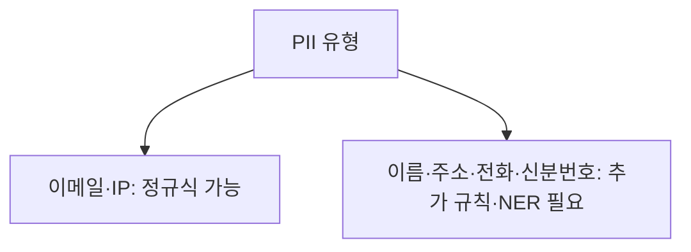

# 학습 데이터 속 개인정보

> 웹에서 모은 학습 데이터에는 이메일·IP·전화번호·이름·주민등록번호 같은 **개인 식별 정보(PII)**가 섞여 있고, 모델이 이를 외워 출력할 수 있다. 그래서 학습 전에 찾아서 가리거나(마스킹) 치환하는 단계를 둔다.

## 쉽게 말하면
수천 권의 책을 모아 학생에게 읽히기 전에, 연락처가 적힌 부분을 검은 펜으로 지운다. 그런데 펜이 "전화번호 모양"만 알아보면 이름이나 다른 형식의 번호는 그대로 남는다.

## 자세히
- 왜 문제인가: [학습 데이터 추출 공격](#training-data-extraction-attack)은 GPT-2에서 이름·전화번호·이메일 등 개인정보를 그대로 복원했고, 같은 논문은 데이터 정제가 "첫 방어선일 뿐 완전한 예방이 아니다"라고 쓴다.
- 도구 예: datatrove의 `PIIFormatter`(0.10.1 소스 확인). **이메일**과 **IP 주소**를 정규식으로 찾아 치환한다. 기본 치환은 이메일이 `email@example.com`·`firstname.lastname@example.org`를 번갈아 쓰고, IP는 미리 정한 목록의 값으로 바꾼다. IP는 기본으로 **공인(public) IP만** 치환한다(사설 IP는 개인정보가 아니므로 `only_remove_public_ips=True`).
- 직접 실행(한 문장에 여러 PII를 넣음): 
  - 입력: `연락: kim.minsu@corp.co.kr, 서버 8.8.8.8 와 192.168.0.1, 전화 010-1234-5678, 이름 김민수, 주민번호 900101-1234567, jane@example.com`
  - 출력: 이메일 2개 → `email@example.com`, `firstname.lastname@example.org`로 치환, 공인 IP 8.8.8.8 → 치환, 사설 IP 192.168.0.1은 그대로. **전화번호·이름·주민번호는 그대로 남았다.**
- 해석: 정규식 PII 도구는 형식이 뚜렷한 항목(이메일·IP)에는 쓸 만하지만 **이름·주소·전화번호·국가별 신분번호는 별도 규칙이나 개체명 인식(NER) 모델이 필요**하다. 한국어 환경이면 한국 전화·주민번호 패턴을 직접 추가해야 한다(제안).
- 실무 점검(제안): ① 치환 전후 표본을 사람이 확인 ② 남은 PII 유형별 재현율을 소규모 정답 세트로 측정 ③ 치환은 부분일 뿐이므로 민감 데이터는 처음부터 학습 데이터에서 제외 ④ 규제(개인정보 보호법 등)는 별도 검토([개인정보·저작권](#privacy-copyright)).

## 그림으로 보기

## 예시
- datatrove 파이프라인 끝에 `PIIFormatter()`를 넣어 이메일·공인 IP를 치환([FineWeb 예제](#datatrove-fineweb-example)의 마지막 단계).
- 교육: "지운 줄 알았는데 남아 있다"는 사례로 마스킹 검증의 필요성을 설명.

## 헷갈리는 것과 비교
| 개념 | 차이 |
|---|---|
| 마스킹/치환 | 가짜 값으로 바꿈 |
| 삭제 | 문서·문장을 통째로 제거 |
| [암기](#memorization-in-llms) | 남은 PII가 출력으로 새는 현상 |

## 더 읽을거리
- [huggingface/datatrove](https://github.com/huggingface/datatrove) — `PIIFormatter` 소스(설치해 실행, 읽음).
- [Extracting Training Data from Large Language Models (arXiv 2012.07805)](https://arxiv.org/abs/2012.07805) — 개인정보가 추출된 사례(PDF 본문 읽음).
