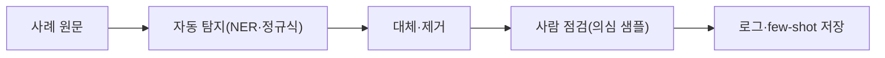
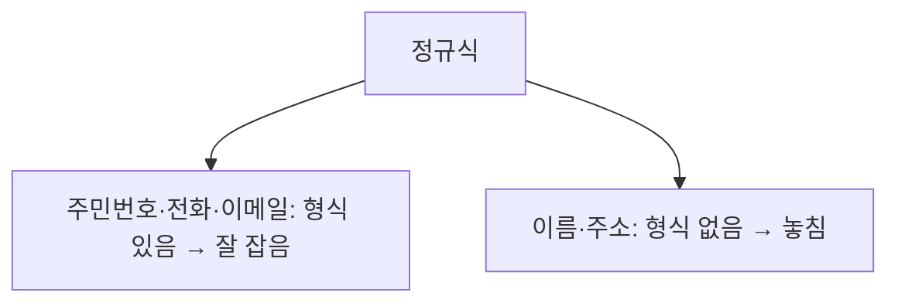

# 로그의 개인정보 마스킹

> 경계 사례 로그에는 고객 문의 같은 원문이 들어가므로 이름·전화번호·이메일·주민번호 같은 개인정보를 가리거나 대체한 뒤 저장·공유해야 한다. 자동 마스킹은 완벽하지 않으므로 사람 확인과 함께 쓴다.

## 쉽게 말하면
사례집에 실을 판례에서 당사자 이름과 주소를 지우고 "갑", "을"로 바꾸는 것과 같다. 사례의 내용은 남기고 사람이 누구인지는 알 수 없게 한다.

## 자세히
- **도구(Presidio 공식 사이트)**: Microsoft가 시작한 Presidio는 텍스트·이미지·정형 데이터에서 개인정보를 찾는 Analyzer와 찾은 항목을 여러 연산자로 비식별화하는 Anonymizer로 구성된다. 탐지는 개체명 인식(NER), 정규식, 규칙, 체크섬을 쓰고 여러 언어와 사용자 정의 인식기를 지원한다. 사이트는 "모든 민감 정보를 찾는다는 보장은 없다"고 명시하고 추가 안전장치를 권한다.
- **직접 실행한 정규식 마스킹(Python, 가상 문장)**: 원문 `문의: 홍길동(010-1234-5678) hong@example.com 주민번호 900101-1234567, 주문번호 A-1234 환불 부탁`에 주민번호·전화·이메일 정규식을 적용했더니 결과가 `문의: 홍길동([전화]) [이메일] 주민번호 [주민번호], 주문번호 A-1234 환불 부탁`이었다. 형식이 일정한 항목은 잘 가려졌지만 **이름(홍길동)은 그대로** 남았다. 정규식만으로는 이름·주소처럼 형식이 없는 정보를 못 잡는다는 것을 보여 준다.
- **마스킹 방식(해석)**: ① 제거 ② 유형 태그로 대체(`[전화]`)로 문맥은 유지 ③ 일관된 가명으로 대체(같은 사람이 같은 가명) ④ 일반화(나이 34 → 30대) ⑤ 접근 제한을 병행.
- **절차(해석)**: ① 저장 전 자동 마스킹 ② 의심 샘플(이름·주소가 남을 가능성)은 사람 점검 ③ 원문 보관소와 로그를 분리하고 권한을 제한 ④ 마스킹 전 원문은 로그에 저장하지 않음 ⑤ LLM 라벨러에 외부 API로 보낼 때도 마스킹 후 전송 ⑥ 마스킹된 사례로도 판정 기준이 전달되는지 확인(필요한 단서까지 지우지 않게). 국내외 법·사내 규정은 별도 확인이 필요하다(이 페이지는 법률 자문이 아니다).

## 그림으로 보기

## 예시
- 마스킹 결과의 `[전화]`, `[이메일]`은 남기고 이름은 별도 NER·사람 점검으로 `[이름]`으로 바꾼다.
- 교육 활용: 가상의 문의 문장에서 개인정보를 찾는 연습 후 자동 도구가 놓친 항목을 비교한다.

## 헷갈리는 것과 비교
| 개념 | 차이 |
| --- | --- |
| 마스킹 | 개인정보를 가리거나 대체 |
| 암호화 | 열쇠가 있으면 복원 가능 |
| [경계 사례 → few-shot 예시](#case-to-fewshot) | 마스킹이 필요한 활용처 |
| [라벨러 ID 가명 처리](#annotator-id-pseudonymization) | 라벨러 정보의 가명 처리 |

## 더 읽을거리
- [Presidio 공식 사이트](https://presidio.dataprivacystack.org/) — Analyzer·Anonymizer, 탐지 방법, 보장 없음 안내
