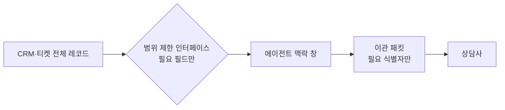
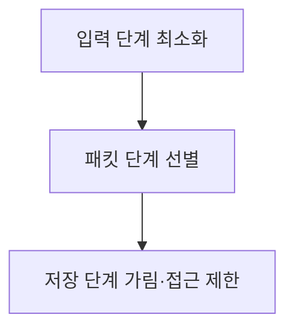

# 이관 시 개인정보 최소화

> 사람에게 넘기는 이관 패킷과 그 전 과정에서, 업무에 필요한 개인정보만 다루고 나머지는 걸러 내는 원칙. "출력에서 가린다"보다 "애초에 들이지 않는다"가 핵심이다.

## 쉽게 말하면
택배 기사에게 집 주소는 알려 주지만 통장 잔고는 알려 주지 않는다. 서류 전체를 복사해 주는 대신 이번 일에 필요한 칸만 잘라서 건넨다.

## 자세히
- **들어오는 지점에서 막기(Waxell 글)**: 도구가 돌려주는 모든 데이터는 맥락 창에 들어가는 순간 개인정보 처리다. 기업 API는 사람 화면용 전체 레코드를 주는 경우가 많아 에이전트가 쓰지도 않을 필드를 받는다. 작업별로 허용 필드만 반환하는 범위 제한 인터페이스를 정의하고, 판단을 요청마다 쓰지 말고 인터페이스에 한 번 둔다. 어떤 데이터가 언제 어느 도구 호출로 들어왔는지 세션 기록을 남긴다.
- **출력 가리기만으로는 부족**: 출력 단계의 마스킹은 사용자에게 보이는 것을 막을 뿐, 이미 처리된 데이터에 대한 최소화는 아니다. LLM으로 가리는 방식도 모델이 이미 전체 기록을 본 뒤라는 한계가 있다는 주장.
- **가리는 방식(Decagon 용어집)**: 마스킹([EMAIL]), 가명처리(일관된 비가역 토큰), 삭제, 암호화. 규칙 기반(카드번호 등)과 개체 인식(이름·주소)을 병행한다. 사전 가림은 엄격하지만 예약번호처럼 값이 필요한 업무에서 답 품질이 떨어질 수 있다. 너무 공격적이면 맥락이 깨져 요약·의도 파악이 나빠진다.
- **이관 패킷에 적용**: 상담사가 지금 해야 할 일에 필요한 식별자만 넣고 전체 전사나 프로필 덤프는 피한다. 전사·녹취 접근은 역할 기반으로 제한한다(벤더 가이드 제안).
- **법적 틀**: GDPR 5조 1항 (c)는 목적에 필요한 범위로 제한한다고 요구한다(검색 요약 기준, 직접 원문은 열지 않음). 역할과 계약 요건은 법무와 확인한다. 이 글은 법률 자문이 아니다.
- 이관 패킷에 특화된 최소화 설계는 자료가 부족했다. 위 적용은 일반 원칙을 옮긴 것이다.

## 그림으로 보기

## 예시
- 배송 문의 이관: 주문번호·배송 상태만 넘기고 주소 전체·결제수단은 제외.
- 교육 실습: 이관 패킷 샘플에서 "이번 처리에 꼭 필요한 필드"만 남기고 나머지를 지워 보게 한다.

## 헷갈리는 것과 비교
| 개념 | 차이 |
|---|---|
| 데이터 최소화 | 처리 자체를 필요한 만큼만 |
| PII 가림(redaction) | 이미 있는 값을 가리는 기술 |
| [이관 패킷 스키마](#handoff-schema) | 필드 계약, 최소화는 어떤 필드를 둘지의 기준 |
| [이관 컨텍스트 패킷](#handoff-context-packet) | 상위 노드 |

## 더 읽을거리
- [Waxell: AI agent context window와 GDPR 최소화](https://waxell.ai/blog/ai-agent-context-window-gdpr-data-minimization) — 도구 인터페이스 단에서 막기(개인 블로그)
- [Decagon: What is PII redaction](https://decagon.ai/glossary/what-is-pii-redaction) — 가림 방식과 시점(벤더)
