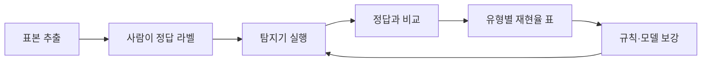
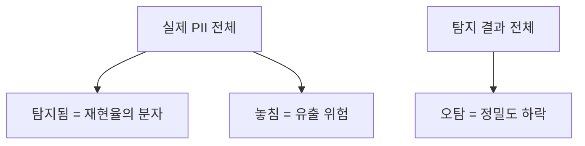

# PII 재현율 감사

> 마스킹·치환을 마친 데이터에서 **정답을 아는 소규모 표본**으로, 아직 남아 있는 개인정보(PII)가 유형별로 얼마나 되는지 재현율(recall)로 재는 점검이다.

## 쉽게 말하면
검은 펜으로 연락처를 지운 책 중 100쪽을 뽑아, 미리 "여기 연락처가 몇 개 있었다"고 적어 둔 답안지와 대조한다. 못 지운 게 10개면 재현율은 90%다. 전체를 다 읽지 않고도 펜이 얼마나 놓쳤는지 알 수 있다.

## 자세히
- **재현율** = 찾아낸 진짜 PII ÷ 실제 PII 전체. 놓친 PII가 곧 유출이므로 PII 감사는 정밀도보다 재현율이 중요하다([정규식 vs NER](#pii-regex-vs-ner)에서 본 것처럼 정규식은 이름·전화번호를 놓친다).
- **정밀도** = 찾았다고 한 것 중 진짜 비율. 낮으면 멀쩡한 텍스트까지 지워 데이터가 손상된다.
- 절차(제안): ① 표본 추출 → ② 사람이 PII 위치·유형을 라벨(정답 세트) → ③ 탐지기를 돌려 비교 → ④ 이메일·전화·이름·주소 등 **유형별** 재현율 표 → ⑤ 낮은 유형에 규칙·모델 보강 후 재측정.
- 도구 예: Microsoft `presidio-research`는 Presidio 전체·NER 모델·개별 인식기를 평가해 정밀도·재현율·F 점수와 오류 분석을 낸다. 템플릿("My name is {{name}}")에 가짜 개인정보를 채워 합성 문장을 만들고 IO/BIO/BILUO 태그로 변환하며, 같은 템플릿이 train/test에 겹치지 않게 나누는 노트북이 있다. README는 기본(vanilla) Presidio 결과가 썩 정확하지 않고 맞춤 설정으로 F 점수가 약 30% 오를 수 있다고 쓴다(README 기준, 2026-11 확인).
- 주의: 합성 데이터의 점수는 실제 웹 텍스트보다 낙관적일 수 있다(추정). 실제 표본 라벨을 섞는 것이 안전하다.
- 모델마다 라벨 체계가 달라 비교 전 개체 유형 매핑이 필요하다(README: 여러 모델 평가 시 "crucial").

## 그림으로 보기

## 예시
- 한국어 말뭉치 200문서를 라벨 → 이메일 98%, 전화 71%, 주민번호 40% → 전화·주민번호 정규식 추가 후 재측정.
- 교육: "지웠다"와 "지웠음을 측정했다"의 차이를 보여 주는 사례.

## 헷갈리는 것과 비교
| 개념 | 차이 |
|---|---|
| 재현율 감사 | 놓친 PII 비율 측정 |
| [학습 데이터 속 개인정보](#pii-in-training-data) | 문제 자체와 치환 방법 |
| 표본 육안 점검 | 정답 없이 눈으로 확인, 수치화 어려움 |

## 더 읽을거리
- [microsoft/presidio-research](https://github.com/microsoft/presidio-research) — PII 탐지 평가 프레임워크(README 읽음).
