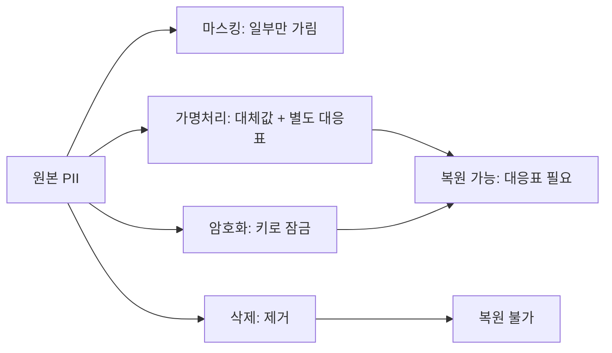
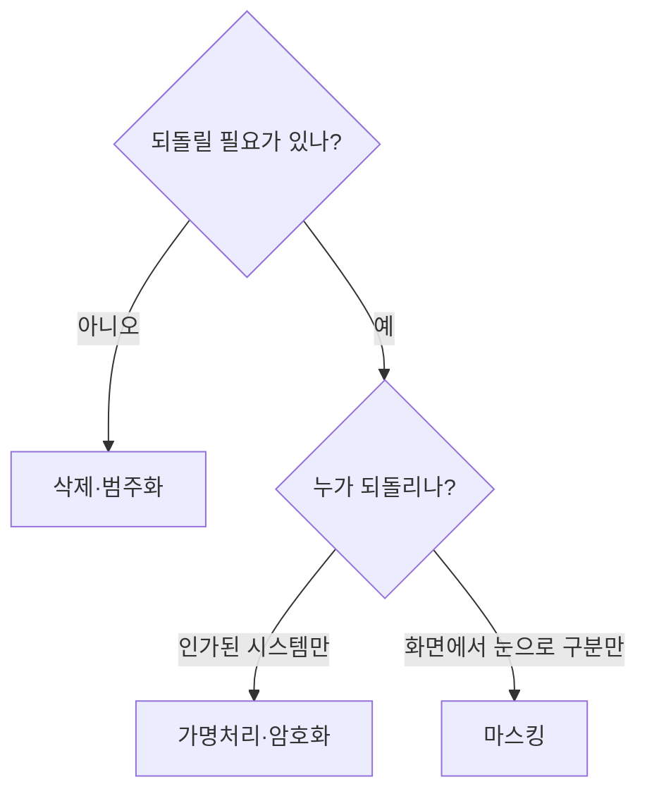

# PII 가림 방식

> 개인을 알아볼 수 있는 정보(PII)를 AI나 다음 담당자에게 넘기기 전에 가리는 방법들이다. 마스킹·가명처리·삭제·암호화(그리고 익명화)는 "되돌릴 수 있는가"와 "쓸모가 남는가"가 서로 다르다.

## 쉽게 말하면
택배 송장에서 이름 가운데 글자를 가리면(마스킹) 대충 누구 건지는 알지만 전체 이름은 모른다. 이름을 "고객 A"로 바꾸고 대응표를 금고에 두면(가명처리) 필요할 때만 원래대로 돌릴 수 있다. 칸을 지우면(삭제) 돌릴 수 없다.

## 자세히
기법 분류는 폐지된 2016년 「개인정보 비식별 조치 가이드라인」 용어 정리를 따랐다(itwiki 정리 기준). 현재는 가명처리 중심이며 개인정보보호위원회 「가명정보 처리 가이드라인」(2024년 2월 개정으로 이미지·음성·영상 반영, 검색 결과 요약 기준 — 원문 확인 필요)을 따른다.
- **가명처리**: 하위 기법으로 휴리스틱 가명화(규칙으로 대체값 부여), 암호화.
- **암호화**: 키가 있으면 복호화된다. 일방향(해시)은 이론상 복호화가 불가능하다. 다만 값 범위가 좁으면(전화번호 등) 대입 공격이 가능하므로 솔트 등이 필요하다(일반적 지적).
- **마스킹**: 일부를 `*`·대체값으로 바꾼다. 임의 잡음 추가, 공백·대체 등.
- **삭제**: 식별자 삭제, 부분 삭제, 레코드 삭제. 돌릴 수 없다.
- **총계처리·범주화**: 합계·평균, 나이를 "30대"로 묶기 등 — 개인 단위 정보를 흐린다.
- 원칙(2016 가이드라인): 식별자는 원칙적으로 삭제하고, 목적상 필요한 것만 조치 후 활용하며, 기법은 단독·복합으로 쓴다.
- 가명정보는 추가 정보와 결합하면 식별 가능하므로 여전히 개인정보로 취급된다(법적 구분은 법령 원문 확인).

## 그림으로 보기

## 예시
- 상담 이관 요약에서 `홍길동 010-1234-5678` → `고객_A / 010-****-****`: 상담원이 본인 확인은 못 하지만 대화는 이어진다.
- LLM에 보낼 프롬프트: 주민번호는 삭제, 이름은 가명(`고객_A`), 응답 후 대응표로 복원.

## 헷갈리는 것과 비교
| 개념 | 차이 |
|---|---|
| 마스킹 | 보이는 부분만 가림. 원본은 보통 따로 남아 있음 |
| 가명처리 | 대체값 + 대응표 분리 보관, 여전히 개인정보 |
| 삭제 | 영구 제거, 쓸모도 같이 사라짐 |
| 암호화 | 키 관리가 핵심, 가명처리의 한 방식으로 분류 |
| [이관 시 개인정보 최소화](#pii-minimization-handoff) | 이 방식들을 언제 쓸지의 원칙 |

## 더 읽을거리
- [IT위키: 개인정보 비식별 기법](https://itwiki.kr/w/개인정보 비식별 기법) — 기법별 하위 분류 목록(정의는 없음, 가이드라인 폐지 언급).
- [보안뉴스: 비식별 조치 및 결합지원 서비스](https://m.boannews.com/html/detail.html?idx=51840) — 비식별 조치 맥락 설명(검색 결과 기준, 본문 미열람).
