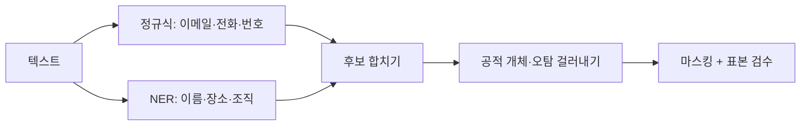
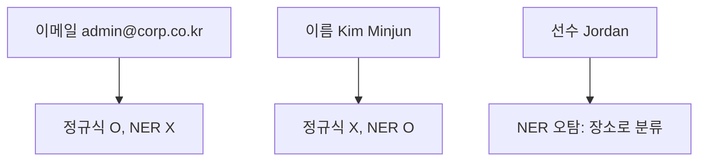

# 정규식 vs NER

> 개인정보 탐지는 **형식이 정해진 정보(이메일·전화번호)는 정규식**이, **이름·장소처럼 형식이 없는 정보는 NER(개체명 인식) 모델**이 잘 찾는다. 서로 놓치는 것이 달라 보통 함께 쓴다.

## 쉽게 말하면
이메일 주소는 "@"와 점이라는 틀이 있어 도장(정규식)으로 찍어 찾을 수 있다. 사람 이름은 틀이 없어서 문맥을 읽는 독자(NER 모델)가 "이 단어는 사람 같다"고 판단해야 한다. 도장은 빠르고 정확하지만 틀이 없는 것은 못 찾고, 독자는 넓게 찾지만 가끔 틀린다.

## 자세히
- **NER 모델 설명**(Hugging Face `dslim/bert-base-NER` 모델 카드 확인): bert-base-cased를 영어 CoNLL-2003(로이터 뉴스 기반)으로 미세조정한 모델로 개체 유형은 PER(사람)·ORG(조직)·LOC(장소)·MISC(기타). 카드는 뉴스·특정 시기 데이터로 학습돼 다른 분야에는 잘 일반화되지 않을 수 있고, 하위 토큰을 개체로 표시하는 경우가 있어 후처리가 필요하다고 한계를 적는다.
- **직접 실행**(위 모델 + 이메일·전화 정규식, 문장 5개):

| 문장(요약) | 정규식 결과 | NER 결과 |
|---|---|---|
| Sarah Connor, 이메일, 미국 전화 | 이메일, 전화 둘 다 | PER "Sarah Connor" |
| Kim Minjun, 주소, 런던, 영국 전화 | 전화 | PER "Kim Minjun", LOC "Baker Street", "London" |
| CFO Tim Cook, Apple, Cupertino | 없음 | PER, ORG, LOC 모두 |
| Bank of England, admin@corp.co.kr | 이메일 | ORG "Bank of England" |
| Jordan(선수)과 Jordan River | 없음 | LOC "Jordan", LOC "Jordan River" |

- 해석: ① **정규식은 형식 정보(이메일·전화)를 정확히** 찾았고 이름·주소는 못 찾았다. ② **NER은 이름·장소를 찾았지만 이메일·전화는 놓쳤다**(이 문장들에서). ③ NER은 **오탐**도 있다: 선수 "Jordan"을 장소(LOC)로 태깅했다(마지막 문장). ④ "Tim Cook", "Apple", "Bank of England"는 공적 인물·기업이라 **개인정보가 아닐 수 있는데도** 개체로 잡히므로, 탐지 뒤 "이것이 정말 보호 대상 개인정보인가"를 가리는 규칙이 필요하다. 5문장의 작은 예시이며 정확도 통계는 아니다.
- **조합 구조(제안)**: ① 정규식으로 형식 정보 제거 ② NER로 이름·주소 후보 ③ 후보를 맥락·사전으로 필터(공적 개체 제외) ④ 표본 점검으로 오탐·미탐 비율 측정([PII 오탐·미탐 점검](#pii-false-positive-audit)). 한국어는 영어 CoNLL 모델을 그대로 쓸 수 없고 한국어 NER 모델이 필요하다(한국어 모델은 이번에 시험하지 않았다).

## 그림으로 보기

## 예시
- 고객 상담 로그 정제: 정규식으로 전화·이메일·카드번호, NER로 이름·주소를 마스킹하고 상위 오탐 유형을 점검.
- 교육: 위 5문장을 직접 돌려 정규식과 NER이 서로 놓치는 칸을 표에 채우는 실습.

## 헷갈리는 것과 비교
| 개념 | 차이 |
|---|---|
| 정규식 | 형식 기반, 빠르고 설명 가능, 형식 없는 정보 못 찾음 |
| NER 모델 | 문맥 기반, 이름·장소 탐지, 오탐·도메인 의존 |
| [PIIFormatter](#pii-formatter) | 이메일·공인 IP만 정규식으로 치환 |
| [한국형 정규식](#korean-pii-regex) | 주민번호·전화 규칙 추가 |

## 더 읽을거리
- [dslim/bert-base-NER 모델 카드](https://huggingface.co/dslim/bert-base-NER) — 학습 데이터, 개체 유형, 한계(열어 확인).
- [datatrove pii.py 소스](https://github.com/huggingface/datatrove/blob/main/src/datatrove/pipeline/formatters/pii.py) — 이메일·IP 정규식(열어 확인).
