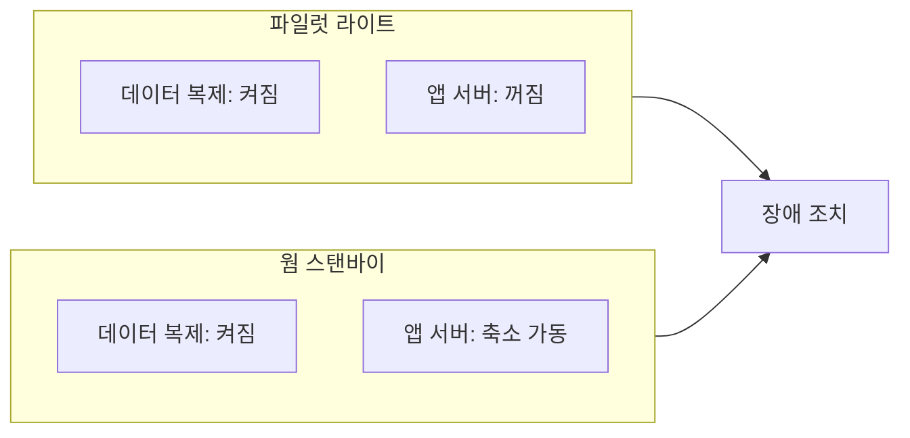
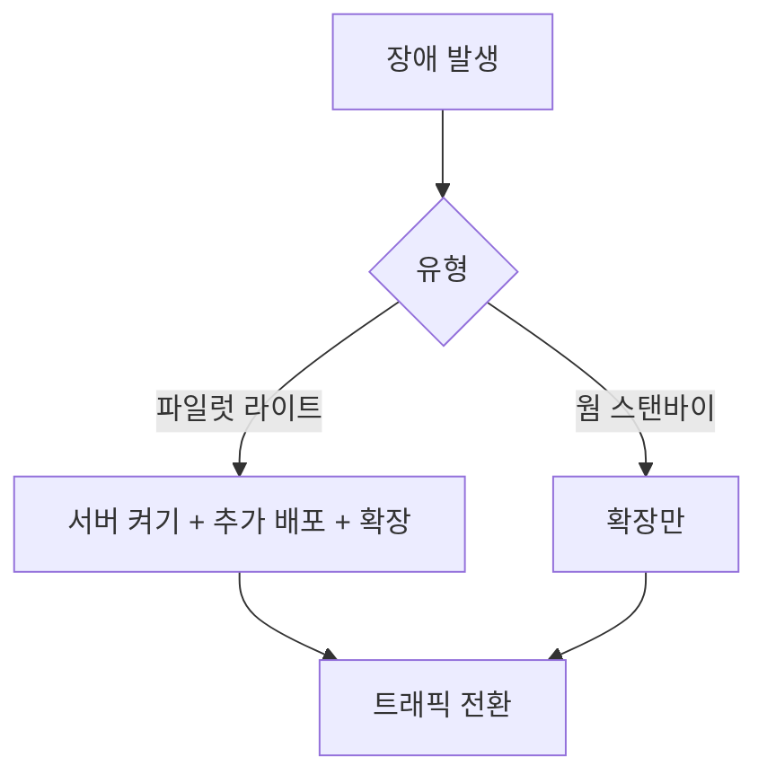

# 파일럿 라이트 vs 웜 스탠바이

> 재해 복구(DR)에서 **꺼 둔 최소 사본(파일럿 라이트)** 과 **축소해서 켜 둔 완전한 사본(웜 스탠바이)** 의 차이다. 핵심 구분은 "추가 조치 없이 트래픽을 받을 수 있는가"이다.

## 쉽게 말하면
가스레인지의 불씨(파일럿 라이트)는 작게 계속 타고 있지만 요리하려면 불을 키워야 한다. 웜 스탠바이는 약불로 이미 끓고 있는 냄비라서 불만 세게 하면 바로 먹을 수 있다. 더 빨리 쓸 수 있는 대신 평소 비용이 더 든다.

## 자세히
(AWS 재해 복구 백서의 해당 절을 직접 읽었다. AWS 용어이지만 개념은 다른 클라우드에도 통한다.)
- **파일럿 라이트**: 데이터를 다른 리전으로 복제하고 핵심 인프라 사본을 마련한다. 데이터베이스·객체 저장소 같은 **복제·백업 자원은 항상 켜 두고**, 애플리케이션 서버는 코드·설정만 로드한 채 **꺼 둔다**. 장애 때 켜고 확장한다. 평소 비용이 최소이고, 모든 리전에 인프라·코드 변경을 동시에 배포하도록 배포 방식을 바꿔야 한다(IaC 권장). 서버 자원은 "배포하지 않고 켜는 설정만 만들어 두는" 방식이 모범이라고 한다.
- **웜 스탠바이**: 운영 환경의 **축소된 완전 기능 사본**이 다른 리전에서 항상 켜져 있다. 파일럿 라이트를 확장한 개념으로 복구 시간이 더 짧고, 지속적인 테스트가 쉽다.
- **백서의 구분 문장**: 파일럿 라이트는 추가 조치 없이는 요청을 처리할 수 없고, 웜 스탠바이는 (줄어든 용량으로) **즉시 트래픽을 처리**한다. 전자는 서버를 켜고 비핵심 인프라를 더 배포하고 확장해야 하며, 후자는 확장만 하면 된다. RTO·RPO 요구로 고른다.
- **Auto Scaling 의존**: 확장은 control plane 작업이라 의존하면 복구의 회복력이 낮아진다. 복구 리전이 전체 부하를 감당하도록 미리 용량을 두는 정적 안정 구성이 **핫 스탠바이**다. 일부 구현은 초기 트래픽만큼 배포해 RTO를 줄이고 이후 Auto Scaling으로 늘린다. DR 리전의 서비스 할당량도 미리 올려 둬야 한다.
- **장애 조치 주의**: 자동 장애 조치는 오경보 시 손실이 생기므로 조심하고, 수동 개시라도 단계는 자동화해 "버튼 한 번"처럼 만든다고 한다.
- **다른 전략**: 백업·복원(가장 저렴, 가장 느림), 멀티 사이트 액티브/액티브(가장 복잡·비쌈, 복구 시간 거의 0).
- 이 문서는 AWS 가이드라인이며 RTO·RPO 수치 범위는 읽은 페이지에 없어 적지 않는다.

## 그림으로 보기

## 예시
- RAG 서비스: 벡터 DB 복제본은 항상 켜 두고(파일럿 라이트) 검색 API 서버는 꺼 둠. 더 짧은 복구가 필요하면 API 서버를 소규모로 켜 두는 웜 스탠바이로 올림.
- 교육 소재: 비상용 발전기와 상시 가동 보조 발전기의 차이로 설명.

## 헷갈리는 것과 비교
| 개념 | 파일럿 라이트 | 웜 스탠바이 |
|---|---|---|
| 앱 서버 | 꺼짐 | 축소 가동 |
| 바로 트래픽 처리 | 불가 | 가능(저용량) |
| 평소 비용 | 낮음 | 더 높음 |
| 복구 시간 | 상대적으로 김 | 상대적으로 짧음 |
| [백업 복원 테스트](#backup-restore-testing) | 두 방식 모두에서 필요한 검증 | |

## 더 읽을거리
- [Disaster recovery options in the cloud (AWS 백서)](https://docs.aws.amazon.com/whitepapers/latest/disaster-recovery-workloads-on-aws/disaster-recovery-options-in-the-cloud.html) — 네 가지 DR 전략과 구분 설명(직접 읽음).
