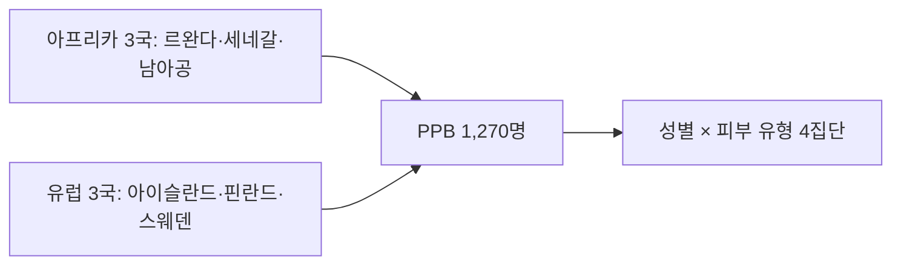
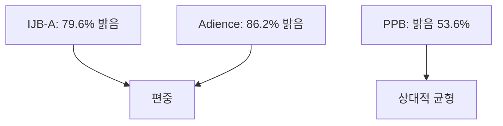

# Pilot Parliaments Benchmark

> Gender Shades가 만든 얼굴 데이터셋(PPB)이다. 아프리카 3개국과 유럽 3개국 국회의원 1,270명으로 성별과 피부색 분포를 더 균형 있게 맞췄다.

## 쉽게 말하면
기존 시험지가 밝은 피부 남성 위주여서 약점이 안 보였다. 그래서 다양한 얼굴을 고르게 넣은 새 시험지를 만들었다.

## 자세히
(Gender Shades 논문 PDF를 하위 에이전트가 읽은 노트 기준.)
- **구성**: 총 **1,270명**, 르완다(75)·세네갈(149)·남아공(437)·아이슬란드(63)·핀란드(197)·스웨덴(349). 2017년 공개. 어두운 피부 589명(46.4%), 밝은 피부 681명(53.6%).
- **집단 비율**: 어두운 여성 21.3%, 어두운 남성 25.0%, 밝은 여성 23.3%, 밝은 남성 30.3%.
- **선정 이유**: 국회의원 사진은 공개되고 직업적 이미지라 비교적 통제됨. 국가는 국제의회연맹(IPU)의 성별 균형 순위로 선택.
- **비교 대상**: 기존 벤치마크 IJB-A는 79.6%, Adience는 86.2%가 밝은 피부로 편중.
- **라벨**: 피부 유형은 사진 기준 라벨이라 오차가 있어 Fitzpatrick I–III(밝음)/IV–VI(어두움)로 묶었고, 최종 라벨은 전문 피부과 의사가 부여([Fitzpatrick](#fitzpatrick-skin-type)).
- 한계(제안): 정치인 사진은 일반 촬영 환경과 다르며 이진 성별 라벨만 사용한다.
- 참고: Gender Shades 그림 3 캡션이 본문과 일부 어긋난다고 에이전트가 표시했다.

## 그림으로 보기

## 예시
- 자사 얼굴 인식 모델을 PPB 형식으로 집단별 평가(라이선스·동의 확인 필요).
- 교육 활용: "평가 데이터를 누가 만들었느냐"가 결과를 바꾸는 사례.

## 헷갈리는 것과 비교
| 개념 | 차이 |
|---|---|
| PPB | 성별·피부색 균형 평가용 벤치마크 |
| 학습 데이터셋 | 모델을 학습시키는 데이터 |
| [교차 평가](#intersectional-evaluation) | PPB로 수행한 평가 방법 |

## 더 읽을거리
- [Gender Shades (PMLR 81)](http://proceedings.mlr.press/v81/buolamwini18a/buolamwini18a.pdf) — PPB 구성.
