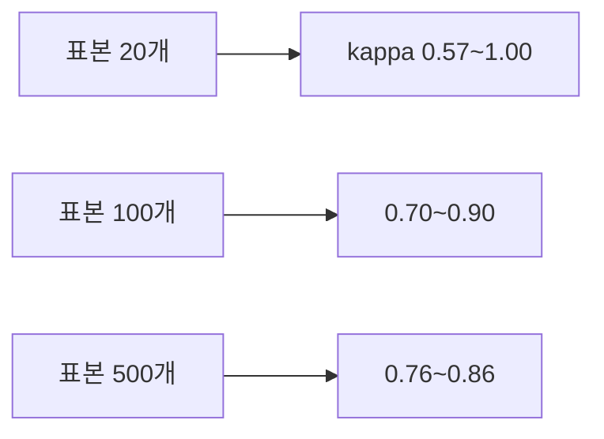
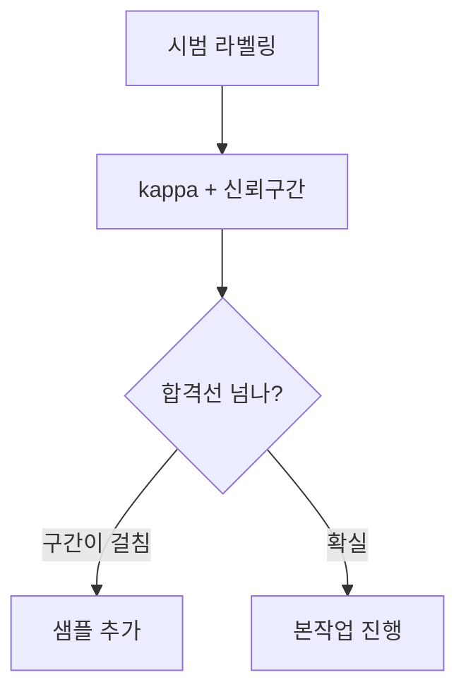

# kappa용 시범 크기

> kappa는 표본이 작을수록 값이 크게 흔들린다. 라벨링 본작업 전에 하는 시범(파일럿)에서 몇 개를 서로 라벨링해 보면 일치도를 믿을 수 있는지가 표본 수에 달려 있다.

## 쉽게 말하면
동전을 5번만 던져 앞면이 4번 나왔다고 "앞면이 80%"라고 결론내면 안 된다. 20개 샘플로 잰 kappa도 마찬가지로 운이 크게 작용한다.

## 자세히
- **직접 시뮬레이션(참 일치 조건: 평가자 2명이 각각 95% 정확도, 클래스 50:50 균형, 각 크기마다 2,000번 반복해 kappa 분포를 관찰)**:

| 시범 샘플 수 | kappa 평균 | 하위 5% | 상위 5% |
| --- | --- | --- | --- |
| 20 | 0.80 | 0.57 | 1.00 |
| 50 | 0.81 | 0.67 | 0.92 |
| 100 | 0.81 | 0.70 | 0.90 |
| 500 | 0.81 | 0.76 | 0.86 |

  참 kappa는 약 0.81인데, 20개로 재면 0.57~1.00 사이로 흔들려 "합격선 0.60"을 넘었는지 판단하기 어렵다. 100개면 0.70~0.90, 500개면 0.76~0.86이다. (한쪽 클래스만 나온 표본은 kappa가 정의되지 않아 제외했다. 가정은 위 조건이며 평가자 독립 등은 단순화된 것이다.)
- **해석**: 시범 크기는 합격선과 구간 폭을 비교해 정한다. 합격선 근처의 값이면 더 많이 재야 하고, 값이 합격선보다 확실히 위·아래면 적어도 된다. [kappa 해석표](#kappa-interpretation-scales)로 합격선을 정한 뒤 크기를 고른다.
- **보고 방법(해석)**: kappa 값만 쓰지 말고 표본 수와 신뢰구간(부트스트랩 등)을 같이 쓴다. 클래스가 쏠리면 소수 클래스 샘플 수를 따로 확보한다([kappa와 클래스 불균형](#kappa-class-imbalance)).

## 그림으로 보기

## 예시
- 합격선 0.60인데 시범 50개에서 kappa 0.68이 나오면, 하위 5%가 0.67 수준이므로 대체로 통과지만 100개로 확인하면 더 안전하다(위 시뮬레이션 기준).
- 교육 활용: 학습자가 20개와 100개로 각각 kappa를 구해 값이 달라지는 것을 체험한다.

## 헷갈리는 것과 비교
| 개념 | 차이 |
| --- | --- |
| 시범 크기 | 일치도 추정의 불확실성 |
| 본작업 크기 | 학습 데이터 양 |
| [kappa 해석표 비교](#kappa-interpretation-scales) | 합격선 정하기 |
| [kappa와 클래스 불균형](#kappa-class-imbalance) | 분포가 값에 미치는 영향 |

## 더 읽을거리
- [Interrater reliability: the kappa statistic (McHugh, 2012)](https://pmc.ncbi.nlm.nih.gov/articles/PMC3900052/) — kappa 해석과 한계
- [scikit-learn cohen_kappa_score](https://scikit-learn.org/stable/modules/generated/sklearn.metrics.cohen_kappa_score.html) — 계산 함수
