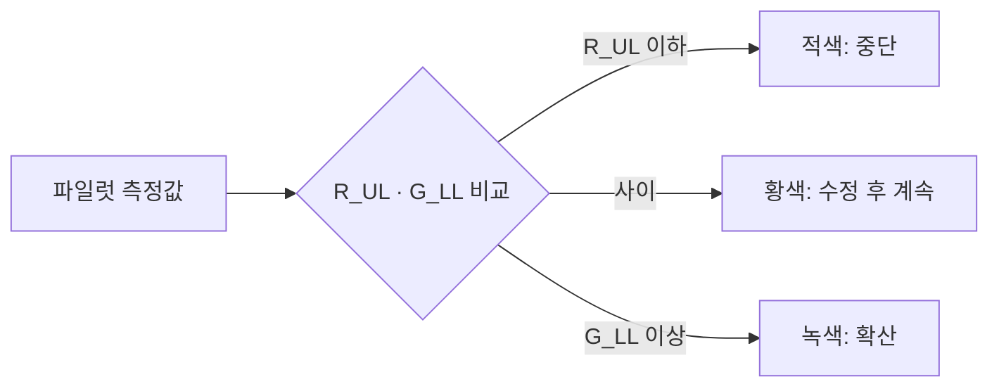
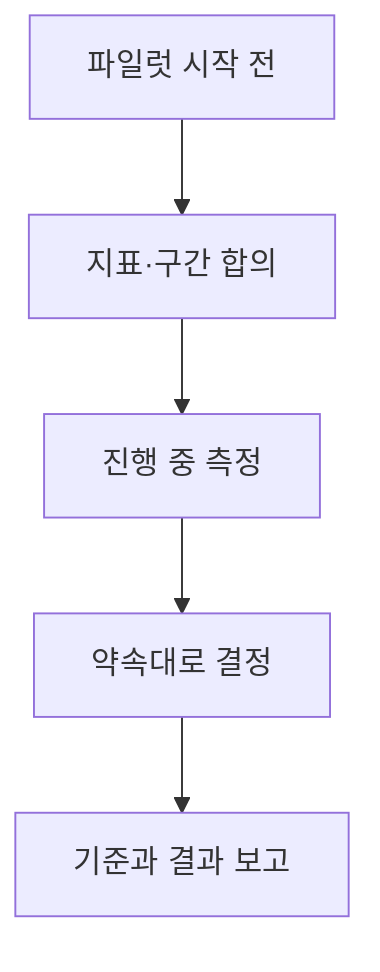

# 파일럿 중단 규칙

> 파일럿 중단 규칙은 시작하기 전에 "어떤 지표가 어느 선 아래면 멈추고, 어느 선 위면 확산하고, 그 사이면 고쳐서 계속한다"를 숫자로 합의해 두는 약속이다. 임상시험 분야의 진행 기준(progression criteria)과 신호등(적·황·녹) 방식이 대표적이다.

## 쉽게 말하면
등산 출발 전에 "정오까지 1,000m 지점에 못 오면 하산, 3시까지 정상 직전이면 계속, 그보다 빠르면 정상 도전"이라고 정해 두는 것과 같다. 중간에 힘들 때 기분이 아니라 약속으로 결정한다.

## 자세히
- **임상시험의 사례(Avery 등, BMJ Open 2017, 열람)**: 내부 파일럿이 있는 무작위 임상시험이 본 시험으로 넘어갈지(정지·수정·진행) 정하는 사전 합의 목표가 진행 기준이다. 논문은 문헌 309편을 검토해 내부 파일럿이 있는 임상시험 11건을 찾았고, 기준은 모집, 프로토콜 준수, 결과 자료의 세 가지에 모였으며 기준을 어떻게 세우고 적용했는지 보고가 부실했다고 한다. 예: COMMANDO 시험은 기준을 모두 못 채워 중단, Sheffield "Booster"는 추적 목표 75%를 못 채웠지만 수정해 계속하다 조기 종결.
- **신호등 방식**: 단순 진행/중단 대신 녹(계속)·황(수정)·적(중지)으로 나눈다. 황색은 고칠 수 있는 문제를 위한 구간이다. 모집 목표는 센터·월당 비율로 쓰고, 부족하면 선별 기록으로 원인을 나눠 본다. 기준은 후원자와 합의하고 보고서에 기준과 결과를 함께 적는다.
- **통계적 틀(Lewis 등, Pilot and Feasibility Studies 2021, 열람)**: 진행 기준을 단측 가설 검정으로 본다. 귀무가설은 참값이 적색 상한(R_UL) 이하, 대립가설은 참값이 녹색 하한(G_LL)이다. 기본 α = 0.05, β = 0.05~0.2. 추정값이 R_UL 이하이고 비유의면 적색, 그 사이면 황색, G_LL 이상이고 유의하면 녹색이다. 예: 치료 충실도 R_UL 50%, G_LL 75%, 검정력 90%이면 중재군 34명이 필요하고 구간은 0~17 적색, 18~25 황색, 26~34 녹색이다. 지표가 여러 개면 각각 평가해 가장 나쁜 지표가 전체 신호를 정하며, 지표가 늘수록 모두 맞을 집합 검정력은 떨어진다(90% 세 개 약 73%, 80% 다섯 개 약 33%. 계산으로 확인).
- **오류의 의미(같은 논문)**: G_LL이 참일 때 적색·큰 수정이 나올 확률이 β(잘못 멈춤), R_UL이 참일 때 황색 일부·녹색이 나올 확률이 α(잘못 진행)이다. 임상시험의 과정 지표(모집·충실도·유지율)에 쓰는 방법이고 효능 판정이 아니다.
- **AI 파일럿에 옮기기(해석, 출처 없음)**: 지표는 활성 사용률, 건당 수정 시간, 오류율, 사용자 만족 등으로 잡는다. 임상시험이 쓰는 방법을 비즈니스 파일럿에 그대로 적용한 연구는 이번 조사에서 확인하지 못했다. 한 번의 나쁜 주가 아니라 연속 N주 같은 조건을 두면 우연한 출렁임에 덜 흔들린다([손익분기점](#breakeven-point), [NPSV](#npsv) 같은 계산에서 스위칭 값을 기준으로 삼을 수 있다).

## 그림으로 보기

## 예시
- AI 문서 요약 파일럿: 활성 사용률 적색 50% 이하·녹색 75% 이상, 건당 수정 시간 적색 10분 초과·녹색 5분 이하로 합의하고(가상 값), 4주 뒤 지표별로 신호를 매겨 가장 나쁜 신호로 결정한다.
- 교육 활용: 파일럿 계획서에 "중단 조건"란을 넣어 숫자로 채우는 연습.

## 헷갈리는 것과 비교
| 개념 | 차이 |
| --- | --- |
| [중단 기준 정하기](#stop-criteria) | 상위 주제. 파일럿 중단 규칙은 그 운영 약속 |
| 신호등 방식 | 적·황·녹 세 구간. 단순 진행/중단보다 황색 구간 존재 |
| 효능 가설 검정 | 효과가 있는지 판정. 진행 기준은 시행 가능성 판단 |
| [손익분기점](#breakeven-point) | 경제적 임계값. 중단선의 후보 |

## 더 읽을거리
- [Avery 등: Informing efficient randomised controlled trials (BMJ Open 2017)](https://pmc.ncbi.nlm.nih.gov/articles/PMC5318608) — 진행 기준의 어려움과 신호등 권고
- [Lewis 등: Determining sample size for progression criteria for pragmatic pilot RCTs (2021)](https://pmc.ncbi.nlm.nih.gov/articles/PMC7856754) — 가설 검정 방식과 표본 크기
