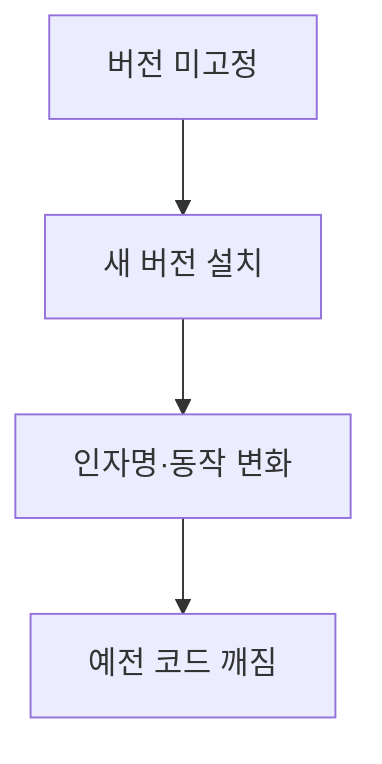

# 의존성 버전 고정

> `requirements.txt`에 패키지 버전을 `==`로 적어 **같은 환경을 언제든 다시 만들 수 있게** 하는 관행이다. 라이브러리가 업데이트되어 인자명이 바뀌거나 동작이 달라져도 내 코드가 깨지지 않는다.

## 쉽게 말하면
요리 레시피에 "버터 적당량" 대신 "무염 버터 20g, 브랜드 A"라고 적는 것과 같다. 몇 달 뒤 누가 만들어도 같은 맛이 난다.

## 자세히
- pip 공식 문서(Repeatable Installs)는 반복 가능한 설치의 세 단계를 든다: ① 버전 고정(`SomePackage == 1.2.3`) — "새 버전의 버그·비호환"으로부터 보호. `pip freeze`로 간접 의존성까지 고정한 파일을 만들 수 있고 `--no-deps`로 목록 밖 설치를 막는다 ② 해시 검사(`--hash=sha256:…`) — 인덱스 침해나 같은 버전의 파일 변조를 막는다 ③ 휠 묶음(wheelhouse, `pip wheel -r requirements.txt --wheel-dir=…`) — 인터넷 없이 설치. 컴파일 패키지는 OS·아키텍처 종속이다.
- 직접 확인(이 실행 환경 `pip freeze`): `albumentations==2.0.8`, `albucore==0.0.24`, `numpy==2.5.3`, `opencv-python-headless==5.1.0.95`, `pydantic==2.13.5`. 직접 설치한 albumentations 하나가 간접 의존성(albucore, opencv, pydantic 등)을 줄줄이 끌고 온다 — 이 전체를 적어야 환경이 재현된다.
- 버전 드리프트 연결: 같은 Albumentations라도 2.0.8은 `BboxParams(format=…)`, 더 새 문서는 `coord_format`을 쓴다([사용 중단 경고 읽기](#deprecation-notices)). 버전을 적어 두지 않으면 몇 달 뒤 같은 노트북이 다르게 동작할 수 있다.
- 실무(제안): 앱·실험은 정확히 고정(`==`), 라이브러리는 호환 범위(`>=2.0,<3`). 고정 파일은 날짜와 함께 커밋하고 주기적으로(예: 월 1회) 올려 테스트한다. 고정만 하고 방치하면 보안 패치를 놓치므로 업데이트 점검도 같이 한다.
- 한계: `pip freeze`는 설치된 모든 것을 적어 개발 도구까지 섞이기 쉽다. 직접 의존성 목록(`requirements.in`)과 고정본을 분리하는 도구(pip-tools 등)를 쓰는 방법이 있다(pip 문서가 언급).

## 그림으로 보기



## 예시
```
albumentations==2.0.8
albucore==0.0.24
opencv-python-headless==5.1.0.95
```
- 교육: 실습 노트북 첫 셀에 `pip install -r requirements.txt`를 두어 수강생 환경을 맞추는 방법.

## 헷갈리는 것과 비교
| 개념 | 차이 |
|---|---|
| `==` 고정 | 정확히 그 버전만 |
| `>=` 범위 | 새 버전 허용, 변동 위험 |
| 해시 검사 | 같은 버전이라도 파일 변조 방지 |
| 가상환경 | 프로젝트별 격리(고정과 함께 사용) |

## 더 읽을거리
- [pip: Repeatable Installs](https://pip.pypa.io/en/stable/topics/repeatable-installs/) — 고정·해시·휠 묶음(읽음).
