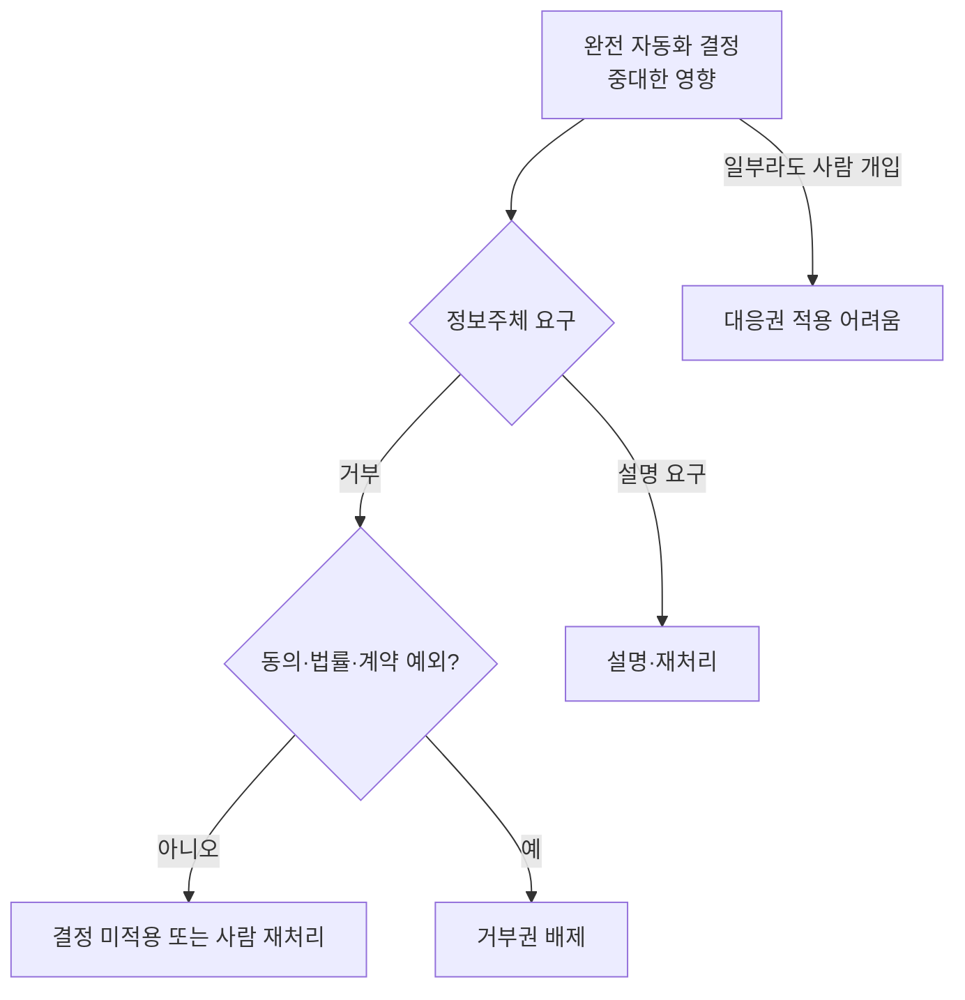

# 개인정보 보호법 자동화 결정 대응권

> 개정 개인정보 보호법 제37조의2가 정보주체에게 "완전히 자동화된 결정"에 대해 주는 권리: 중대한 영향을 미치는 자동화 결정의 거부, 설명 요구, 사람 개입 재처리 요구. 한국은 자동화 결정을 금지하지 않고 권리를 부여하는 방식이다. (법률 자문 아님)

## 쉽게 말하면
AI가 혼자 내린 결정이 내 삶에 크게 영향을 준다면 "그 결정 적용하지 마세요", "왜 그렇게 나왔죠?", "사람이 다시 봐 주세요"라고 말할 수 있다.

## 자세히
출처: 법률신문 해설 기사와 보안뉴스 기사 검색 요약(조문 본문은 확인하지 못함). 시행령(44조의2~44조의3)에 관한 서술은 검색 요약 기준이다.
- **권리**: 거부권, 설명요구권, 인적 개입을 통한 재처리 요구권. 완전히 자동화된 결정에만 적용되므로 일부라도 사람이 개입하면 거부권 주장이 어렵다.
- **거부권 예외**: 정보주체가 동의한 경우, 법률에 규정이 있는 경우, 계약 체결·이행에 필요한 경우.
- **처리자 의무(해설 요약)**: 자동화 결정 사실·목적·주요 개인정보 유형·처리 절차·권리 행사 방법을 공개. 정보주체가 거부하거나 설명을 요구하면 정당한 사유가 없는 한 그 결정을 적용하지 않거나 인적 개입 재처리·설명 등 필요한 조치를 한다. 설명 요구 없이도 추가 의견 제출과 검토 요구 가능(검색 요약).
- **불명확한 점**: 기사는 "중대한 영향"의 구체 범위가 시행령안에서 아직 정리되지 않았고 개인정보보호위원회 안내서를 기다려야 한다고 했다(기사 시점 기준; 현재는 확인 필요).
- **EU 비교**: GDPR 22조는 원칙적으로 자동화 결정 자체를 금지하는 형태인 반면 한국은 권리 부여 방식이라는 해설.
- **특별법**: 신용 평가는 [신용정보법 36조의2](#credit-info-act-36-2)가 특별 규정.

## 그림으로 보기

## 예시
- AI 채용 서류 심사에서 사람 검토 없이 탈락 → 지원자가 설명 요구와 사람 재검토를 요청. 반대로 담당자가 최종 검토 서명을 한다면 "완전 자동화"가 아닐 수 있어 적용이 쟁점.

## 헷갈리는 것과 비교
| 개념 | 차이 |
|---|---|
| PIPA 37조의2 | 일반법의 자동화 결정 대응권 |
| [신용정보법 36조의2](#credit-info-act-36-2) | 금융 신용평가 특별 규정 |
| GDPR 22조 | 원칙적 금지 방식 |

## 더 읽을거리
- [법률신문 해설 기사](https://www.lawtimes.co.kr/news/articleView.html?idxno=194236) — 개정 법의 권리 구조(기사 내용 확인)
- [보안뉴스: Q&A 개인정보 보호법 시행령 개정안](http://www.boannews.com/news/articleView.html?idxno=127833) — 시행령 해설(검색 요약만, 본문은 열지 못함)
