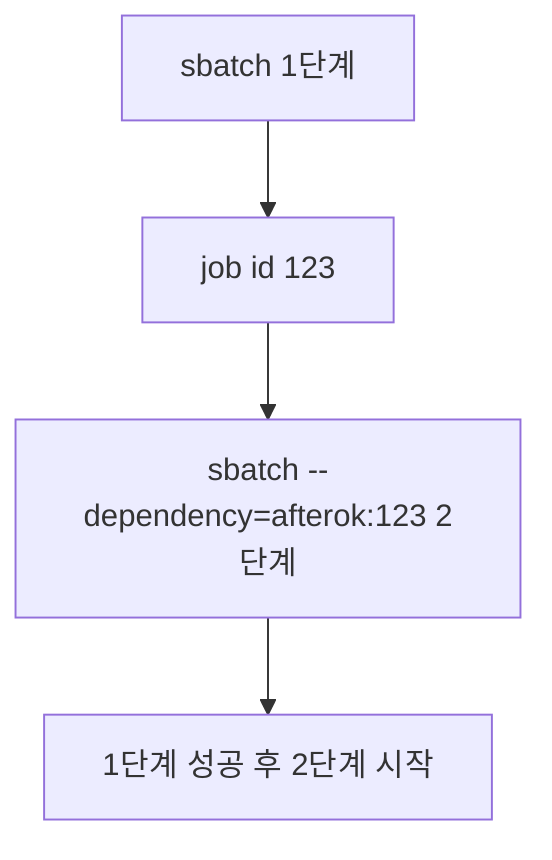

# 실행기 의존 관계

> datatrove의 `depends=` 인자는 "이 실행기는 **다른 실행기가 끝난 뒤에** 돌려라"를 뜻한다. 여러 단계를 따로 실행기로 나누고 앞 단계를 선언해 두면, 마지막 단계만 실행해도 앞 단계가 먼저 돈다.

## 쉽게 말하면
요리에서 "소스를 먼저 만든 다음 파스타에 얹는다"는 순서가 있다. 파스타 담당에게 "소스 담당이 끝나야 시작"이라고 적어 두면, 파스타만 시작시켜도 소스부터 만든다.

## 자세히
- **Local 실행기**(소스 확인): `depends`는 다른 LocalPipelineExecutor여야 한다. `run()`을 부르면 의존 실행기가 아직 시작 전이면 먼저 실행하고, 의존 실행기의 미완료 task 수를 확인해 끝날 때까지 기다린다("Dependency job still has N/M tasks. Waiting...").
- **직접 실행**(JSONL 4파일, 1단계 4 task로 60자 초과 문서 남김 → 2단계 2 task로 150자 초과): 2단계 실행기를 `depends=1단계`로 만들고 **2단계에서만 `run()`**을 호출했다. 로그에 "Launching dependency job"이 먼저 나오고 1단계 rank 0~3이 처리된 뒤 2단계 rank 0~1이 처리됐다. 결과는 1단계 148문서, 2단계 56문서. `completions/`는 1단계 4개, 2단계 2개.
- **Slurm 실행기**(소스 확인): `depends`(다른 SlurmPipelineExecutor) 또는 `depends_job_id`(이미 제출된 작업 번호)를 받고, 제출 시 `sbatch --dependency=afterok:<앞 작업>`을 붙인다. 앞 작업이 **성공해야** 시작하며, `run_on_dependency_fail=True`면 `afterany`로 실패해도 시작한다. 순서는 Slurm 스케줄러가 `--dependency`로 관리한다(`afternotok`은 앞 작업이 실패했을 때만 시작, sbatch 문서 확인).
- **FineWeb 예시와의 연결**: 중복 제거 단계(서명→버킷→군집→필터)를 `depends`로 이어 단계별로 다시 시작할 수 있게 만든 구조다([FineWeb 예시](#datatrove-fineweb-example)). 어느 단계에서 실패하면 그 단계만 [skip_completed](#datatrove-skip-completed)로 재개한다.
- 주의: Local은 `LocalPipelineExecutor`끼리, Slurm은 `SlurmPipelineExecutor`끼리만 의존할 수 있다. 의존 단계의 출력 경로와 다음 단계 입력 경로를 사람이 맞춰야 한다(위 실험에서 `dout1`).

## 그림으로 보기

## 예시
- 사내 문서: 1단계 정제 → 2단계 중복 제거를 각각 실행기로 만들고 2단계에 `depends=1단계`.
- 교육: 단계 3개짜리 파이프라인을 짜 2단계에서 일부러 실패시켜 재시작 범위를 확인.

## 헷갈리는 것과 비교
| 개념 | 차이 |
|---|---|
| 한 실행기 안의 파이프라인 단계 | 같은 task 안에서 순서대로 이어짐 |
| `depends` | 별도 실행기(별도 task 집합) 사이의 순서 |
| `afterok` / `afterany` | 앞 작업 성공 후 / 성공·실패 무관 |
| [재개 가능한 파이프라인](#resumable-data-pipelines) | depends와 completions로 단계별 재개 |

## 더 읽을거리
- [huggingface/datatrove](https://github.com/huggingface/datatrove) — 실행기·depends 인자(설치해 소스 확인, 직접 실험).
- [Slurm sbatch 문서](https://slurm.schedmd.com/sbatch.html) — `--dependency` 옵션 종류(afterok, afterany).
