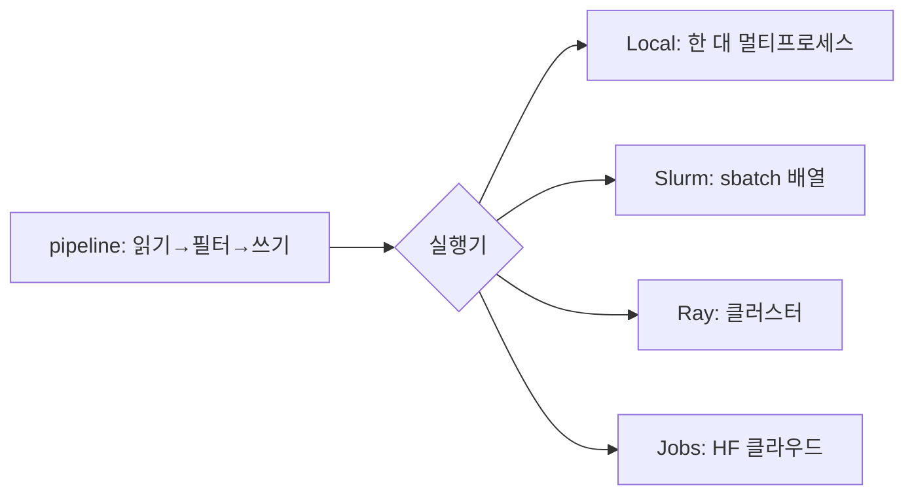
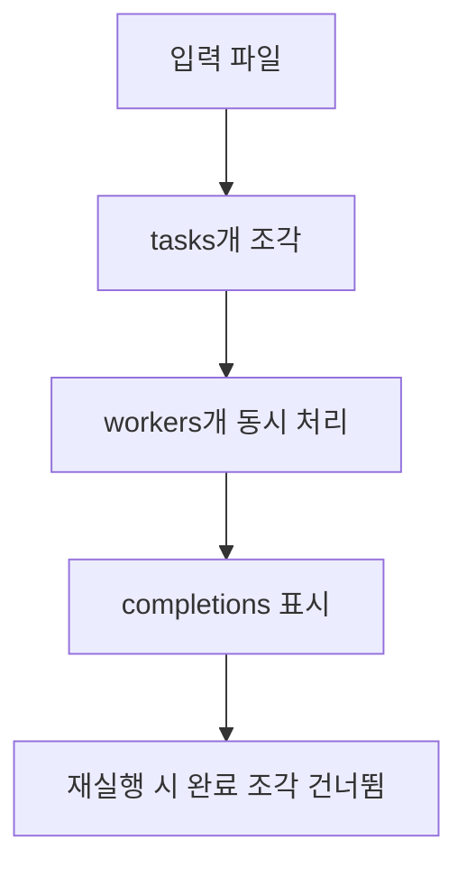

# 파이프라인 실행기 종류

> datatrove에서 **같은 처리 단계 목록(pipeline)을 어디서·어떻게 병렬로 돌릴지** 정하는 객체다. Local·Slurm·Ray·Jobs 네 종류가 있고, 처리 코드는 그대로 두고 실행기만 바꿔 노트북에서 클러스터까지 규모를 키운다.

## 쉽게 말하면
레시피(파이프라인)는 같은데 주방이 다르다. 집 부엌(Local)에서 혼자 만들 수도, 식당 주방 예약 시스템(Slurm)으로 여러 요리사에게 나눠 맡길 수도, 클라우드 주방 서비스(Ray·Jobs)를 빌릴 수도 있다.

## 자세히
(datatrove 0.10.1 소스·docstring을 직접 읽고 실행)
- 공통 개념: 데이터를 `tasks`개 조각(rank)으로 나눠 각 task가 파일 일부를 처리한다. `logging_dir`에 로그·통계·완료 표시를 남기며 `skip_completed=True`면 이미 끝난 task는 다시 돌리지 않아 **중단 후 재개**가 된다.
- LocalPipelineExecutor: `tasks`(전체 조각 수)와 `workers`(동시 실행 수)를 지정해 한 대에서 멀티프로세스로 실행. `local_tasks`·`local_rank_offset`으로 여러 머신에 조각을 나눠 맡길 수도 있다.
- SlurmPipelineExecutor: `time`·`partition`·`cpus_per_task`(권장 1)·`mem_per_cpu_gb`(기본 2)를 받아 sbatch 배열 작업으로 제출. 배열 크기 한도(`max_array_size` 기본 1001)를 넘으면 여러 작업으로 나눈다.
- RayPipelineExecutor: 이미 `ray.init()`된 Ray 클러스터에서 실행. `cpus_per_task`·`mem_per_cpu_gb`·`gpus_per_task`·`nodes_per_task`·`time`(초) 지정.
- JobsPipelineExecutor: Hugging Face Jobs로 분산(docstring에 **experimental**로 표시). `logging_dir`이 로컬이 아니라 `hf://`·`s3://` 같은 원격 경로여야 하고, 로컬의 조정 프로세스가 끝까지 살아 있어야 한다.
- 직접 실행(Local, JSONL 문서 2,000개를 길이 필터): tasks=1·workers=1은 0.15초, tasks=4·workers=4는 0.53초(출력 파일 4개). 문서가 아주 작아 프로세스 기동 비용이 병렬 이득보다 커서 오히려 느렸다. 병렬화는 데이터가 클 때 이득이다. 멀티프로세스 실행은 stdin 스크립트가 아닌 `.py` 파일과 `if __name__=="__main__":`이 필요했다(이 환경에서 확인).
- 선택 기준(제안): 수 GB 이하 = Local, 학교·회사 클러스터 = Slurm, 이미 Ray가 있음 = Ray, 자체 클러스터가 없고 HF 계정이 있음 = Jobs.

## 그림으로 보기



## 예시
```python
from datatrove.executor import LocalPipelineExecutor
from datatrove.pipeline.readers import JsonlReader
from datatrove.pipeline.filters import LambdaFilter
from datatrove.pipeline.writers import JsonlWriter

LocalPipelineExecutor(
    pipeline=[JsonlReader("in"), LambdaFilter(lambda x: len(x.text) > 30), JsonlWriter("out")],
    tasks=4, workers=4, logging_dir="logs",
).run()
```
클러스터로 옮길 때는 실행기 클래스와 `time`·`partition` 같은 인자만 바꾼다.

## 헷갈리는 것과 비교
| 개념 | 차이 |
|---|---|
| tasks | 전체 조각 수 |
| workers | 동시에 도는 조각 수 |
| Local | 단일 머신 |
| Slurm/Ray/Jobs | 다중 머신, 대용량용 |
| [datatrove](#datatrove) | 이 실행기들을 담은 라이브러리 |

## 더 읽을거리
- [huggingface/datatrove](https://github.com/huggingface/datatrove) — 라이브러리 저장소(설치한 0.10.1의 소스·docstring을 읽었다).
