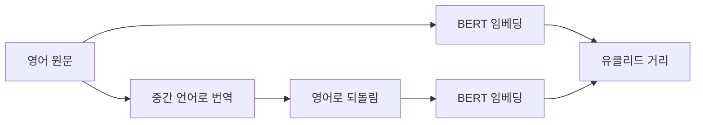
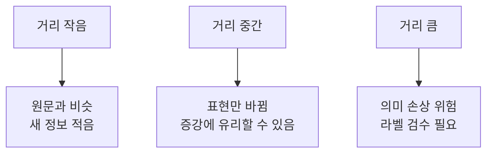

# 중간 언어 거리

> 역번역에서 **원문과 돌아온 문장이 임베딩 공간에서 얼마나 떨어졌는지**를 재는 값. 중간 언어를 고르는 기준으로 쓰이지만, 클수록 좋은지는 아직 검증되지 않았다.

## 쉽게 말하면
말을 한 사람에게 다른 나라 말로 옮기게 한 뒤 다시 원래 말로 되돌려 보게 하는 전화 게임과 같다. 돌아온 문장이 원문과 거의 같으면 "거리"가 작고, 많이 달라졌으면 크다. 달라진 정도가 데이터 다양성이 될 수도, 그냥 번역 실수일 수도 있어서 해석에 조심해야 한다.

## 자세히
- 출처: Ciolino·Noever·Kalin의 역번역 서베이(arXiv 2102.09708, 2021 제출, 2022-11 개정). 영어 트윗 1000개(Sentiment-140)를 Google Translate의 108개 언어로 보냈다가 영어로 되돌렸다.
- 측정: bert-base-uncased의 768차원 임베딩 사이 **유클리드 거리**를 언어별 평균±표준편차로 보고했다. 문장 벡터를 어떻게 만들었는지(풀링)는 논문에 적혀 있지 않다. 값은 0 이상, 상한 없음.
- 가장 가까운 언어: 덴마크어 2.08, 프리지아어 2.11, 이디시어 2.17. 가장 먼 언어: 타타르어 5.30, 라틴어 4.91, 신디어 4.82. 표준편차가 1.7~2.1이라 언어 간 겹침이 크다.
- 저자들은 거리가 클수록 일반화에 도움이 될 것이라 **추측**하지만 분류 실험은 하지 않았다. 먼 언어는 BLEU 같은 번역 품질도 낮은 언어라서, 거리가 의미 손상을 반영할 수 있다.
- 실무 해석: 거리는 "다양성"과 "의미 손상"이 섞인 신호다. 거리만으로 고르지 말고 라벨 보존 여부(감정이 뒤집히지 않았는지)를 표본 검수로 같이 본다.

## 그림으로 보기

## 예시
| 언어 | 평균 거리(논문 수치) | 읽는 법 |
|---|---|---|
| 덴마크어 | 2.08 | 돌아온 문장이 원문과 가장 비슷 |
| 타타르어 | 5.30 | 가장 많이 변함, 의미 손상 가능성도 큼 |
- 고객 리뷰 감정 분류 데이터를 늘릴 때: 거리가 중간인 언어 몇 개를 고르고, 돌아온 문장 100개를 사람이 보아 감정 라벨이 유지되는지 확인한다.

## 헷갈리는 것과 비교
| 개념 | 차이 |
|---|---|
| 중간 언어 거리 | 임베딩 공간에서 원문과 역번역문의 차이 |
| [중간 언어 선택](#intermediate-language-choice) | 어떤 언어를 쓸지 정하는 일. 거리는 그 기준 중 하나 |
| [역번역](#back-translation) | 거리를 재는 대상이 되는 증강 기법 |
| BLEU | 단어 겹침 기반 번역 품질 점수. 임베딩 거리와 다른 척도 |

## 더 읽을거리
- [Back Translation Survey for Improving Text Augmentation (arXiv 2102.09708)](https://arxiv.org/abs/2102.09708) — 108개 언어 왕복 실험과 BERT 거리 수치, 직접 읽음.
