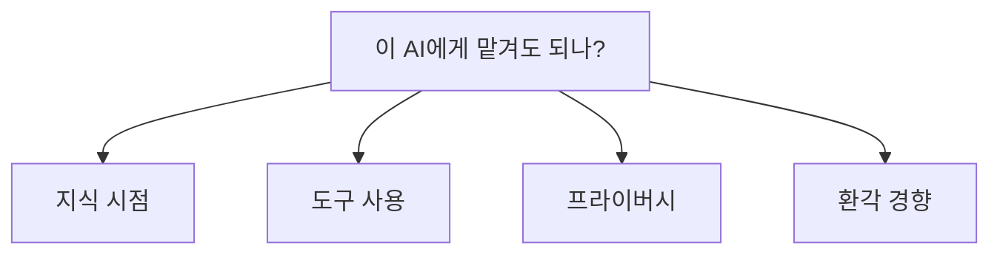

# 플랫폼 인식

> **쓰려는 AI 시스템이 무엇을 잘하고 어떤 한계가 있는지 이해하는 것.** AI Fluency 4D의 위임(Delegation) 중 하나다. (Anthropic AI Fluency 용어 요약 열람 2026-11-28)

## 쉽게 말하면
공구를 쓰기 전에 그 공구가 못 하는 일을 아는 것이다. 드라이버로 못을 박으면 안 되듯, AI마다 맞는 일이 다르다.

## 자세히
- 정의(문서): "다양한 AI 시스템의 **능력과 한계**를 이해하는 것". 위임의 세 요소는 **문제 인식**(AI를 쓰기 전에 목표와 일의 성격을 명확히 이해), **플랫폼 인식**, **과업 위임**(사람과 AI의 강점을 살려 일을 분배).
- 점검 항목(내 정리, 이 글의 출처는 항목 목록을 제시하지 않음): ① 지식 시점(학습 마감 이후 정보를 모를 수 있음) ② 입력 길이·형식 한계 ③ 도구 사용 가능 여부(웹 검색·코드 실행·파일) ④ 데이터 보존·프라이버시 정책 ⑤ 환각·편향 경향 ⑥ 비용·속도.
- 같은 문서의 기술 용어 요약은 온도(무작위성 조절)·RAG(외부 지식 연결로 정확도를 높이고 환각 감소)·편향(훈련 데이터 패턴 반영) 등을 한 줄 정의로 제시해 플랫폼 이해의 어휘를 제공한다.
- 한계: 플랫폼은 빠르게 바뀌므로 이 개념의 점검 결과는 날짜를 적어야 한다.

## 그림으로 보기

## 예시
- 최신 법령 질문을 학습 마감 이전 지식만 가진 모델에 맡기면 위험 → 웹 검색 도구가 있는지 먼저 확인.
- 교육: 사내에서 쓰는 AI 도구 3개의 능력·한계를 표로 정리.

## 헷갈리는 것과 비교
| 개념 | 차이 |
|---|---|
| 플랫폼 인식 | AI 도구의 능력·한계 이해 |
| 문제 인식 | 내 목표와 일의 성격 이해 |
| [협업 모드](#collaboration-modes) | 일을 나누는 방식 |

## 더 읽을거리
- [AI Fluency 용어 요약(Anthropic PDF)](https://www-cdn.anthropic.com/4396730ed190e691a3712cf2fd6bfe35509deca2.pdf) — 위임의 세 요소(읽음).
