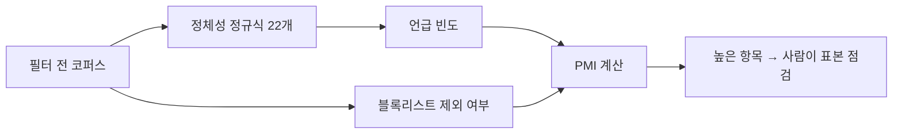
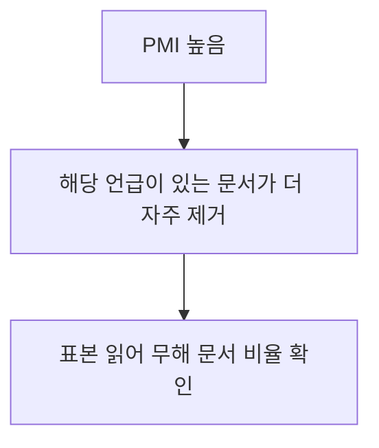

# PMI로 본 정체성별 제거

> 점별 상호정보(PMI)로 "어떤 정체성 단어가 문서에 등장하는 것"과 "그 문서가 필터에 걸려 제거되는 것"이 얼마나 함께 일어나는지 재서, 필터가 어떤 집단을 더 지우는지 확인하는 방법이다.

## 쉽게 말하면
"안경 쓴 사람"과 "지각한 사람"이 우연보다 자주 겹치는지 보는 것과 같다. 특정 단어가 있는 문서가 우연 이상으로 자주 삭제된다면 필터가 그 단어(집단)에 불리하다는 신호다.

## 자세히
(Dodge 외 arXiv 2104.08758 5.2절을 직접 읽고 확인.)
- **방법**: 정체성 언급을 담은 **22개 정규식**의 빈도를 구하고, "정체성 언급이 등장함"과 "블록리스트에 걸려 제외됨" 사이의 **PMI**를 계산(Church & Hanks 1990). PMI가 클수록 둘이 우연보다 자주 함께 일어난다.
- **결과**: 성적 지향 언급(lesbian, gay, heterosexual, homosexual, bisexual)이 인종·민족 정체성보다 필터에 걸릴 가능성이 높았다.
- **수동 점검**: "lesbian"·"gay"가 포함된 문서 각 50건 표본에서 비공격적·비성적 문서가 각각 22%, 36%. 동성 관계(결혼·연애) 주제의 글이 지워지는 사례.
- **한계(제안)**: PMI는 상관일 뿐 원인은 아니다. 정체성 단어가 성적 맥락에서 자주 쓰이는 것도 영향을 준다. 정규식 목록(22개)이 모든 집단을 포괄하지 않는다.
- 쓰는 법(제안): 필터 전후 코퍼스에서 같은 단어 목록의 PMI·제거율을 표로 비교하고, 가장 높은 항목의 표본 문서를 사람이 읽어 확인한다.

## 그림으로 보기

## 예시
- 사내 필터로 제거된 문서에서 직무·성별·지역 단어의 제거율을 비교.
- 교육 활용: PMI를 "함께 나타나는 정도"로 쉽게 풀어 편향 감사의 첫 도구로 소개.

## 헷갈리는 것과 비교
| 개념 | 차이 |
|---|---|
| PMI 감사 | 단어-제거 연관 측정 |
| [블록리스트 필터 편향](#blocklist-filter-bias) | 그 감사가 밝힌 문제 |
| 방언별 제거율 | 방언 분류기로 문서를 나눠 비교(다른 축) |

## 더 읽을거리
- [Documenting Large Webtext Corpora (arXiv 2104.08758)](https://arxiv.org/abs/2104.08758) — 5.2절 PMI 분석.
