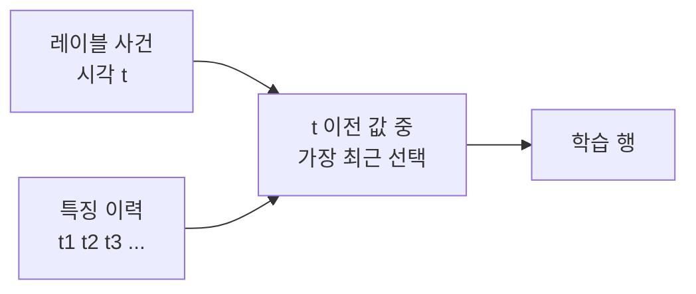
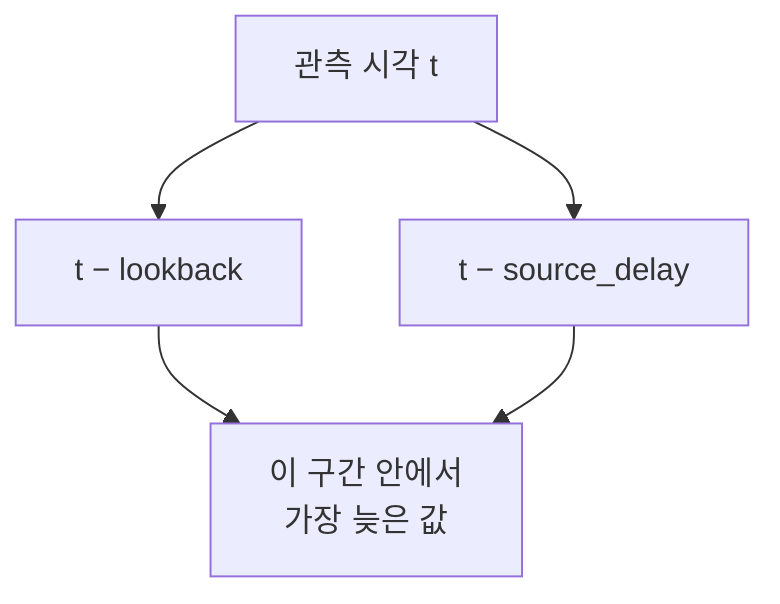

# 시점 기준 조인

> 학습 데이터를 만들 때 각 사건(레이블)의 발생 시각 **이전에 알 수 있었던 특징 값만** 붙이는 조인이다. ASOF 조인·temporal join이라고도 부르며, 미래 정보가 학습에 새는 누수를 막는다.

## 쉽게 말하면
시험 채점 후에 "이 학생 점수는 이랬다"는 걸 알고 나서 과거 모의고사를 해석하면 항상 맞춘 것처럼 보인다. 시점 기준 조인은 "그날 아침까지 알 수 있던 정보만 책상에 올려 두라"는 규칙이다. 그날 이후에 생긴 정보는 보지 못하게 한다.

## 자세히
(Databricks·Azure ML 공식 문서 직접 확인.)
- **원리**: 레이블 행마다 같은 키(예: 사용자)의 특징 중 **해당 시각 이전(또는 같은 시각)에서 가장 최근 값**을 붙인다. 이전 값이 없으면 null. 순진한 조인은 전역 최신 행을 붙여 사건 이후의 값이 섞인다.
- **Databricks**: 특징 테이블에 `timeseries_columns`(Unity Catalog; 워크스페이스는 `timestamp_keys`)를 지정하면 정확히 같은 시각 대신 최신 값으로 조인한다. `FeatureLookup`의 `timestamp_lookup_key`가 조회 시각 열이고, `lookback_window`(timedelta, 기본 None)는 너무 오래된 값을 제외한다. 이 윈도우는 학습·배치 추론에만 적용되고 온라인 추론은 항상 최신 값을 쓴다. null 특징 행은 버리지 않는다. 이는 Delta Lake time travel과 무관하다.
- **Azure ML**: 관측 시각 `t`에 대해 구간 `[t - temporal_join_lookback, t - source_delay]` 안에서 가장 늦은 특징 값을 조인. `source_delay`는 사건이 원천 테이블에 도착하기까지의 지연(기본 0)으로, 무시하면 학습은 "아주 가까운 과거"를 쓰고 서빙은 지연된 값만 쓰게 되어 성능이 떨어진다. `temporal_join_lookback` 기본값은 무한대이며, 비어 있지 않은 결과를 얻으려면 `source_delay`보다 크게 잡는다.
- **Feast**는 `get_historical_features`가 비슷한 일을 하고 TTL(앞 노드 [온라인·오프라인 특징 동등성](#online-offline-feature-parity))로 범위를 제한한다.
- **함정**: 타임스탬프의 의미를 혼동(사건 시각 vs 적재 시각), 시간대 불일치, 나중에 백필·정정된 값(생성 시각 필터 필요), 지연 도착.

## 그림으로 보기

## 예시
- 광고 클릭 예측: 노출 시각 `ad_impression_ts` 기준으로 사용자의 7일 이내 `purchases_30d`만 조인(lookback_window=7일).
- 교육 소재: "시험 후에 알게 된 정보로 시험 전을 설명하면 안 된다"를 AI 학습 데이터에 적용.

## 헷갈리는 것과 비교
| 개념 | 차이 |
|---|---|
| 시점 기준 조인 | 시각 이전 최신값만 붙이는 방법 |
| [시점 누수](#point-in-time-leakage) | 이 조인이 막으려는 문제 |
| [특징 TTL](#feature-ttl) | 얼마나 오래된 값까지 허용하나 |
| [느리게 바뀌는 차원](#slowly-changing-dimension) | 이력 테이블로 같은 문제를 푸는 모델링 |

## 더 읽을거리
- [Point-in-time feature joins (Databricks)](https://docs.databricks.com/aws/en/machine-learning/feature-store/time-series.html) — AS OF 조인, lookback_window, 예제 코드.
- [Offline feature retrieval using a point-in-time join (Azure ML)](https://learn.microsoft.com/en-us/azure/machine-learning/offline-retrieval-point-in-time-join-concepts) — source_delay·temporal_join_lookback.
- [Feast point-in-time joins](https://docs.feast.dev/getting-started/concepts/point-in-time-joins) — TTL과 created timestamp 필터.
