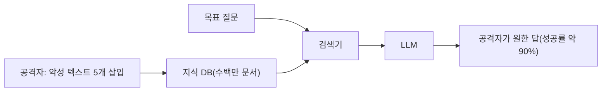
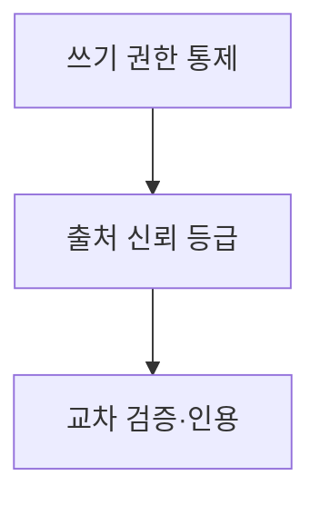

# PoisonedRAG

> **PoisonedRAG**는 RAG의 지식 DB에 **악성 텍스트 몇 개**를 심어 LLM이 공격자가 정한 질문에 공격자가 정한 답을 내게 만드는 **지식 오염 공격**이다(arXiv 2402.07867).

## 쉽게 말하면
도서관 서가에 가짜 책 다섯 권만 끼워 넣어도, 사서(검색기)가 그 책을 먼저 집어 주면 독자(LLM)는 그 내용을 근거로 틀린 답을 믿는다.

## 자세히
(논문 초록 확인)
- 저자들은 이를 **RAG에 대한 첫 지식 오염 공격**이라 주장한다.
- 목표 질문당 **악성 텍스트 5개**를 지식 DB에 삽입. DB에 **수백만 개 텍스트**가 있어도 공격 성공률 **약 90%**.
- 평가한 **여러 방어**가 충분하지 않았다고 보고한다(방어 이름과 사용 데이터셋은 초록에 없어 확인하지 않았다).
- 시사점(일반 지식): 검색 결과는 신뢰할 수 없는 입력으로 취급해야 한다. 지식 DB의 쓰기 권한 통제, 출처별 신뢰 등급, 근거 인용과 교차 검증이 방어 방향이다([메모리 오염](#memory-injection)).

## 그림으로 보기

## 예시
- 누구나 편집하는 위키를 RAG 소스로 쓰던 챗봇이 "환불 불가"라는 가짜 문서를 근거로 답하게 되는 경우.

## 헷갈리는 것과 비교
| 개념 | 차이 |
|---|---|
| PoisonedRAG | 지식 DB 오염으로 특정 답을 유도 |
| [간접 프롬프트 주입](#indirect-prompt-injection) | 가져온 데이터 속 지시를 실행하게 함 |
| 데이터 포이즈닝(학습) | 학습 데이터 오염 |
| 환각 | 의도 없는 오류 |

## 더 읽을거리
- [PoisonedRAG](https://arxiv.org/abs/2402.07867)
