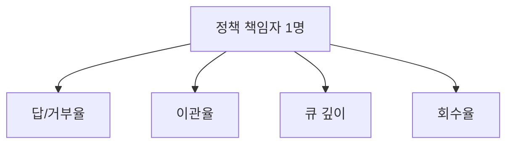

# 정책 단일 책임자

> 임계값 정책과 **서로 연동된 지표들**(답/거부율·이관율·큐 깊이·회수율)을 **한 사람이** 함께 책임지게 하는 운영 원칙이다.

## 쉽게 말하면
수도꼭지를 네 명이 각자 따로 돌리면 물이 넘치거나 끊긴다. 한 명이 압력과 유량을 함께 보며 조절해야 한다.

## 자세히
(Tian Pan 블로그를 직접 읽었다.)
- **원칙(글)**: **한 명의 제품 담당자**가 정책과 네 연동 지표를 소유한다 — **답/거부율, 이관율, 큐 깊이, 회수율**. 하나만 따로 최적화하면 나머지가 깨진다.
- **이유(해석)**: 거부를 줄이려 임계값을 내리면 이관이 늘어 큐가 막히고, 이관을 줄이려 올리면 오답이 늘어난다. 서로 다른 팀이 각 지표를 맡으면 충돌한다.
- **관련**: [검토자 용량](#reviewer-capacity)이 임계값의 천장을 정한다.

## 그림으로 보기

## 예시
- 상담 챗봇 임계값 변경 회의에 AI팀·운영팀이 따로 오지 않고 한 명이 네 지표 변화를 한 장에 보고(제안).

## 헷갈리는 것과 비교
| 개념 | 차이 |
|---|---|
| 정책 책임자 | 연동 지표의 단일 소유자 |
| [RACI](#raci-data-responsibility) | 책임 분담 표(A 한 명 원칙과 연결) |

## 더 읽을거리
- [Tian Pan — The two-threshold problem](https://tianpan.co/blog/2026/04/27/two-threshold-problem-confidence-gated-ai) — 직접 읽음.
