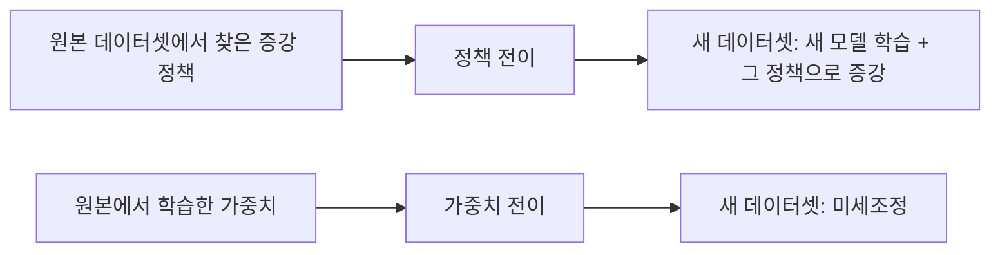
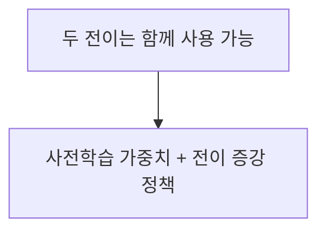

# 정책 전이 vs 가중치 전이

> **정책 전이**는 한 데이터셋에서 찾은 **증강 정책(어떤 변환을 얼마나 쓰는가)**을 다른 데이터셋 학습에 그대로 가져다 쓰는 것이고, **가중치 전이**는 사전학습된 **모델 가중치**를 가져와 미세조정하는 것이다. 무엇을 옮기느냐가 다르다.

## 쉽게 말하면
요리에서 "레시피(조리 순서와 양념 비율)"를 빌리는 것이 정책 전이, "이미 반쯤 끓인 육수(재료)"를 빌려 오는 것이 가중치 전이다. 레시피는 가볍게 가져올 수 있지만, 새 가게에서 처음부터 끓여야 한다.

## 자세히
- 출처: Cubuk 외, *AutoAugment: Learning Augmentation Strategies from Data*(arXiv 1805.09501, 4.3절·5절 읽음). 논문은 데이터셋마다 직접 정책을 탐색하는 것(AutoAugment-direct)은 자원이 많이 들 수 있어, **이미 찾은 정책을 다른 데이터셋에 옮겨 쓰는 것(AutoAugment-transfer)**이 가능한지 확인한다.
- **정책 전이의 증거**: ImageNet에서 찾은 정책을 FGVC(세부 분류) 데이터셋 5종에 적용해 **Inception v4를 처음부터 학습**했다(가중치를 가져오지 않음). 논문 Table 4(Top-1 오류율 %, 기준선 → AutoAugment-transfer):
  | 데이터셋 | 학습 크기 | 클래스 | 기준선 | 전이 정책 |
  |---|---|---|---|---|
  | Oxford 102 Flowers | 2,040 | 102 | 6.7 | 4.6 |
  | Caltech-101 | 3,060 | 102 | 19.4 | 13.1 |
  | Oxford-IIIT Pets | 3,680 | 37 | 13.5 | 11.0 |
  | FGVC Aircraft | 6,667 | 100 | 9.1 | 7.3 |
  | Stanford Cars | 8,144 | 196 | 6.4 | 5.2 |
  (표 추출 순서가 어긋나 열 대응은 본문 서술·값의 배열로 추정해 읽음.)
- 논문의 서술: CIFAR-10에서 찾은 정책이 다른 모델 구조와 CIFAR-100에서도 개선을 주었고, **AutoAugment 정책은 다른 데이터셋에서 학습해도 성능을 해친 적이 없다**(Cutout이 SVHN에서 해쳤던 것과 대비). 다만 **대상 데이터 분포에 가장 가까운 데이터에서 학습한 정책이 가장 좋았다** — SVHN에 CIFAR-10 정책을 쓰면 기준선보다 약간 낫지만 SVHN용 정책만큼은 아니었다.
- 비교 표:
  | | 정책 전이 | 가중치 전이 |
  |---|---|---|
  | 옮기는 것 | 증강 변환·확률·강도 | 모델 파라미터 |
  | 학습 방식 | 새 모델을 처음부터 학습(위 실험) | 사전학습 모델에서 미세조정 |
  | 비용 | 정책 파일 하나, 가벼움 | 모델 크기만큼 |
  | 위험 | 대상 데이터의 대칭성·라벨 의미와 안 맞을 수 있음([대칭성에 의존하는 증강](#symmetry-dependent-augmentation)) | 사전학습 데이터와 도메인 차이 |
  | 함께 쓰기 | 가능: 사전학습 가중치로 시작하고 전이 정책으로 증강 | |
- 위 논문은 두 방식을 같은 실험에서 비교하지는 않았다(정책 전이만 확인). "어느 쪽이 더 낫다"는 결론은 이 문서에서 내리지 않는다.
- 실무(제안): 비슷한 자연 이미지면 공개 정책([공개 증강 정책 쓰기](#public-augmentation-policies))이나 TrivialAugment 같은 튜닝 없는 방법을 기준선으로 두고, 도메인이 다르면 [허용 목록](#augmentation-allowlist)을 만든다.
- 한계: 논문은 2018년 연구이며 최신 대형 사전학습 환경과 직접 비교할 수 없다.

## 그림으로 보기

## 예시
- 새 사진 분류 과제: ImageNet 정책(공개 AutoAugment IMAGENET)을 증강으로 쓰고 모델은 처음부터 학습 → 기준선보다 오류율이 내려가는 사례(논문 Table 4).
- 교육: "무엇을 재사용하는가"를 가르는 전이 학습 개념 정리.

## 헷갈리는 것과 비교
| 개념 | 차이 |
|---|---|
| 정책 전이 | 증강 설정을 재사용 |
| 가중치 전이 | 모델 가중치를 재사용 |
| AutoAugment-direct | 대상 데이터에서 직접 정책 탐색(비용 큼) |
| TrivialAugment | 탐색·전이 자체가 필요 없는 방법 |

## 더 읽을거리
- [AutoAugment (arXiv 1805.09501)](https://arxiv.org/abs/1805.09501) — 4.3절 전이 실험, Table 4(읽음).
- [공개 증강 정책 쓰기](#public-augmentation-policies) — 실제 사용법.
