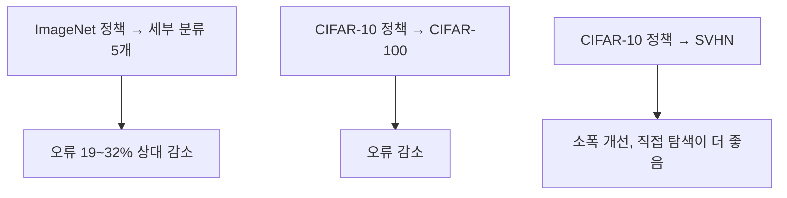

# 정책 이식

> 한 데이터셋에서 찾은 증강 정책을 **다시 탐색하지 않고 다른 데이터셋에 그대로 쓰는 것**이다. AutoAugment 논문은 ImageNet에서 찾은 정책이 다섯 세부 분류 데이터셋에서, CIFAR-10 정책이 CIFAR-100에서 오류를 줄였다고 보고한다.

## 쉽게 말하면
한 학교에서 잘 맞는 학습 계획표를 다른 학교에서도 그대로 써 보는 것이다. 비슷한 수준의 학교라면 상당히 잘 맞지만, 학생 구성이 많이 다른 학교에서는 효과가 작을 수 있다.

## 자세히
- **ImageNet 정책의 이식**(Cubuk 외 2018, arXiv 1805.09501 ar5iv 확인): ImageNet에서 찾은 정책을 정책 재탐색 없이 5개 세부 분류 데이터셋에 적용했다(학습률·가중치 감쇠는 각 검증셋에서 조정). Inception v4 top-1 오류(%):

| 데이터셋 | 기준선 | 이식 후 | 감소 | 상대 감소(직접 계산) |
|---|---|---|---|---|
| Oxford 102 Flowers | 6.7 | 4.6 | 2.1 | 31% |
| Caltech-101 | 19.4 | 13.1 | 6.3 | 32% |
| Oxford-IIIT Pets | 13.5 | 11.0 | 2.5 | 19% |
| FGVC Aircraft | 9.1 | 7.3 | 1.8 | 20% |
| Stanford Cars | 6.4 | 5.2 | 1.2 | 19% |

  저자들은 다섯 모두 유의하게 개선됐다고 하며 Stanford Cars 5.2%는 당시 알려진 최저 오류라고 말한다(처음부터 학습한 모델 기준, 기존 최고 5.9%는 ImageNet 사전학습 사용).
- **CIFAR-10 정책의 이식**: 축소 CIFAR-10에서 찾은 정책을 CIFAR-100에 쓰자 Wide-ResNet-28-10 오류가 18.8%에서 17.1%, Shake-Shake가 17.1%에서 14.3%, PyramidNet+ShakeDrop이 14.0%에서 10.7%로 내려갔다. SVHN에서는 이식 정책의 개선이 SVHN에서 직접 찾은 정책(WRN-28-10 1.1%, Shake-Shake 1.0%)보다 작았다.
- **저자의 관찰**: 학습한 정책이 **성능을 해친 경우는 없었고**, 대상과 가장 가까운 데이터에서 찾은 정책이 가장 좋았다.
- **해석(제안)**: 대상 데이터가 정책을 찾은 데이터와 시각적 특성(자연 이미지 vs 숫자 등)이 비슷할수록 이식이 안전하다. 다르면 이득이 작을 수 있으므로 소규모 검증으로 기준선과 비교한다([RandAugment 격자 탐색](#randaugment-grid-search)의 기준선 원칙). 이 수치는 논문 보고이며 직접 재현하지 않았다.

## 그림으로 보기

## 예시
- 사내 제품 사진 분류에 공개된 ImageNet 정책을 가져다 쓰고, 기준선과 3시드 비교로 이득을 확인.
- 교육: 이식 이득이 큰 데이터(Caltech-101)와 작은 데이터(Stanford Cars)의 차이를 토론.

## 헷갈리는 것과 비교
| 개념 | 차이 |
|---|---|
| 정책 이식 | 찾은 정책을 재탐색 없이 재사용 |
| 전이학습 | 모델 가중치를 재사용 |
| [대리 과제](#proxy-task-pitfall) | 탐색 비용을 줄이려는 축소 설정 |
| [AutoAugment](#autoaugment-search-space) | 정책을 만드는 쪽 |

## 더 읽을거리
- [AutoAugment 논문 — ar5iv](https://ar5iv.labs.arxiv.org/html/1805.09501) — 이식 실험 표(열어 확인).
