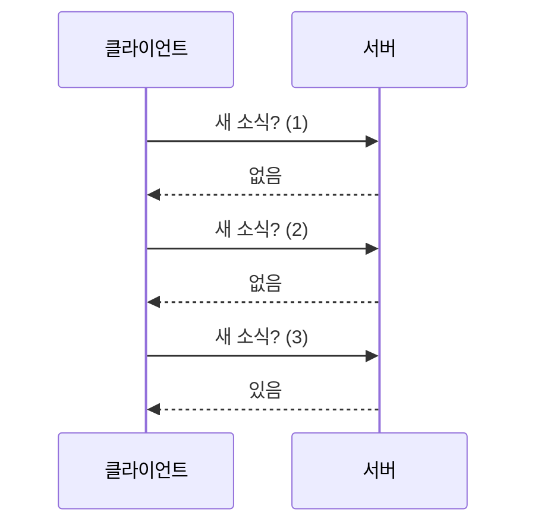
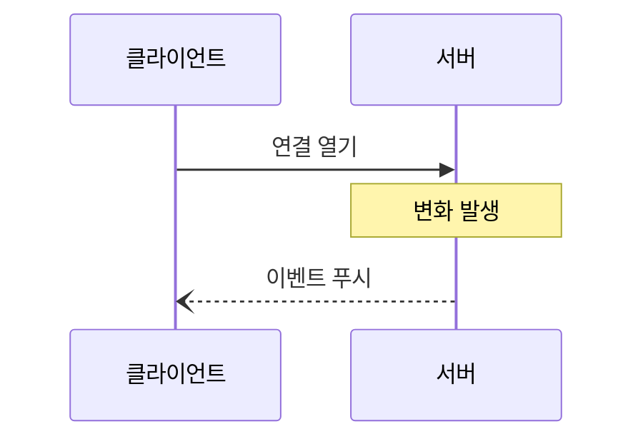

# 폴링과 푸시

> 폴링(polling)은 클라이언트가 주기적으로 "새 소식 있어요?"라고 묻는 방식, 푸시(push)는 서버가 변화가 생길 때 먼저 알려 주는 방식이다.

## 쉽게 말하면
택배를 기다릴 때 10분마다 현관문을 열어 보는 것이 폴링, 초인종이 울릴 때까지 기다리는 것이 푸시다. 자주 열어 볼수록 헛걸음이 늘고, 드물게 열면 늦게 안다.

## 자세히
(MDN 기준)
- **폴링**: 타이머로 계속 HTTP 요청. 변화가 없어도 매번 헤더 비용이 들고, 지연은 폴링 간격만큼. 구현은 쉽고 어디서나 동작.
- **SSE(Server-Sent Events)**: 연결 하나를 열어 두고 서버가 `Content-Type: text/event-stream`으로 이벤트를 밀어 준다. 단방향, 끊기면 브라우저가 자동 재연결, 텍스트(UTF-8)만. HTTP/1.1에서 도메인당 약 6개 연결 한계.
- **WebSocket**: HTTP 핸드셰이크 뒤 양방향 영구 연결(RFC 6455). 채팅·실시간 협업에 적합. 백프레셔가 없어 메시지가 몰리면 메모리·CPU가 튈 수 있다.
- **선택 기준**: 드물고 단순 → 폴링 / 서버→클라이언트 일방 스트림 → SSE / 양방향·빈번 → WebSocket.
- **MCP와의 연결**: 서버가 클라이언트에 변화를 알리는 `list_changed`·`resources/updated` 알림이 푸시형이고, 알림을 받은 뒤 목록·내용을 다시 읽는 것은 요청형이다. MCP의 Streamable HTTP 전송도 SSE를 쓸 수 있다(전송 문서 참고).

## 그림으로 보기

## 예시
- 에이전트가 장시간 작업 상태를 확인할 때: 단순 구현은 5초마다 `GET /jobs/1` 폴링, 규모가 커지면 SSE로 진행률을 받는다.
- 자바스크립트: `new EventSource("/events")`로 서버 이벤트 수신.

## 헷갈리는 것과 비교
| 방식 | 방향 | 지연 | 비고 |
| --- | --- | --- | --- |
| 폴링 | 클라이언트→서버 | 간격만큼 | 가장 단순 |
| SSE | 서버→클라이언트 | 즉시 | 자동 재연결 |
| WebSocket | 양방향 | 즉시 | 백프레셔 없음 |
| 웹훅 | 서버→서버 | 즉시 | 수신 주소 필요 |
| [구독](#mcp-subscriptions) | MCP의 푸시 알림 신청 | | |

## 더 읽을거리
- [MDN: Server-sent events 사용하기](https://developer.mozilla.org/en-US/docs/Web/API/Server-sent_events/Using_server-sent_events) — SSE 형식과 한계
- [MDN: WebSockets API](https://developer.mozilla.org/en-US/docs/Web/API/WebSockets_API) — 양방향 연결
