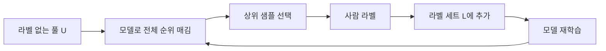
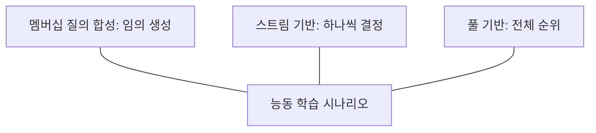

# 풀 기반 샘플링

> 라벨 없는 대량 데이터 풀 전체를 모델로 평가·순위 매긴 뒤 가장 가치 있는 샘플을 골라 라벨을 요청하는 능동 학습 시나리오다. 응용 논문에서 가장 흔하다.

## 쉽게 말하면
시험 문제 은행(풀) 전체를 한 번 훑어 "학생이 가장 헷갈릴 문제"를 골라 선생님께 해설을 요청하는 방식이다. 반대로 스트림 방식은 문제가 한 장씩 도착할 때마다 바로 묻을지 버릴지 정한다.

## 자세히
(Settles 서베이 2절 "Scenarios"를 직접 읽고 확인.)
- **3가지 시나리오**
  1. **멤버십 질의 합성**(Angluin 1988): 입력 공간의 임의 샘플(직접 생성 포함)을 물을 수 있다. 사람 라벨러에게는 알아보기 어려운 이미지가 나오는 문제(Lang & Baum 1992 필기 문자). 성공 사례로 효모 대사 경로를 실험하는 '로봇 과학자'(King 외)가 소개된다.
  2. **스트림 기반 선택 샘플링**(Cohn 외 1990·1994): 샘플이 하나씩 실제 분포에서 들어오고 모델이 즉시 질의/폐기를 결정. 메모리·연산이 제한된 모바일·임베디드에 적합.
  3. **풀 기반**(Lewis & Gale 1994): 소량 라벨 세트 L과 큰 라벨 없는 풀 U(보통 고정). 풀(또는 부분표본) 전체를 평가·순위 매기고 탐욕적으로 최선을 고른다.
- **핵심 차이**: 스트림은 순차 스캔하며 개별 결정, 풀은 전체를 순위 매긴 뒤 선택.
- 풀 기반은 텍스트 분류, 정보 추출, 이미지·영상 검색, 음성 인식, 암 진단 등 응용 논문에서 가장 많이 쓰인다.

## 그림으로 보기

## 예시
- 상담 로그 5만 건 풀에서 불확실한 100건씩 뽑아 라벨러에게 보내고 모델을 재학습하는 반복.
- 교육 활용: 라벨링 예산이 한정될 때 "어떤 것을 먼저 라벨링할까?" 토론.

## 헷갈리는 것과 비교
| 시나리오 | 결정 방식 | 적합한 상황 |
|---|---|---|
| 멤버십 질의 합성 | 임의 생성 | 라벨러가 기계(실험)일 때 |
| 스트림 기반 | 하나씩 즉시 | 메모리·연산 제한 |
| 풀 기반 | 전체 순위 후 선택 | 큰 정적 데이터셋 |

## 더 읽을거리
- [Active Learning Literature Survey (Settles)](https://burrsettles.com/pub/settles.activelearning.pdf) — 2절 시나리오.
