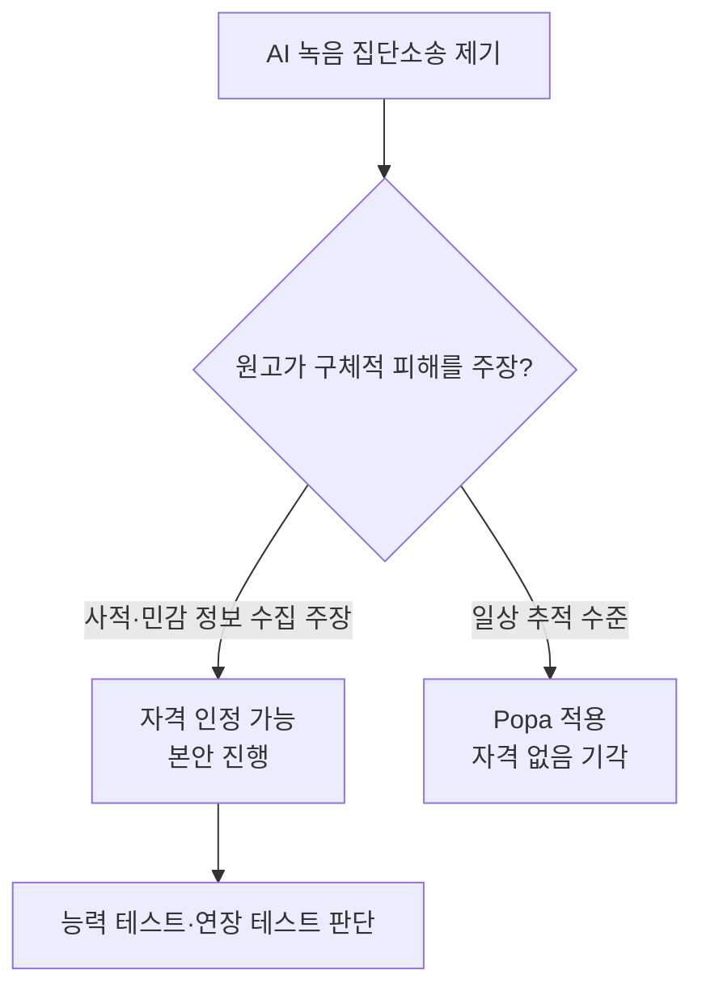

# Popa v. Microsoft

> 2025-08-26 제9순회 연방항소법원이, 웹사이트 방문 기록(세션 리플레이)을 수집했다는 이유만으로는 연방 소송을 낼 자격(Article III standing)이 없다고 판단한 판결. AI 녹음 소송에서 원고가 "구체적 피해"를 보여야 한다는 쪽으로 무게를 옮겼다. (법률 자문 아님)

## 쉽게 말하면
가게 점원이 손님이 어떤 물건을 구경하는지 지켜봤다고 해서 소송을 낼 수는 없다. 민망하거나 사적인 정보까지 가져갔다는 실제 피해가 있어야 법원 문턱을 넘는다는 판단이다.

## 자세히
- **사건**: Popa v. Microsoft, No. 24-14, 153 F.4th 784 (9th Cir. 2025-08-26). 원고가 펫용품 사이트를 방문했고 그 사이트가 Microsoft의 세션 리플레이 도구 Clarity를 썼다. 청구 근거는 펜실베이니아 도청법(WESCA)이었다.
- **판단**: 원고가 구체적 피해를 주장하지 못해 Article III 자격이 없다고 보고 본안 판단 없이 기각을 유지했다. "Clarity가 수집한 당황스럽거나 침습적이거나 사적인 정보를 원고는 특정하지 못했다"는 취지이고, 법 위반만으로는 자격이 안 생긴다고 했다(Spokeo·TransUnion 인용).
- **CIPA 능력 테스트와의 관계(해설)**: Popa는 [능력 테스트](#capability-test)를 명시적으로 부정하지 않았고 Ambriz를 공식적으로 뒤집지도 않았다. 다만 "할 수 있는 해악"이 아니라 "실제 해악"을 요구해 Ambriz의 논리와 긴장 관계라는 분석이 있다(Maine 법학 저널 글).
- **후속 영향**: 피고가 소송 초기에 자격 문제를 먼저 제기할 것으로 예상된다는 전망, 그리고 2026-07 C.D. Cal. 명령이 Popa를 근거로 CIPA 집단 인증을 기각한 사례(Lewis v. Magnite)가 있다는 검색 요약. 후자는 원문을 열지 못했다.
- **한계**: 세션 리플레이와 통화 전사가 같은 취급을 받을지는 열려 있다. 통화는 대화 내용 자체라 사적 정보 가능성이 크다는 구분이 Ambriz류를 살릴 수 있다는 의견이 있다. 연방법원 자격 문제라 주 법원에서는 다르게 진행될 수 있다.

## 그림으로 보기

## 예시
- 웹사이트 클릭 추적만 문제 삼은 소송 → Popa에 따라 자격 부족으로 기각될 가능성이 높다.
- 의료 상담 통화를 AI가 전사한 소송 → 민감 정보라는 점이 자격 주장에 유리(해설 기반, 보장 아님).

## 헷갈리는 것과 비교
| 개념 | 차이 |
|---|---|
| [CIPA 소송](#cipa-lawsuits) | 상위 주제, Popa는 연방 소송 자격 문제를 보탬 |
| [능력 테스트](#capability-test) | 본안(제3자 여부) 기준, Popa는 문턱 기준 |
| Article III 자격 | 연방법원에 들어올 최소 요건, 주 법원은 다를 수 있음 |

## 더 읽을거리
- [The Collapse of Capability Theory (Maine SJIPL, 2025-12-18)](https://sjipl.mainelaw.maine.edu/2025/12/18/the-collapse-of-capability-theory-ambriz-popa-and-the-future-of-article-iii-standing-in-ai-privacy-cases/) — Popa가 Ambriz에 주는 영향(열어서 확인)
- [Ninth Circuit Dismisses Session Replay Lawsuit–Popa v. Microsoft (Eric Goldman)](https://blog.ericgoldman.org/archives/2025/08/ninth-circuit-dismisses-session-replay-lawsuit-popa-v-microsoft.htm) — 판결 해설(검색 결과로만 확인)
