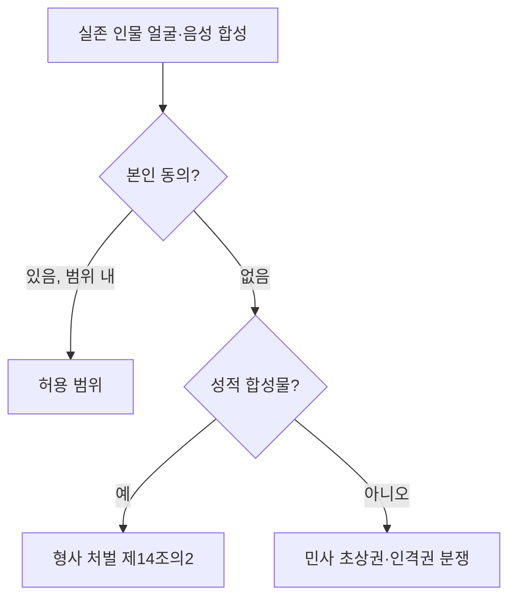
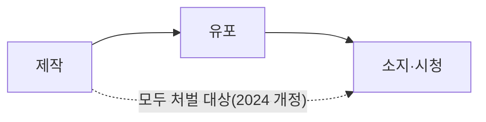

# 초상권과 딥페이크

> 초상권은 자기 얼굴·모습을 함부로 촬영·이용당하지 않을 권리다. AI는 실존 인물의 얼굴·목소리를 합성하기 쉬워, 동의 없는 합성은 민사(초상권 침해)뿐 아니라 형사 처벌 대상이 될 수 있다.

## 쉽게 말하면
내 사진을 누가 광고에 몰래 쓰면 화를 낼 수 있다. AI는 사진이 없어도 내 얼굴을 "새로 그려" 줄 수 있으니, 그 그림이 나를 알아볼 수 있게 닮았다면 같은 문제가 생긴다. 특히 성적·사기 목적이면 범죄다.

## 자세히
- **민사(일반 설명, 법령 원문 미확인)**: 초상권·인격권 침해로 손해배상·게시 중단 청구가 가능하다. 유명인의 이름·얼굴의 상업적 가치를 보호하는 퍼블리시티권은 한국에선 명문 규정이 없고 판례로 다뤄진다는 설명이 많다.
- **형사 — 성폭력처벌법 제14조의2(허위영상물 편집·반포)**, 로톡 해설 기준:
  - 본인 의사에 반해 얼굴·신체·음성을 성적 욕망·수치심을 일으킬 수 있게 합성하면 처벌. 합성 도구가 AI든 일반 편집툴이든 같다.
  - 2024-10 개정으로 제작·유포는 7년 이하 징역(또는 5천만 원 이하 벌금), **반포 목적이 없어도 제작 자체가 범죄**, 알면서 소지·시청해도 3년 이하 징역·3천만 원 이하 벌금. 영리 목적 대규모 유포는 가중. 항 번호는 자료마다 달라 확인 필요.
  - 미성년자가 대상이면 아동·청소년 성보호법이 적용된다. 합성물로 협박·강요하면 제14조의3.
- **AI 서비스 운영자 관점**: 얼굴 업로드 기능, 음성 복제, 인물 LoRA는 동의 확인·사용 범위 고지·삭제 절차가 필요하다.
- 피해 시: 증거(캡처·URL) 확보 후 경찰 신고·전문가 상담. 해외 사이트·비공개방은 삭제가 어렵다.
- 2026년에는 AI 성적 영상물을 겨냥한 별도 법안 발의가 논란이 됐다는 보도가 있으나 시행 여부는 미확인.

## 그림으로 보기

## 예시
- 인물 LoRA를 만들 때: 본인 또는 서면 동의를 받은 사람 사진만 쓰고, 용도(개인 소장·상업)를 문서로 남긴다. 유명인 얼굴로 광고를 만들지 않는다.
- 서비스 약관에 "타인 얼굴 업로드 금지·동의 책임은 이용자"를 넣어도 운영자 책임이 면제되지는 않는다(일반 원칙).

## 헷갈리는 것과 비교
| 개념 | 차이 |
| --- | --- |
| 초상권 | 얼굴·모습 이용을 통제할 권리(민사) |
| 퍼블리시티권 | 유명인 이름·모습의 재산적 가치 |
| [딥페이크](#deepfake) | 합성 기술 자체. 법적 책임은 목적·동의로 갈림 |
| 저작권 | 창작물 보호. 얼굴은 저작물이 아니다 |

## 더 읽을거리
- [로톡: 딥페이크, 이렇게 처벌됩니다 — 성폭력처벌법 제14조의2 AtoZ](https://www.lawtalk.co.kr/posts/112749) — 요건·형량·소지 처벌
- [로톡: 딥페이크 처벌수위 항별 정리](https://www.lawtalk.co.kr/posts/187023) — 항별 비교(변호사 해설글, 법령 원문으로 재확인 권장)
