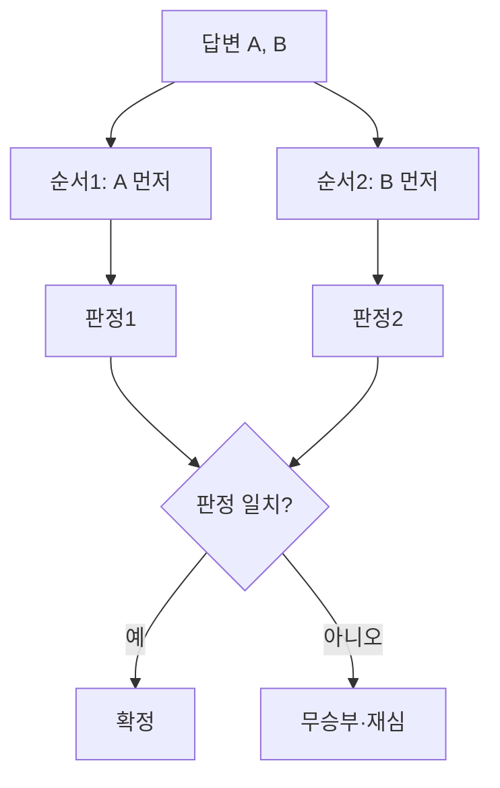

# 위치 편향

> 심판 역할을 하는 LLM(LLM-as-a-judge)이 두 답을 비교할 때 내용보다 "어느 쪽에 놓였는가"에 영향을 받아, 순서를 바꾸면 판정이 달라지는 현상.

## 쉽게 말하면
오디션에서 첫 번째 참가자에게 점수를 후하게 주는 심사위원과 같다. 실력이 비슷할수록 순서가 결과를 정한다. 그래서 두 순서로 한 번씩 심사해 보는 것이다.

## 자세히
- **원 연구**: Zheng 외 MT-Bench 논문(arXiv 2306.05685)은 심판 LLM의 편향으로 위치·장황함·자기 선호를 꼽았다. GPT-4급 심판은 사람 선호와 80% 이상 일치해 사람 간 일치도 수준이지만 편향은 있다(초록 확인). 본문 표에서 대부분의 심판이 첫 번째 위치를 선호했다고 보고(검색 요약으로 확인, 본문 직접 확인은 안 함).
- **일관성(consistency)**: 두 답의 순서를 바꿔도 같은 판정을 내리는 비율. 모델·데이터에 따라 크게 다르다. 한 2026 롱폼 벤치마크 논문은 설정에 따라 일부 모델의 불일치율이 78.7%까지 나온 사례를 보고했다(검색 요약, 원문 미확인).
- **품질 차이가 작을수록 심하다**: 두 답이 비슷할 때 위치가 결정 요인이 된다는 보고가 있다(2차 요약).
- **완화**: ① 순서 맞바꿔 두 번 호출, 결과가 다르면 무승부 처리하거나 제외 ② 여러 번 샘플링·다수결 ③ 점수 기반 루브릭 평가에서는 균형 잡힌 순열을 평균 ④ 평가 기준을 명시.
- **한계**: 맞바꿈은 위치 편향만 잡는다. 긴 답·마크다운 많은 답·자신감 있는 어투를 선호하는 편향은 따로 점검해야 한다.

## 그림으로 보기

## 예시
- 챗봇 두 버전 비교: 각 질문을 (A,B)와 (B,A)로 한 번씩 심사. 일관성 70%면 30%는 순서 때문에 흔들렸다는 뜻이라 사람 검수 표본을 늘린다.
- 프롬프트: "답변 순서는 판정에 영향이 없다. 기준 1~3으로 각각 점수를 매기고 근거를 쓴 뒤 결론."

## 헷갈리는 것과 비교
| 개념 | 차이 |
|---|---|
| 위치 편향 | 순서에 따른 쏠림 |
| 장황함 편향 | 긴 답 선호 |
| 자기 선호 편향 | 자기 모델 답 선호 |
| [LLM 자동 평가](#llm-auto-rater) | 심판 LLM을 쓰는 평가 방식 전체 |

## 더 읽을거리
- [Judging LLM-as-a-Judge with MT-Bench and Chatbot Arena](https://arxiv.org/abs/2306.05685) — 편향 분류와 사람 일치도(초록 확인)
- [LLMs-as-Judges 서베이](https://arxiv.org/pdf/2412.05579) — 맞바꿈 완화 설명(검색 결과로만 확인)
