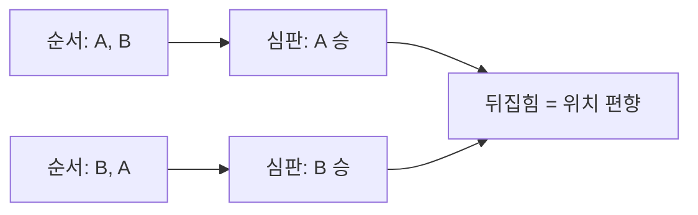
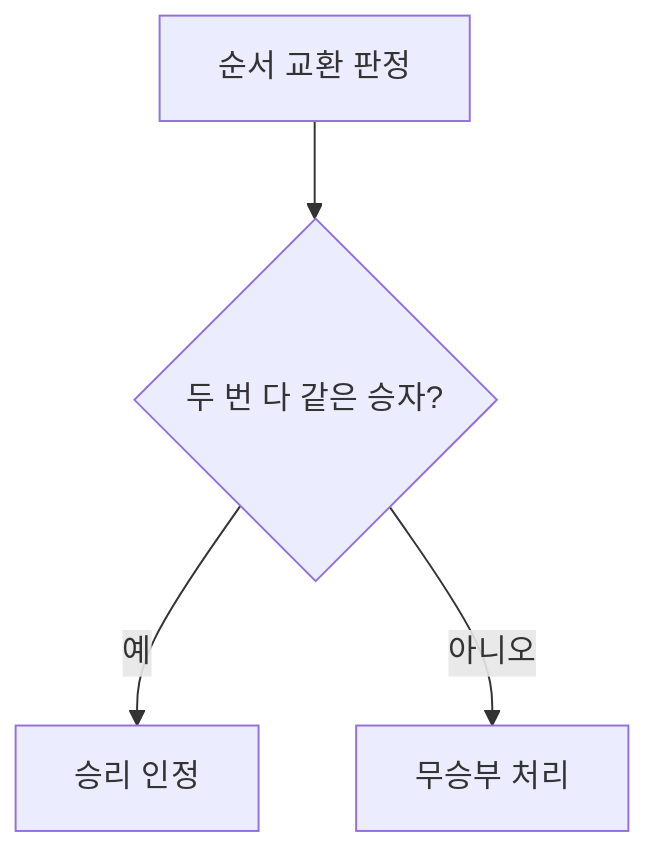

# 위치 편향

> LLM 심판(judge)이 **답변이 제시된 순서(첫째/둘째)에 따라 판정을 바꾸는** 편향. 같은 두 답인데 자리만 바꿔도 승자가 뒤집힌다.

## 쉽게 말하면
면접관이 먼저 본 지원자를 더 높게 평가하는 버릇과 같다. 실력과 무관하게 "먼저 나온 것"에 점수가 후해진다.

## 자세히
Zheng 외, *Judging LLM-as-a-Judge with MT-Bench and Chatbot Arena*(arXiv 2306.05685, PDF 본문 직접 읽음)의 측정:
- 설정: MT-bench 첫 턴 질문마다 GPT-3.5를 온도 0.7로 두 번 호출해 **비슷한 답 2개**를 만들고, 순서를 바꿔 판정하게 했다. 일관성은 순서를 바꿔도 같은 결과를 내는 비율. "rename" 프롬프트는 어시스턴트 이름을 바꿔 위치 편향인지 이름 편향인지 구분.
- 결과(기본 프롬프트): **Claude-v1 일관성 23.8%**(첫째 쪽 75.0%), **GPT-3.5 46.2%**(첫째 50.0%), **GPT-4 65.0%**(첫째 30.0%). rename 후 Claude-v1은 56.2%, GPT-3.5 51.2%, GPT-4 66.2%. Claude-v1은 "Assistant A"라는 이름을 선호하는 이름 편향도 보였다. GPT-4만 60% 넘게 일관됐다.
- 대부분의 심판이 **첫째 위치**를 선호. 이 시험은 두 답이 매우 비슷해 사람도 구별이 어려운 어려운 설정이라는 단서가 있다.
- 원인에 대한 저자 추측: 학습 데이터 또는 인과 트랜스포머의 왼쪽→오른쪽 구조(미검증).
- 완화: **순서를 바꿔 두 번 판정하고 둘 다에서 이긴 답만 승리**로 인정, 불일치면 무승부. 위치를 무작위로 배정하는 방법은 대규모에서 효과적. 퓨샷 예시로 GPT-4 일관성이 65.0%→77.5%가 됐지만 일관성이 곧 정확성은 아니고, 프롬프트가 길어 API 비용이 4배라고 한다.
- 모델 버전이 오래돼(2023) 오늘날 모델에서는 수치가 다를 수 있다.

## 그림으로 보기

## 예시
- 두 요약문을 A/B로 비교하게 하고, B/A로 다시 물어 결과가 같은지 확인.
- 교육: 같은 답 쌍을 순서만 바꿔 판정시키고 일관성 비율을 계산하는 실습.

## 헷갈리는 것과 비교
| 개념 | 차이 |
|---|---|
| 위치 편향 | 제시 순서에 따라 판정 변화 |
| [장황함 편향](#verbosity-bias) | 긴 답을 선호 |
| [자기 선호 편향](#self-preference-bias) | 자기 모델 답을 선호 |
| [순서 교환 채점](#position-swap-judging) | 위치 편향의 대표 완화책 |

## 더 읽을거리
- [Judging LLM-as-a-Judge (arXiv 2306.05685)](https://arxiv.org/abs/2306.05685) — Table 2 위치 편향(읽음).
