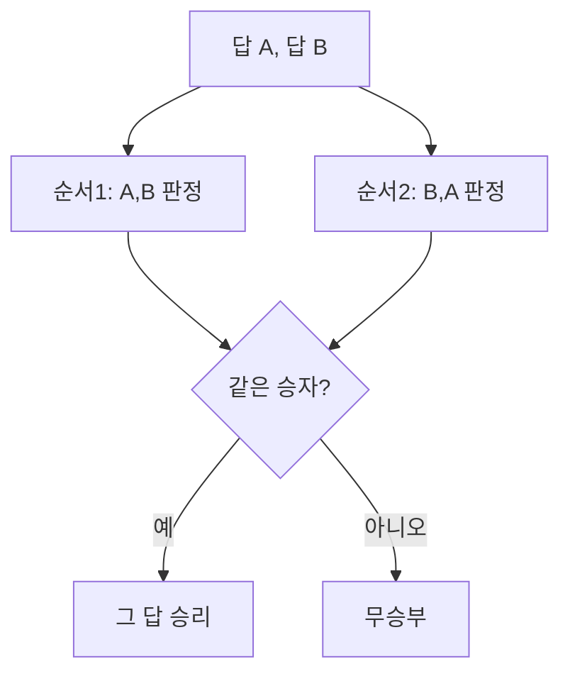

# 순서 교환 채점

> 두 답을 비교하는 LLM 심판에게 **순서를 바꿔 두 번 판정**시키고, **두 순서 모두에서 이긴 답만 승리**로 인정하는 방법. 일치하지 않으면 무승부로 처리한다. [위치 편향](#position-bias)의 가장 간단한 완화책이다.

## 쉽게 말하면
같은 두 후보를 한 번은 A·B 순으로, 한 번은 B·A 순으로 심사해서 두 번 다 이긴 쪽만 챔피언으로 인정하는 것이다. 자리 덕을 본 승리는 걸러진다.

## 자세히
Zheng 외 (arXiv 2306.05685, PDF 본문 직접 읽음):
- 보수적 방식: 심판을 두 번 호출하되 순서를 바꾸고, **두 순서에서 모두 선호된 답에만 승리를 부여**한다. 결과가 엇갈리면 무승부. 논문의 이후 실험은 이 방식을 사용했다.
- 공격적 방식: 위치를 **무작위로 배정**. 규모가 크면 기대값 차원에서 효과적이라고 한다.
- 효과 확인: 논문의 일치율 표(MT-bench 첫 턴)에서 S1은 무승부·불일치(위치 편향 때문)를 모두 포함하고 불일치를 무승부로 센다. S1에서 GPT-4 쌍 비교와 사람의 일치율은 66%(무작위 기준 33%), S2(무승부 제외)에서는 85%(무작위 기준 50%)였다. 이는 순서 교환으로 불일치를 무승부 처리한 결과이며 순서 교환 자체의 단독 효과를 분리한 수치는 아니다(내 해석 주의).
- 비용: 심판 호출이 **2배**로 늘어난다.
- 한계: 불일치가 많으면 무승부가 늘어 변별력이 떨어진다. 일관성이 곧 정확성은 아니다(논문도 지적).

## 그림으로 보기



## 예시
```python
r1 = judge(a, b); r2 = judge(b, a)   # r2는 승자 라벨을 뒤집어 해석
winner = r1 if r1 == flip(r2) else "tie"
```
- 교육: 직접 구현해 두 답 쌍 50개의 무승부 비율을 확인.

## 헷갈리는 것과 비교
| 개념 | 차이 |
|---|---|
| 순서 교환 | 두 번 호출해 일치할 때만 인정 |
| 위치 무작위화 | 한 번 호출, 위치를 섞어 평균화 |
| [위치 편향](#position-bias) | 이 방법이 줄이려는 문제 |

## 더 읽을거리
- [Judging LLM-as-a-Judge (arXiv 2306.05685)](https://arxiv.org/abs/2306.05685) — 3.4절 Swapping positions(읽음).
