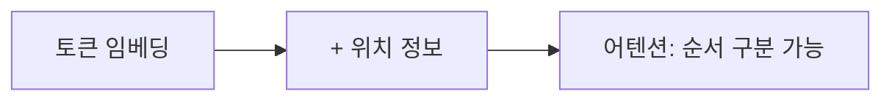
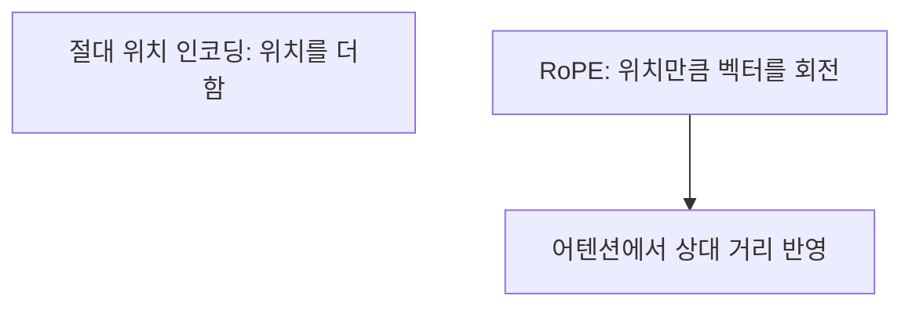

# 위치 인코딩

> 트랜스포머의 어텐션은 토큰을 **순서 없는 집합**처럼 다루므로, **위치 정보**를 따로 넣어 줘야 한다. 그 방법이 위치 인코딩이고 현재 널리 쓰이는 것이 **RoPE(회전 위치 임베딩)** 다.

## 쉽게 말하면
"개가 고양이를 쫓는다"와 "고양이가 개를 쫓는다"는 같은 단어가 순서만 다르다. 단어 카드를 섞어 놓으면 뜻을 알 수 없으니, 카드마다 "몇 번째인지" 표시를 달아 줘야 한다.

## 자세히
- **트랜스포머**(Vaswani 외, arXiv 1706.03762 초록 확인): 순환·합성곱 층을 버리고 **어텐션만**으로 구성한 모델. WMT 2014 영어→독일어 **28.4 BLEU**(앙상블 포함 이전 결과를 2 BLEU 넘게 앞섬), 영어→프랑스어 단일 모델 **41.8 BLEU**(GPU 8장 3.5일). 어텐션 자체는 순서를 알지 못하므로 위치 정보를 입력에 더해 준다(초록에는 방식이 없음, 논문은 사인·코사인 함수를 쓴다는 것은 일반 지식).
- **RoPE**(RoFormer, arXiv 2104.09864 초록 확인): 각 토큰의 **절대 위치를 회전**으로 인코딩하고, 어텐션 계산에서 **상대 거리**가 드러나게 한다. 시퀀스 길이에 유연하고 거리가 멀수록 토큰 간 의존성이 약해지는 성질이 있으며, 선형 어텐션에도 상대 위치 인코딩을 적용할 수 있다. 장문 분류 벤치마크에서 대안보다 낫다고 보고하며 Hugging Face에 통합됐다.
- 긴 컨텍스트 확장(일반 지식): 학습 길이를 넘는 입력은 위치 인코딩의 외삽 문제가 있어 스케일링 기법을 쓴다. 구체 방식은 이 글에서 확인하지 않았다.

## 그림으로 보기

## 예시
- "고양이가 개를 쫓는다" 문장에서 위치 인코딩을 끄면 주어·목적어를 구분하기 어렵다.
- 긴 문서 처리용 모델 설명서에서 "RoPE 기반 컨텍스트 확장"이라는 문구를 만났을 때 위치 인코딩의 한계를 완화하는 기법이라고 이해.

## 헷갈리는 것과 비교
| 개념 | 차이 |
|---|---|
| 위치 인코딩 | 순서 정보 주입 |
| 토큰 임베딩 | 토큰의 의미 벡터 |
| RoPE | 회전으로 상대 거리 반영 |
| [컨텍스트 윈도우](#context-window) | 처리 가능한 최대 길이 |

## 더 읽을거리
- [Attention Is All You Need](https://arxiv.org/abs/1706.03762)
- [RoFormer: Rotary Position Embedding](https://arxiv.org/abs/2104.09864)
