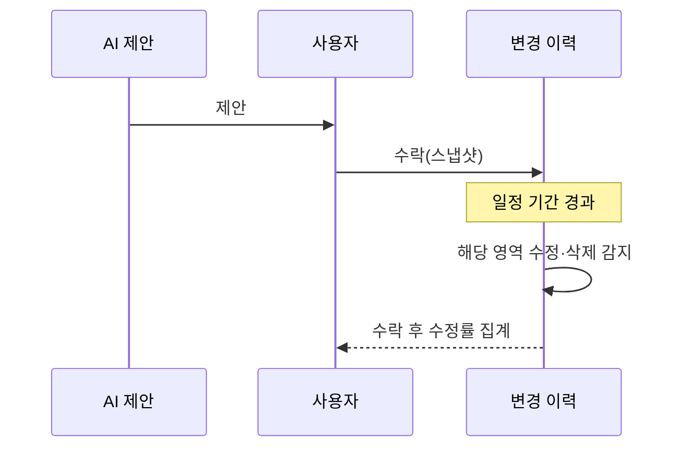

# 수락 후 수정률

> AI 제안을 수락한 뒤 나중에 그 부분을 고치거나 되돌린 비율. 수락 순간에는 좋아 보였지만 실제로는 품질이 부족했는지를 보는 사후 지표다.

## 쉽게 말하면
처음엔 괜찮아 보여 사 온 가구를 며칠 뒤 다시 손보게 되는 비율이다. 수락 직후 지표(수락률)만 보면 이런 후회가 보이지 않는다.

## 자세히
출처: Ziegler 외(arXiv 2205.06537) 초록 확인. 아래 정의와 활용은 이를 바탕으로 한 설계 설명이다.
- **정의**: 일정 기간(예: 수락 후 30분, 7일) 내에 수락된 제안 영역이 수정·삭제된 비율. 코드에서는 "수락한 완성이 시간이 지나도 남아 있는 정도(지속성)"의 반대 방향이다.
- **연구 결과**: GitHub Copilot 연구에서 사용자의 생산성 인식은 수락률과 연결됐고, 지속성 같은 더 세부적 지표는 그런 관계를 보이지 않았다. 즉 수락 후 지표는 인식과는 별개로 실제 품질을 보는 보완 지표로 쓸 수 있으나, 이 연구가 그 효과를 입증한 것은 아니다.
- **측정 설계**: 수락 시점 스냅샷 보관 → 이후 변경 이력과 비교 → 수정 범위를 [편집 거리](#edit-distance-metric)로 계산 → 기간별 곡선 작성. 일부 수정은 정상적 개선이므로 오류 수정과 단순 스타일 수정을 구분해야 한다.
- **해석**: 수락률 높음 + 수락 후 수정률 높음 → 품질 낮은 수락(과신 가능, [무수정 수락률](#accept-without-edit-rate)과 같이 본다). 수락 후 수정률 낮음 → 품질 양호 또는 수정 없이 방치(문서에서는 아무도 안 보면 낮게 나옴).
- 업무 문서(상담 요약 등)에서는 수락 후 감사에서 발견된 오류와 연결한다.

## 그림으로 보기

## 예시
- 코드 제안: 수락 후 7일 내 해당 줄이 수정된 비율 18% → 제안 유형별(테스트 코드, 경계 처리)로 나눠 약한 유형 파악.
- 상담 요약: 수락 후 감사에서 정정된 건 비율을 월별 추적.

## 헷갈리는 것과 비교
| 개념 | 차이 |
|---|---|
| 수락률 | 수락 순간 |
| 무수정 수락률 | 수락 시점 수정 여부 |
| 수락 후 수정률 | 수락 이후 사후 수정 |
| [제안 수락률](#suggestion-acceptance-rate) | 상위 개념 |

## 더 읽을거리
- [Productivity Assessment of Neural Code Completion](https://arxiv.org/abs/2205.06537) — 수락률과 지속성 지표(초록 확인)
