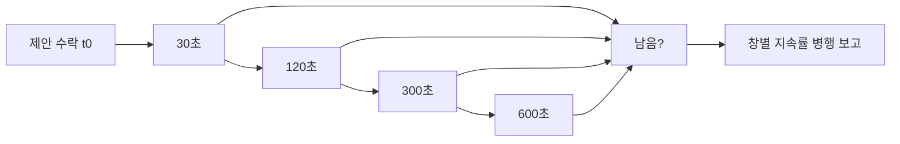

# 사후 관찰 기간 (Post-acceptance Window)

> AI 제안을 수락한 뒤 **얼마 동안 그 결과가 고쳐지거나 지워지는지를 지켜볼지** 정하는 기간. 너무 짧으면 곧 고쳐질 것을 놓치고, 너무 길면 다른 변경이 섞여 AI 제안의 영향을 가리기 어렵다.

## 쉽게 말하면
음식을 받고 30초 뒤에 "맛있다"고 하는 것과, 10분 뒤에도 접시가 비워져 있는지 보는 것은 다르다. 관찰 기간이 짧을수록 첫인상만, 길수록 실제로 쓰였는지를 본다.

## 자세히
출처: Ziegler 외, GitHub Copilot 생산성 연구(arXiv 2205.06537, ar5iv HTML 본문 확인, 2026-11-18). 이 연구는 코드 완성에 대한 것이며, 다른 업무에서 같은 기간이 적절하다는 근거는 아니다.
- **연구의 창**: 수락된 제안이 **30초, 120초, 300초, 600초** 뒤에도 변경 없이 남는지(unchanged_X), 편집 거리 33% 미만으로 조금만 수정되어 남는지(mostly_unchanged_X)를 측정했다([지속성 지표](#persistence-metric)).
- **창이 길어질수록 상관이 약해짐**: 인식 생산성과의 스피어먼 상관이 mostly_unchanged_30_per_shown 0.23, mostly_unchanged_120_per_shown 0.23, unchanged_30_per_shown 0.21, unchanged_600_per_shown 0.17로 나타났다. 논문은 지속 지표가 모두 수락률(0.24)보다 상관이 약했고 창이 길수록 약해졌다고 서술한다. 수락당 지속률로 보면 unchanged_30 0.06, unchanged_600 −0.00.
- **창이 짧으면**: 수락 직후 곧 고치는 경우를 놓친다. 창이 길면: 이후의 다른 편집, 리팩터링, 요구사항 변경이 섞여 "제안이 쓸모없어서 고친 것"과 구분이 어렵다(해석).
- **설계 기준(제안)**: ①업무의 자연스러운 검토·수정 주기에 맞춘다(채팅 답변은 수 분, 요약은 당일, 문서는 수일). ②여러 창(짧음·중간·긴)을 함께 보고하고 한 창에만 의존하지 않는다 ③창이 닫히지 않은 최근 데이터는 집계에서 제외([측정 창 72시간](#measurement-window)의 성숙도 가드와 같은 원리) ④자동 포맷팅·린트가 만든 변경은 제외 ⑤창을 중간에 바꾸지 않는다.
- **무엇을 "수정"으로 셀지**: 편집 거리 임계값(33% 등)을 쓰되 공백·문장부호를 정규화한다([정규화 편집 거리](#normalized-edit-distance)).
- **한계**: 논문에서 지속성 지표는 생산성 인식과의 상관이 약했다. 지속성은 인식이 아니라 별개의 정보(실제 사용)를 담을 수 있으나 그 가치는 이 자료에서 검증되지 않았다.

## 그림으로 보기

## 예시
| 창 | 수락 100건 중 변경 없이 남은 수(가상) | 지속률 |
|---|---|---|
| 30초 | 62 | 0.62 |
| 120초 | 54 | 0.54 |
| 600초 | 41 | 0.41 |
(표는 계산 양식 예시이며 실제 값이 아니다.) 창이 길수록 낮아지는 패턴은 가정일 뿐 연구에서 이런 값이 보고된 것은 아니다.
교육 활용: AI 도구 평가 설계에서 "어떤 기간 뒤에 무엇을 볼지"를 먼저 정하는 계획서 작성 실습.

## 헷갈리는 것과 비교
| 개념 | 차이 |
|---|---|
| 사후 관찰 기간 | 수락 후 지켜보는 시간 길이 |
| [측정 창 72시간](#measurement-window) | 해결 인정을 위한 관찰 기간(상담 지표) |
| [지속성 지표](#persistence-metric) | 창 안에서 남은 비율 |
| [수락 후 수정률](#post-acceptance-edit-rate) | 수락 뒤 고친 비율 |

## 더 읽을거리
- [Ziegler 외 arXiv 2205.06537](https://arxiv.org/abs/2205.06537) — 30·120·300·600초 창과 상관 결과
- [ar5iv HTML 판](https://ar5iv.labs.arxiv.org/html/2205.06537) — 측정 정의와 표
