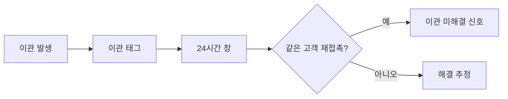
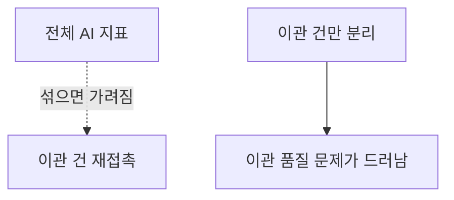

# 이관 후 재접촉률

> 사람에게 이관된 대화의 고객이 24시간 안에 다시 문의하는 비율이다. 이관이 실제로 문제를 풀었는지 보는 지표이며, 전체 AI 지표와 **분리해서** 봐야 이관 품질 문제가 묻히지 않는다.

## 쉽게 말하면
병원에서 전문의에게 넘겨졌는데 다음 날 같은 증상으로 다시 접수한다면, 넘겨진 것 자체는 성공이었어도 치료는 실패한 것이다. 재접수 비율이 "넘김의 결과"를 보여 준다.

## 자세히
- **정의(channel.tel 글 확인)**: 에스컬레이션 후 24시간 안에 고객이 해결이 안 돼서 다시 연락하는 비율.
- **추적 방법**: 이관된 대화에 태그를 달고, 같은 고객이 24시간 안에 다시 지원팀에 연락했는지 확인한다. AI 전체 지표와 분리해 본다.
- **임계값 주장**: 같은 글은 20~25%를 넘으면 이관이 문제를 못 푼다는 강한 신호라고 하지만 데이터셋·연구·벤치마크 출처가 없다. 글쓴이(벤더)의 주장이므로 절대 기준으로 쓰지 말고 **자사 기준선을 먼저 측정**한 뒤 판단한다.
- **창 길이 선택**: 24시간은 이관 직후의 "맥락 손실·미해결"을 잡는 짧은 창이다. 더 길게 보려면 [반복 접촉 창](#repeat-contact-window)의 7~14일 지표와 함께 본다(두 창은 보는 실패가 다르다).
- **고객 식별**: 다른 채널로 다시 올 수 있으므로 채널 간 고객 식별이 필요하다([지연 재접촉](#deferred-contact)).
- **해석 주의**: 재접촉이 항상 실패는 아니다 — 고객이 확인차 연락하거나 상담사가 후속 연락을 약속한 경우도 있다. 사유 태그로 "같은 문제"만 센다.
- **짝지을 지표**: [이관 성공률](#transfer-success-rate)의 다른 항목(반복 설명률, 첫 의미 있는 응답 시간, 이관 건 CSAT 격차).

## 그림으로 보기

## 예시
- 주간 보고: "이관 건 24시간 재접촉 18%, 비이관 건 6%" 식으로 두 집단을 나란히.
- 재접촉 건 20개를 읽어 원인을 분류: 맥락 손실 / 약속한 후속 연락 미이행 / 확인차 문의.

## 헷갈리는 것과 비교
| 개념 | 차이 |
|---|---|
| 이관 후 재접촉률 | 이관 건의 24시간 내 재연락 |
| [반복 접촉 창](#repeat-contact-window) | 전체 접촉의 7~30일 재접촉 |
| [지연 재접촉](#deferred-contact) | 봉쇄 후 다른 채널 재접촉 |
| [이관 성공률](#transfer-success-rate) | 재접촉률은 그 구성 지표 중 하나 |

## 더 읽을거리
- [channel.tel: 에이전트-사람 이관 맥락 패키지](https://www.channel.tel/blog/agent-human-handoff-context-package) — 24시간 재접촉 정의와 임계값 주장(직접 열어 확인, 벤더 글, 임계값 근거 없음).
- [Twig: 이관은 얼마나 매끄러운가](https://www.twig.so/blog/how-smooth-is-handoff-from-ai-to-live-agent) — 이관 오탐·미탐 관점(벤더, 본문 미열람).
