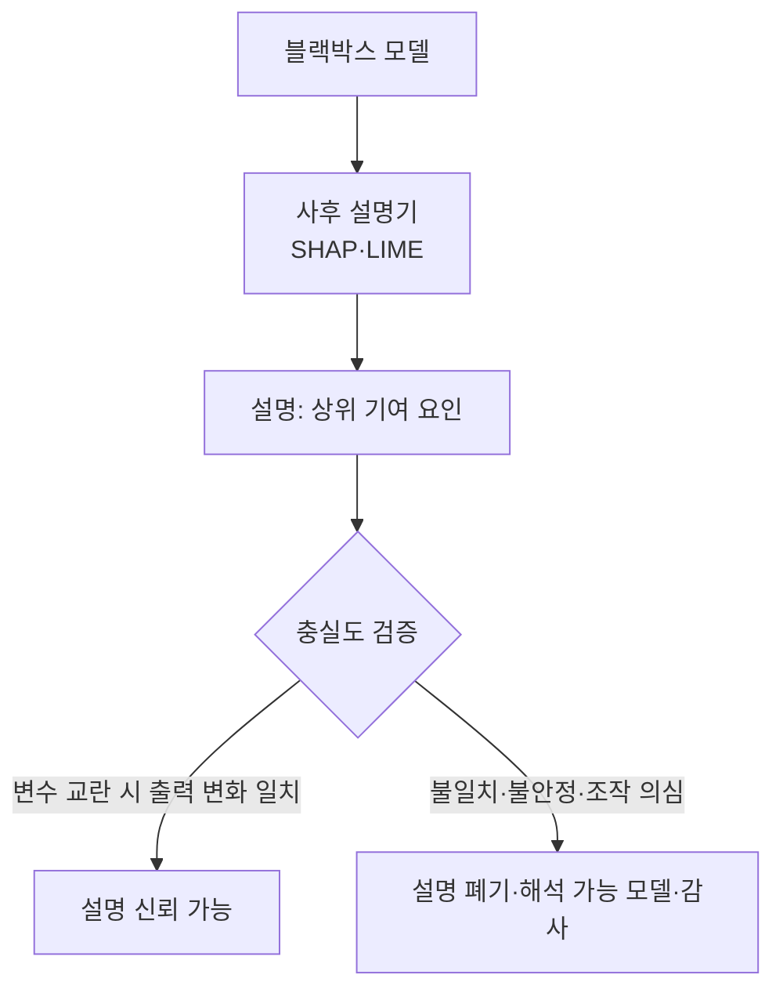

# 사후 설명의 정확도 검증

> 학습이 끝난 모델을 SHAP·LIME 같은 방법으로 **사후에 설명**할 때, 그 설명이 모델의 실제 동작을 충실히 반영하는지(충실도, fidelity) 따로 검증해야 한다. 설명이 그럴듯해도 틀리거나 조작될 수 있기 때문이다.

## 쉽게 말하면
회계 감사 보고서를 회사가 직접 쓰게 두면 보기 좋게 꾸밀 수 있다. 모델 설명도 설명 도구가 "이렇게 판단했다"고 보여 주는 것일 뿐, 모델 내부 그 자체가 아니다. 설명이 실제와 맞는지 확인하는 단계가 필요하다.

## 자세히
출처: Slack 외, "Fooling LIME and SHAP: Adversarial Attacks on Post hoc Explanation Methods"(arXiv 1911.02508, 2019-11 제출, 2020-02 개정, 초록 열어서 읽음), Rudin, "Stop Explaining Black Box Machine Learning Models for High Stakes Decisions and Use Interpretable Models Instead"(arXiv 1811.10154, 2018, Nature Machine Intelligence 2019-05, 초록 열어서 읽음), Molnar SHAP 장(앞서 읽음).
- **조작 가능성(Slack 외)**: 입력 교란 기반 사후 설명(LIME, SHAP)은 신뢰하기 어렵다. 저자들은 "비계(scaffolding)" 기법으로, 실제 데이터에서는 편향된 예측을 유지하면서 설명에는 무해해 보이는 이유가 나오게 하는 분류기를 만들 수 있음을 보였다. COMPAS를 포함한 여러 실제 데이터셋에서 LIME과 SHAP 모두 속았다.
- **대안 주장(Rudin)**: 고위험 의사결정에서는 블랙박스를 설명하기보다 처음부터 **해석 가능한 모델**을 쓰라고 주장한다. 설명 가능한 블랙박스가 나쁜 관행을 지속시키고 심각한 해를 부를 수 있다는 논지다. 초록만 읽었고 충실도에 대한 구체적 논거는 본문을 열지 못해 확인하지 못했다.
- **SHAP 해설서의 주의(Molnar)**: SHAP 설명은 조작되어 편향을 숨길 수 있어, 설명을 받는 쪽이 진실성을 완전히 검증할 수 없다고 적는다.
- **검증 아이디어(일반 정리, 위 출처의 직접 서술이 아님)**:
  - **충실도 점검**: 설명이 가리킨 변수를 바꿨을 때(예: 상위 기여 변수 교란) 모델 출력이 설명대로 변하는지 확인한다.
  - **일관성 점검**: 비슷한 입력에 설명이 안정적인지, 시드·표본에 따라 흔들리지 않는지 본다([SHAP 안정성 확인](#shap-stability-check)).
  - **내재적 해석 모델과의 대조**: 간단한 해석 가능 모델(선형·규칙·단조 제약 모델)과 설명 결과를 비교한다.
  - **독립 감사**: 설명 대상 모델에 접근 가능한 제3자가 점검한다.
- **규제 맥락**: 불리한 조치 통지의 "실제 이유" 요건(Reg B 1002.9(b)(2) 해설: 이유는 실제 고려·점수화된 요인을 정확히 설명해야 함)은 사후 설명의 정확도 문제와 직결된다([샘플 양식 체크리스트](#sample-forms-checklist)).

## 그림으로 보기

## 예시
- 대출 거절 통지에 쓰는 SHAP 상위 요인이 실제로 모델 출력을 좌우하는지, 해당 변수를 평균값으로 바꿨을 때 점수가 설명만큼 변하는지 표본 확인.
- 보호 속성의 대리 변수가 모델에선 쓰이는데 설명에는 나타나지 않는지 별도 점검([대리 변수](#proxy-variable-credit)).

## 헷갈리는 것과 비교
| 개념 | 차이 |
|---|---|
| 사후 설명 | 학습 뒤 모델을 해석하는 도구, 충실도 문제가 있음 |
| 내재적 해석 모델 | 구조 자체가 해석 가능(Rudin의 권고) |
| [SHAP 오해와 조작](#shap-misinterpretation) | SHAP 해석 오류의 구체적 위험 |
| [전역 vs 지역 설명](#global-vs-local-explanation) | 설명의 범위 구분 |

## 더 읽을거리
- [Fooling LIME and SHAP (arXiv 1911.02508)](https://arxiv.org/abs/1911.02508) — 설명 조작 공격(초록 확인)
- [Stop Explaining Black Box Models for High Stakes Decisions (arXiv 1811.10154)](https://arxiv.org/abs/1811.10154) — 해석 가능 모델 주장(초록 확인)
