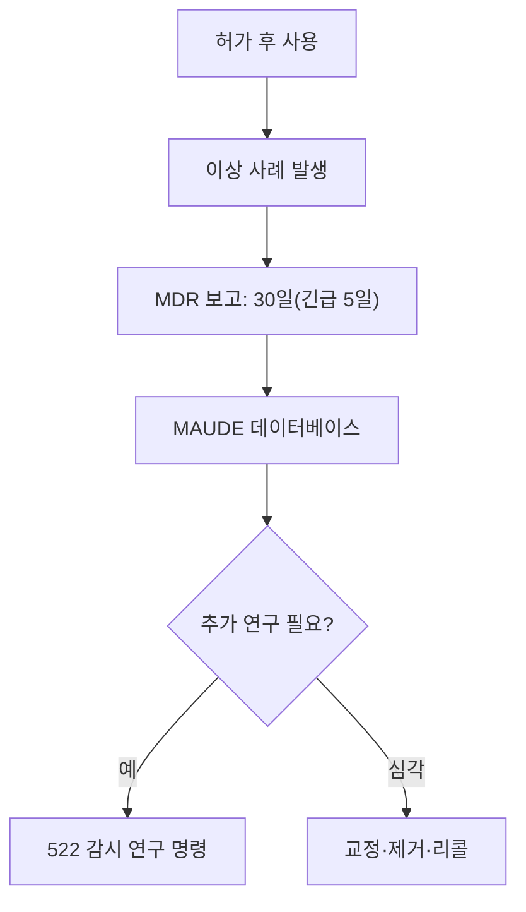

# 시판 후 감시

> 의료기기가 허가돼 시장에 나온 뒤 안전·성능 문제를 계속 수집·분석하는 제도. 미국에서는 의무 이상 사례 보고(MDR), MAUDE 데이터베이스, FDA가 명령하는 522 시판 후 감시 연구 등이 있다.

## 쉽게 말하면
신차 출시 후에도 사고·결함 신고를 모으는 센터가 있는 것과 같다. 시험 단계에서 못 본 문제는 실제 도로에서 드러난다.

## 자세히
출처: 규제 해설·컴플라이언스 가이드 검색 요약. 기한과 조건은 21 CFR Part 803·806·822와 FDA 최신 안내로 확인 필요.
- **MDR(의무 이상 사례 보고)**: 제조사는 문제를 인지한 뒤 30일 이내(긴급 5일) 보고한다는 해설. 모든 MDR 보고는 MAUDE 데이터베이스에 반영된다.
- **교정·제거(21 CFR 806)**: 위험 감소를 위한 교정·제거는 10영업일 이내 보고(MDR과 별개, 해설 인용).
- **522 시판 후 감시**: II·III류 기기가 기준에 해당할 때 FDA가 최대 36개월 감시 연구를 요구할 수 있고, 21 CFR 822.8에 따라 계획은 명령 수령 30일 이내 제출. 불이행 시 기기는 허위 표시(misbranded)로 본다(RAPS 가이드 요약).
- **AI 의료기기**: FDA 허가 AI/ML 기기가 2024년 중반 950개 이상이라는 보도, FDA가 시판 후 성능 모니터링 계획을 기술하게 하는 초안 지침을 냈다는 해설이 있으나 최종 여부는 확인하지 못했다. 허가된 AI의 다수는 견고한 전향적 시판 후 데이터가 부족하다는 RAPS 연구 언급이 있다. 2025-09 Paragon 연구소 보고서는 모든 AI가 예측 불가는 아니므로 표적형 민관 감시를 제안.
- **PCCP와의 관계**: 변경 후 안전·효과를 보는 감시 전략이 [수정 프로토콜](#modification-protocol)에 들어간다. 운영 지표는 [드리프트 모니터링](#model-drift-monitoring).
- 리콜 사례는 [AI 기기 리콜](#ai-device-recalls).

## 그림으로 보기

## 예시
- AI 영상 소프트웨어가 특정 장비에서 오검출이 늘면 병원이 제조사에 신고 → 제조사 MDR 보고 → MAUDE에 기록 → 필요 시 업데이트·리콜.
- 제조사 내부: 사용자 신고와 성능 지표를 월간 점검하는 감시 계획 수립.

## 헷갈리는 것과 비교
| 개념 | 차이 |
|---|---|
| MDR | 이상 사례 의무 보고 |
| MAUDE | 보고 데이터베이스 |
| 522 | FDA가 요구하는 감시 연구 |
| 리콜 | 시정·회수 조치 |

## 더 읽을거리
- [RAPS: Postmarket Requirements for Medical Devices](https://library.raps.org/postmarket-requirements/44) — 시판 후 요건 실무 가이드(검색 결과로만 확인)
- [AI Post-Market Surveillance: Locked vs Continuous Learning](https://intuitionlabs.ai/articles/post-market-surveillance-ai-locked-continuous-learning) — AI 감시 논의(검색 결과로만 확인)
