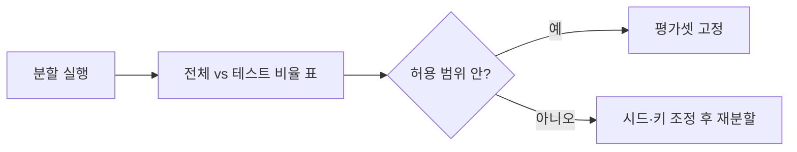
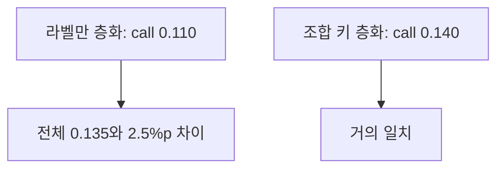

# 분할 후 분포 점검

> 분할 후 분포 점검은 학습·테스트 세트로 나눈 직후, 라벨과 주요 속성(출처 등)의 비율이 전체와 비슷하게 유지됐는지를 `crosstab` 같은 표로 확인하는 절차다. 층화 옵션을 줬더라도 결과를 눈으로 확인한다.

## 쉽게 말하면
조 편성을 마친 뒤 "각 조에 남녀 비율, 학년 비율이 골고루 들어갔나"를 명단으로 한 번 훑어보는 일이다. 규칙대로 뽑았어도 결과를 확인해야 실수를 잡는다.

## 자세히
- **직접 실행한 점검(pandas·scikit-learn 1.9.1, 가상 400건)**: 라벨만으로 층화해 분할한 테스트 세트의 출처 비율은 web 0.510, app 0.330, call 0.110, store 0.050으로 전체(0.500, 0.315, 0.135, 0.050)와 call에서 약 2.5%p 차이가 났다. 라벨+출처 조합 키로 층화하면 0.500, 0.310, 0.140, 0.050으로 거의 같았다([조합 키 만들기](#combined-stratification-key)). 이런 차이는 `test.source.value_counts(normalize=True)`를 전체와 나란히 비교해야 보인다.
- **점검 항목(해석)**: ① 라벨별 학습·테스트 개수와 비율 ② 중요한 속성별(출처·기간·지역) 비율 ③ 라벨 × 속성의 `pd.crosstab`에서 빈 칸(0개) ④ 테스트에 한 번도 안 나온 클래스([test_size와 클래스 수 규칙](#stratify-test-size-rule)) ⑤ 멀티라벨이면 라벨별·라벨 쌍별 개수([Iterative stratification](#iterative-stratification)).
- **코드 모양(해석)**:

```python
pd.concat([df.source.value_counts(normalize=True).rename("전체"),
           test.source.value_counts(normalize=True).rename("테스트")], axis=1)
pd.crosstab(test.label, test.source)
```

- **허용 기준(해석)**: 전체 비율과 ±몇 %p 이내인지 사전에 정한다(예: ±3%p). 기준을 넘으면 시드나 층화 키를 바꿔 다시 나눈다. 단, 테스트 결과를 보고 계속 분할을 바꾸면 선택 편향이 생기므로 점검은 라벨·속성 분포만으로 한다.
- **기록(해석)**: 분할 시드·키·점검 표를 저장해 재현할 수 있게 한다([평가셋 고정](#evaluation-set-freeze)).

## 그림으로 보기



## 예시
- 분할 직후 `pd.crosstab(test.label, test.source)`에서 0이 있는 칸을 찾아 층화 키를 조정한다.
- 교육 활용: 분할을 시드 5개로 반복해 비율 차이의 범위를 표로 만든다.

## 헷갈리는 것과 비교
| 개념 | 차이 |
| --- | --- |
| 분할 후 점검 | 결과 분포 확인 |
| 층화 옵션 | 분할할 때 비율 유지를 시도 |
| [조합 키 만들기](#combined-stratification-key) | 점검에서 어긋난 속성을 키에 포함 |
| [평가셋 고정](#evaluation-set-freeze) | 점검 통과 후 고정 |

## 더 읽을거리
- [pandas Boolean indexing 가이드](https://pandas.pydata.org/docs/user_guide/indexing.html#boolean-indexing) — 조건 선택
- [scikit-learn Cross-validation 가이드](https://scikit-learn.org/stable/modules/cross_validation.html) — 층화 분할기
