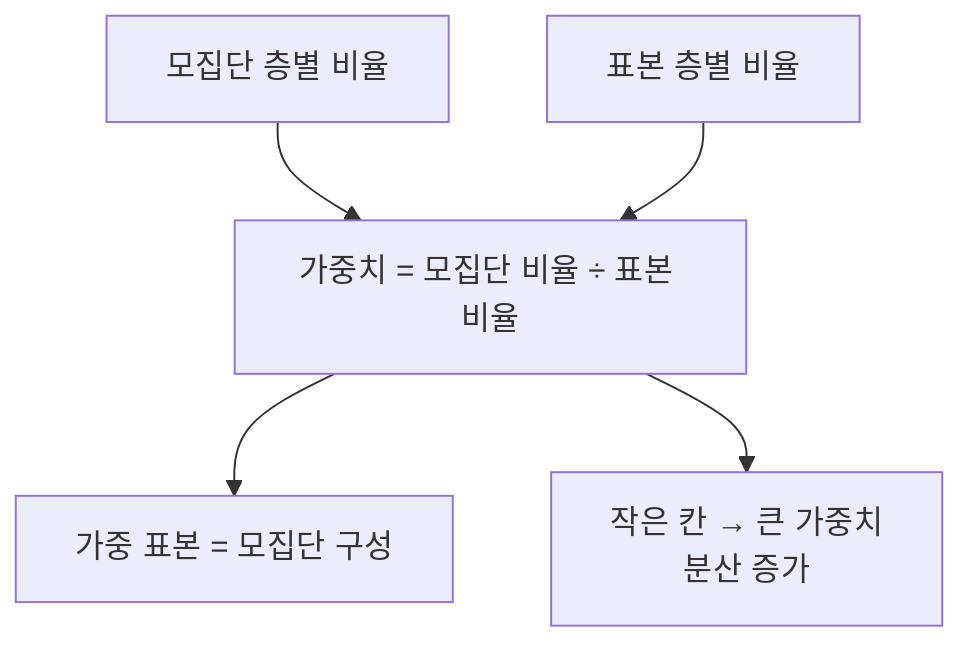
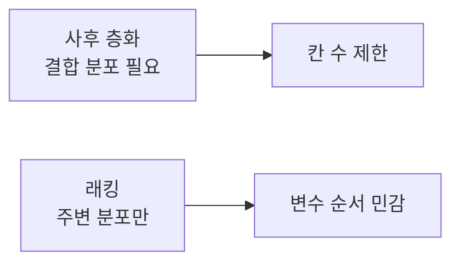

# 사후 층화 가중

> 표본을 뽑은 **뒤에** 모집단의 층(strata)별 비율에 맞도록 각 응답자에게 가중치를 주어, 표본의 구성을 모집단과 같게 보정하는 방법이다. 무응답·수집 편향으로 표본이 쏠렸을 때 쓴다.

## 쉽게 말하면
학급 투표에서 여학생이 70%나 참여했는데 실제 학급은 남녀 반반이라면, 남학생 한 표를 더 크게, 여학생 한 표를 작게 세어 반반으로 맞춘다. 단, 남학생이 한두 명뿐인데 그 표를 크게 부풀리면 그 한 명의 의견이 결과를 좌우해 위험하다.

## 자세히
(Meta 연구진의 `balance` 패키지 논문 arXiv 2307.06024의 3.3절 본문과 부록의 Kish 설계 효과를 PDF에서 직접 읽었다. Pew의 가중 방법 설명은 래킹 중심이라 셀 가중 정의는 거기서 확인하지 못했다.)
- **아이디어(논문)**: 원래는 층화 표집에서 나온 개념이지만, 사후 층화는 층화를 **표본을 뽑은 뒤**에 한다. 무응답처럼 표집 설계 밖 메커니즘에서 생긴 오차를 보정하기 위해서다. 모집단의 각 칸(층)이 차지하는 비율을 구하고, 표본의 각 층이 같은 비율이 되도록 가중치를 맞춘다.
- **공식(논문 식 2)**: 층 H의 모집단 비율을 P_H, 표본 크기를 n, 표본 안 층 H의 응답자 수를 n_H, "팽창 계수" I = N/n(전체 모집단 크기/표본 크기)라 할 때 층 H에 속한 모든 응답자 i의 가중치는 **w_i = P_H × (n / n_H) × I**. I를 곱하는 것은 가중치를 모집단 크기에 맞추려는 임의 선택이라 생략할 수 있다고 논문이 적는다. 즉 핵심은 **모집단 비율 ÷ 표본 비율**이다(예: 모집단 50%, 표본 25% → 가중치 2).
- **요구 조건(논문)**: 표본이 모집단의 **결합 분포**와 정확히 같아지도록 맞추므로, 가중에 쓸 변수들의 결합 분포를 알아야 한다. 주변(marginal) 분포만 알면 **래킹(raking, 반복 비례 적합)** 을 대안으로 쓴다.
- **한계(논문)**: ① 쓸 수 있는 변수 수가 제한된다. 어떤 칸에 응답자가 거의 없으면 소수가 매우 큰 가중치를 받아 **분산이 부푼다** ② 연속 변수는 구간을 어떻게 나눌지 정해야 한다. 더 일반적인 대안으로 역성향점수 가중(IPW)을 소개한다.
- **래킹과의 차이(논문)**: 래킹은 변수별 주변 분포만으로 사후 층화를 변수 순서대로 반복해 수렴시킨다. 결합 분포를 재현하지 못하므로 하위 집단(예: 청년층만) 추론에는 덜 권장되고, 변수 순서에 민감해 일부 변수가 덜 보정될 수 있다. Pew도 래킹이 변수별 주변 비율만 필요하다고 설명한다(직접 읽음, 예: 성별 48:52, 학력 40/31/29%).
- **가중의 대가: 설계 효과(Kish, 논문 부록)**: Deff = n·Σw² / (Σw)², 유효 표본 크기 비율 ESSP = 1/Deff. 가중치 편차가 클수록 유효 표본이 줄어든다. 이 공식은 가중치와 결과 변수가 상관 없다는 가정(haphazard weights) 하의 근사다.
- **ML 연결(해석)**: 학습 데이터가 대상 집단과 다르게 수집됐을 때 샘플 가중치로 보정하는 아이디어와 통한다. 단 이 글의 출처는 서베이 통계 맥락이며 ML 학습에 그대로 적용된다는 근거를 확인한 것은 아니다.

## 그림으로 보기

## 예시
| 층 | 모집단 | 표본 | 가중치(비율비) |
|---|---|---|---|
| 20대 | 20% | 40% | 0.5 |
| 60대 이상 | 20% | 5% | 4.0 |
(표본이 60대 이상 20명뿐이라면 이 20명이 4배 가중되어 분산이 커진다. 예시 수치)
- 교육 소재: 설문 응답자가 한쪽에 쏠렸을 때 결과를 어떻게 보정하고 무엇을 잃는지 토론.

## 헷갈리는 것과 비교
| 개념 | 차이 |
|---|---|
| 사후 층화 | 층별 비율 맞추기(결합 분포 필요) |
| 래킹 | 변수별 주변 분포만으로 반복 보정 |
| [데이터 대표성](#data-representativeness) | 보정하려는 목표 상태 |
| [역확률 가중 보정](#inverse-probability-weighting-logs) | 선택 확률의 역수로 가중하는 방식 |

## 더 읽을거리
- [balance: a Python package for balancing biased data samples (arXiv 2307.06024)](https://arxiv.org/pdf/2307.06024) — 사후 층화·래킹·IPW와 Kish 설계 효과(PDF 직접 읽음).
- [How different weighting methods work (Pew Research)](https://www.pewresearch.org/methods/2018/01/26/how-different-weighting-methods-work/) — 래킹 설명(직접 읽음).
