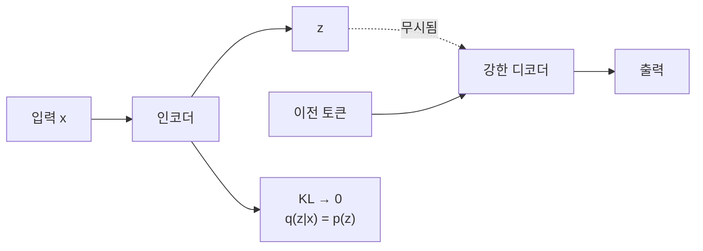

# 사후 붕괴(posterior collapse)

> 사후 붕괴는 VAE에서 인코더가 내는 사후 분포 q(z|x)가 사전 분포 p(z)와 같아져, 잠재 변수 z가 입력 정보를 전혀 담지 못하게 되는 현상이다. 디코더가 z를 무시하고 혼자 데이터를 만든다.

## 쉽게 말하면
번역가에게 요약 메모(z)를 건네고 번역을 시키는데, 번역가가 너무 유능해서 메모를 안 보고 혼자 추측해 쓰기 시작한다. 메모 작성자는 "어차피 안 읽네" 하며 백지만 낸다. 메모에 정보가 하나도 없는 상태가 사후 붕괴다. 문장을 한 단어씩 만드는 강력한 디코더(텍스트 VAE)에서 특히 잘 생긴다.

## 자세히
- 진단: 학습 후 입력 대부분에서 KL(q(z|x) ‖ p(z)) ≈ 0이다. 재구성은 되는 듯해도 z를 바꿔도 출력이 안 변한다.
- 원인: [ELBO](#elbo)의 KL 항이 q를 p(z)로 끌어당기는데, 디코더가 z 없이도 손실을 낮출 수 있으면 "KL=0"이 안정한 지역 최적(local optimum)이 된다. Dai 외(2019)는 KL뿐 아니라 깊은 오토인코더의 지역 최솟값 문제도 원인이라고 본다.
- 처방:
  - **KL annealing**(Bowman 외 2016): 학습 초반엔 KL 가중치를 0에서 시작해 서서히 1로 올린다. 단독으로는 충분하지 않다는 2019년 연구가 있다.
  - **free bits**(Kingma 외 2016): KL을 max(목표 r, KL)로 바꿔 처음 r nats는 공짜로 쓰게 한다.
  - **[β-VAE](#beta-vae)에서 β<1**: KL 가중치를 줄인다. 너무 낮으면 사후가 점 추정에 가까워진다.
  - **조합**: Li 외(2019)는 KL annealing + KL thresholding + 인코더를 오토인코더 목적으로 사전학습하는 방식이 가장 효과적이라고 보고했다.
  - 디코더를 약하게 만들기(디코더 dropout·단어 가리기)도 쓰인다(일반적 기법).
- 확산 모델·VQ-VAE가 인기를 얻은 이유 중 하나가 이 불안정을 피하기 위해서라는 해석이 있다(주장).

## 그림으로 보기


## 예시
학습 로그에서 KL 항 곡선이 0 근처로 붙으면 붕괴를 의심한다.
```python
beta = min(1.0, step / 10000)        # KL annealing
loss = recon + beta * kl.clamp(min=0.5)   # free bits 비슷한 하한(근사)
```

## 헷갈리는 것과 비교
| 개념 | 차이 |
| --- | --- |
| 사후 붕괴 | z가 정보를 안 담음(KL≈0) |
| 모드 붕괴(GAN) | 생성물이 몇 종류로 쏠림 — 다른 문제 |
| [β-VAE](#beta-vae) | KL 가중치 β 조절로 분리·붕괴 균형 |
| [VAE KL 항](#vae-kl-term) | 붕괴를 만드는 정규화 항 |

## 더 읽을거리
- [A Surprisingly Effective Fix for Deep Latent Variable Modeling of Text](https://arxiv.org/abs/1909.00868) — 사후 붕괴를 "disastrous local optimum"이라 부르고 휴리스틱 조합을 제안
- [Effective Estimation of Deep Generative Language Models](https://arxiv.org/abs/1904.08194) — KL annealing·free bits 정리(검색 결과로 확인)
