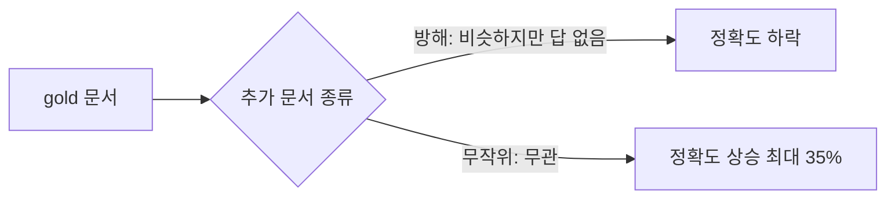

# 무작위 문서의 역설(power of noise)

> RAG 프롬프트에 **질문과 무관한 무작위 문서를 더 넣었더니** 정확도가 **최대 35%** 올랐다는 반직관적 발견이다(Cuconasu 외 2024). 반면 의미적으로 가깝지만 답이 없는 문서는 해로웠다.

## 쉽게 말하면
참고서를 펼쳐 풀 때 "답은 없지만 주제가 비슷한 책"은 오히려 헷갈리게 하는데, "전혀 상관없는 책"이 섞여 있으면 의외로 덜 헷갈린다는 것이다. 이유는 아직 모른다.

## 자세히
(Cuconasu 외, "The Power of Noise: Redefining Retrieval for RAG Systems"(SIGIR 2024, arXiv 2401.14887 v4) PDF를 직접 읽었다. 7B급 이하 모델과 NQ-open 데이터 기준이며 최신 대형 모델에는 그대로 일반화되지 않을 수 있다.)
- **문서 3종(논문)**: **관련**(gold: 답이 들어 있는 문서), **방해**(distracting: 질문과 의미상 가깝지만 답이 없음), **무작위**(random: 질문과 무관하고 답도 없음).
- **데이터·모델(논문)**: NQ-open. 검색기는 Contriever(BM25로 재검증). LLM: **Llama2-7B, Falcon-7B, Phi-2(2.7B), MPT-7B**(4비트). 정확도는 정답 문자열 포함 기준.
- **발견 1(논문)**: 관련 문서는 **질문 가까이**에 둬야 한다. 멀리 두면 모델이 주의를 못 준다.
- **발견 2(논문)**: 검색기의 **상위 점수인데 답이 없는 문서**를 넣으면 LLM 효과가 **나빠진다**.
- **발견 3(논문)**: **무작위 문서를 올바른 위치(near)에 더하면 정확도가 올라간다 — 최대 35%.** 닫힌 책(closed-book) 정확도가 Llama2 0.1123, MPT 0.1205, Phi-2 0.0488, Falcon 0.1083이었다. 통계 유의성은 Wilcoxon 검정(p<0.01).
- **BM25 재현(논문)**: BM25에서도 무작위 문서가 이득이며 평균 **3~4%p** 상승. top-k 정확도는 BM25(k=1,2,4,10: 0.2966, 0.4105, 0.5237, 0.6663)가 Contriever(0.2502, 0.3569, 0.4784, 0.6085)보다 높았다.
- **균형(논문)**: 관련 문서는 반드시 있어야 하고, 검색 문서가 너무 많으면 방해 문서가 늘어 급락한다. 질문 3~5개 문서를 최소로 가져온 뒤 컨텍스트 한도까지 무작위로 채우는 것이 가장 효과적이었다. 원인을 설명하는 이론은 **아직 없다**.
- **해석 주의(해석)**: 현장에서 "무작위 문서를 일부러 넣자"로 곧바로 옮기기 전에 자기 모델·데이터로 시험해야 한다.

## 그림으로 보기

## 예시
- 사내 Q&A에서 top-3 검색 + 무작위 문서 2개를 질문과 가까운 쪽에 넣는 변형을 A/B 시험(제안, 논문 가설의 재현 실험).

## 헷갈리는 것과 비교
| 문서 유형 | 효과(논문) |
|---|---|
| gold | 필수, 질문 가까이 |
| 방해(distracting) | 해로움 |
| 무작위(random) | 올바른 위치에서 이득 |
| [방해 문서](#distractor-documents) | 상위 개념 |

## 더 읽을거리
- [Cuconasu et al. (2024) — The Power of Noise](https://arxiv.org/abs/2401.14887) — 직접 읽음.
