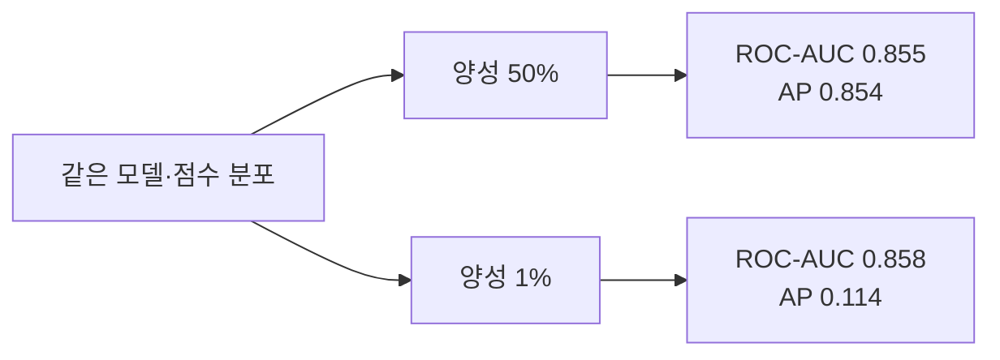
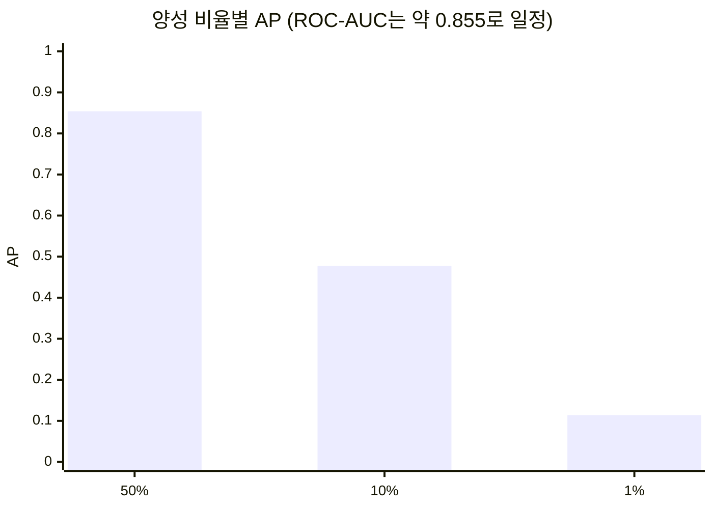

# PR 곡선 vs ROC(불균형)

> **ROC-AUC는 양성 비율이 변해도 거의 그대로**인 반면, **PR 곡선(평균 정밀도 AP)은 양성 비율에 따라 크게 변한다.** 양성이 드문 문제에서는 PR이 "경보가 실제로 쓸모 있는가"를 더 정직하게 보여 준다.

## 쉽게 말하면
화재경보기가 "불난 집 90%를 잡고, 안 난 집 5%에서 오작동"한다고 하자. ROC는 이 두 비율만 보니 어디서나 좋아 보인다. PR은 "울린 경보 중 진짜 불의 비율"을 묻기 때문에, 불이 거의 안 나는 동네에서는 훨씬 나쁜 점수를 낸다.

## 자세히
- **직접 실행**(numpy·scikit-learn 1.9.1: 같은 점수 분포를 쓰되 양성 비율만 변경, 표본 200,000개; 양성 점수 = 음성 분포 + 1.5):

| 양성 비율 | ROC-AUC | 평균 정밀도(AP) | AP 기준선(무작위) |
|---|---|---|---|
| 50% | 0.855 | 0.854 | 0.502 |
| 10% | 0.854 | 0.477 | 0.100 |
| 1% | 0.858 | 0.114 | 0.010 |

  모델 품질(점수 분포)이 같은데 ROC-AUC는 약 0.855로 일정, AP는 0.854 → 0.114로 급락한다. AP의 **무작위 기준선은 양성 비율 자체**이므로 읽을 때 기준선과 비교해야 한다(1%에서 0.114는 기준선의 약 11배).
- **언제 무엇을 쓰나**: 클래스가 균형이고 "순위를 잘 매기는가"가 목적이면 ROC-AUC, 양성이 드물고 경보·검토 비용이 중요하면 PR/AP. 논쟁이 있는 주제이며(ROC가 불균형에 둔감한 것은 장점이기도 단점이기도 하다) 둘을 함께 보고하는 것이 안전하다.
- **주의**: PR 곡선은 **테스트셋의 양성 비율**이 운영과 같아야 의미가 있다. 다르면 [유병률 보정 정밀도](#prevalence-adjusted-precision)로 환산한다.

## 그림으로 보기



## 예시
```python
from sklearn.metrics import roc_auc_score, average_precision_score
print(roc_auc_score(y, score), average_precision_score(y, score), y.mean())
```
- 사기 탐지(양성 0.1%)에서 ROC-AUC 0.95가 나와도 AP가 0.2면 경보의 80%는 헛경보다.

## 헷갈리는 것과 비교
| 개념 | 차이 |
|---|---|
| ROC-AUC | TPR·FPR 기반, 양성 비율에 둔감 |
| PR 곡선·AP | 정밀도 기반, 양성 비율에 민감 |
| [유병률 보정 정밀도](#prevalence-adjusted-precision) | 정밀도를 운영 비율로 환산 |
| [기저율 오류](#base-rate-fallacy) | 비율을 무시해 생기는 착각 |

## 더 읽을거리
- [scikit-learn: Precision-Recall](https://scikit-learn.org/stable/auto_examples/model_selection/plot_precision_recall.html) — AP와 PR 곡선 예제.
- [Saito & Rehmsmeier (2015), The Precision-Recall Plot Is More Informative than the ROC Plot When Evaluating Binary Classifiers on Imbalanced Datasets](https://journals.plos.org/plosone/article?id=10.1371/journal.pone.0118432) — 불균형에서 PR 사용 근거 논문.
