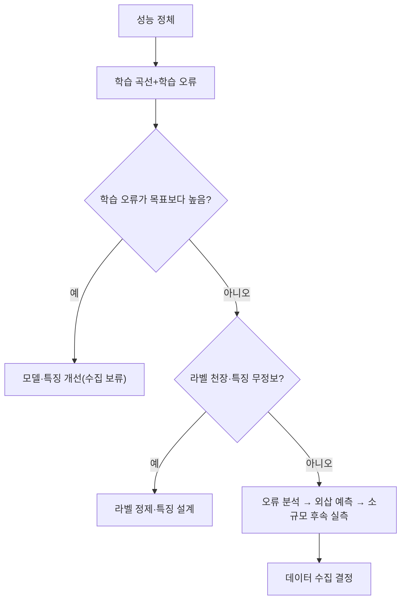
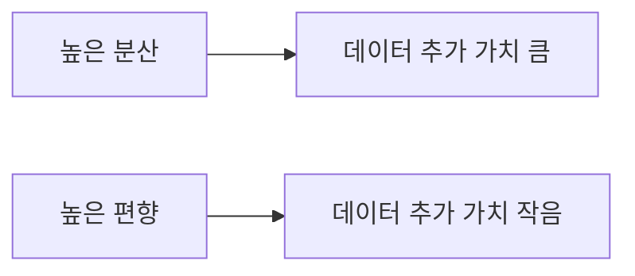

# 데이터 수집 전 점검표

> 데이터를 **더 모으기 전에** 성능이 정체된 원인이 데이터 부족인지를 소거해 가는 체크리스트. 수집·라벨링은 비싸고 오래 걸리므로, 곡선이 "데이터로 풀리는 문제"임을 먼저 확인한다.

## 쉽게 말하면
식당 손님이 줄었다고 광고부터 늘리지 않고, 먼저 맛·가격·위치·위생 평가부터 확인한다. 원인이 맛이면 광고비는 낭비다. 데이터도 같다.

## 자세히
(Andrew Ng, Machine Learning Yearning 초안 20~32장, 본문 확인 + 이 노드의 앞선 글들 종합)
- **점검 순서**
  1. **학습 곡선을 그린다.** 개발 오류가 정체하면 데이터를 더해도 목표에 닿지 못한다(Ng). 학습 오류도 함께: 학습 오류가 **이미 목표보다 높으면** 데이터를 더해도 개발 오류가 목표까지 내려갈 가능성이 거의 없다([높은 편향 곡선](#high-bias-learning-curve)).
  2. **편향 vs 분산 분해.** 피할 수 있는 편향(학습−최적)이 크면 모델·특징 쪽, 분산(개발−학습)이 크면 데이터·규제 쪽([피할 수 있는 편향 vs 분산](#avoidable-bias-vs-variance)). Ng: "분산이 크면 데이터를 더하라, 피할 수 있는 편향이 크면 모델 크기를 키워라."
  3. **라벨 품질.** 시험·검증 라벨 오류율을 표본으로 재고, 곡선이 (1−e) 천장에서 정체하는지 확인([라벨 노이즈 정체](#noisy-label-plateau), [라벨 모호함의 상한](#label-ambiguity-ceiling)).
  4. **특징 정보.** 라벨을 섞은 기준선과 점수가 같다면 데이터 양 문제가 아니다([정보 없는 특징 곡선](#uninformative-features-curve)).
  5. **분포 일치.** 학습·개발·시험이 같은 분포인지, 운영과 일치하는지([개발·시험 분포](#dev-test-label-fix-consistency)).
  6. **오류 분석.** 틀린 예시 100개를 범주화해 데이터로 해결되는 범주인지(예: 특정 입력 유형 부족)인지 확인([메모 먼저 범주화](#memo-first-categorization)).
  7. **기대 이득 추정.** 학습 곡선을 멱법칙으로 맞춰 목표 크기의 예측과 구간을 구한다([점근 오류](#asymptotic-error), [외삽 거리 제한](#extrapolation-distance-limit)).
  8. **소규모 후속 측정.** 2배 크기만 먼저 모아 예측이 맞는지 확인([후속 실측 검증](#follow-up-measurement)).
- **통과/보류 기준(제안)**
  | 점검 결과 | 결정 |
  |---|---|
  | 높은 분산, 곡선이 아직 내려가는 중 | 데이터 수집 진행 |
  | 높은 편향 | 데이터 보류, 모델·특징 개선 |
  | 라벨 노이즈 천장 | 라벨 정제 우선 |
  | 특징 무정보 | 특징 설계 |
  | 분포 불일치 | 대표 데이터로 재구성 |
- **수집할 데이터 선별**: 수집이 맞다면 어떤 데이터를 모을지 정한다 — 오류 분석에서 큰 범주에 해당하는 입력, 가치 높은 점과 비슷한 데이터([임베딩 가치 평가](#embedding-space-valuation)).
- **한계**: 곡선 해석은 시험 잡음과 형태 가정에 영향을 받는다([맞춤 범위 안정성](#fit-range-stability)).

## 그림으로 보기

## 예시
- 챗봇 의도 분류 정확도 84% 정체: 학습 곡선에서 학습 96%·검증 84%(분산) → 오류 분석 100건 중 40%가 신규 상품 질문 → 신규 상품 질문 500건 수집·라벨링 결정.
- 같은 상황에서 학습 정확도 85%·검증 84%였다면 더 큰 모델·특징 개선이 먼저.

## 헷갈리는 것과 비교
| 신호 | 해석 | 조치 |
|---|---|---|
| 학습↑·검증↓ 큰 간격 | 분산 | 데이터·규제 |
| 둘 다 낮고 가까움 | 편향 | 모델·특징 |
| 1−e 천장 | 라벨 | 라벨 정제 |
| 우연 수준 평평 | 무정보 | 특징 |

## 더 읽을거리
- [Andrew Ng, Machine Learning Yearning(초안 PDF) 23·28~32장](https://home-wordpress.deeplearning.ai/wp-content/uploads/2022/03/andrew-ng-machine-learning-yearning.pdf) — 편향·분산별 처방과 학습 곡선 해석(본문 열어 확인).
