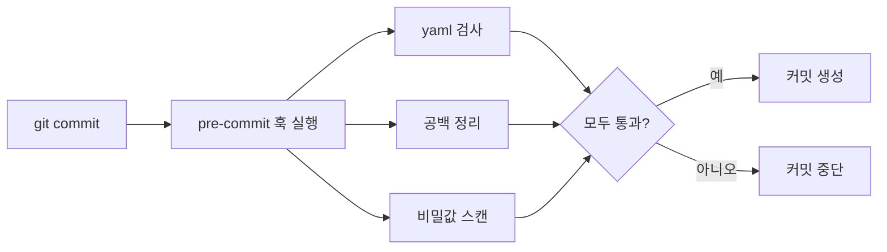

# pre-commit 프레임워크

> pre-commit은 `.pre-commit-config.yaml`에 선언한 검사(훅)들을 `git commit` 때 자동으로 실행해, 통과하지 못하면 커밋을 막는 도구다.

## 쉽게 말하면
출고 전 자동 검수 라인이다. 서류(커밋)가 나가기 전에 오탈자 검사기, 비밀번호 검출기 등을 차례로 거치고, 하나라도 걸리면 되돌려 보낸다.

## 자세히
pre-commit.com(2026-11 확인):
- 설치: `pip install pre-commit` → 프로젝트에서 `pre-commit install`(`.git/hooks/pre-commit` 생성). 전체 검사 `pre-commit run --all-files`.
- 설정: 루트의 `.pre-commit-config.yaml`에 `repo`, 고정 버전 `rev`, `hooks`(id)를 적는다.
- 실행: 커밋 시 **스테이징된 파일**만 검사하고, 스테이징 안 된 변경은 임시 stash한다. 훅이 0이 아닌 코드로 끝나거나 파일을 수정하면 실패로 커밋이 막힌다. 첫 실행은 훅 환경 설치로 느리다.
- 특정 훅만 `pre-commit run <hook_id>`, 한 번 건너뛰기는 `SKIP=<id>` 환경 변수.
- 비밀값 검사 훅(gitleaks 등)을 넣으면 [pre-commit 비밀 스캔](#pre-commit-secret-scan)이 된다.

## 그림으로 보기


## 예시
```yaml
repos:
- repo: https://github.com/pre-commit/pre-commit-hooks
  rev: v2.3.0
  hooks:
  - id: check-yaml
  - id: end-of-file-fixer
```
(공식 예시의 버전이므로 실제로는 최신 태그로 바꾼다.)

## 헷갈리는 것과 비교
| 개념 | 차이 |
|---|---|
| pre-commit | 로컬 커밋 시점 검사 |
| [GitHub 푸시 보호](#github-push-protection) | 서버 푸시 시점 검사 |
| CI | 푸시 후 서버에서 돌리는 검사 — 우회 불가 |

## 더 읽을거리
- [pre-commit.com](https://pre-commit.com/) — 설치·설정·실행 방식.
