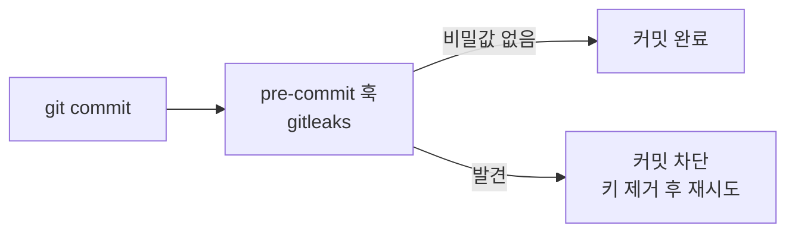
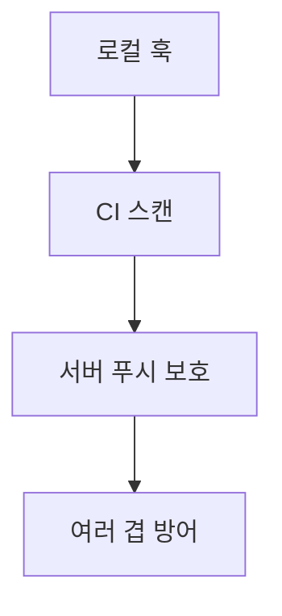

# 커밋 전 비밀값 스캔 (Pre-commit Secret Scan)

> 커밋 직전에 변경 내용에서 API 키·토큰 같은 비밀값을 자동으로 찾아, 발견되면 커밋을 막는 장치. 대표 도구가 gitleaks다.

## 쉽게 말하면
편지를 우체통에 넣기 전 마지막으로 "주민번호를 적진 않았나" 훑어보는 검사원이다. 일단 우체통(git 기록)에 들어가면 꺼내기 어려우니, 넣기 전에 잡는 것이 가장 싸다.

## 자세히
gitleaks README 기준(예시 버전 v8.24.2):
- **pre-commit 연동**: 저장소 루트의 `.pre-commit-config.yaml`에 gitleaks 훅을 적고 `pre-commit install`로 설치. `pre-commit autoupdate`로 버전 갱신.
- **검사 모드**: `gitleaks git`(기록 스캔), `gitleaks dir`(파일·폴더), `gitleaks stdin`(파이프). `detect`·`protect`는 v8.19.0부터 deprecated(동작은 하지만 도움말에서 숨김).
- **베이스라인**: 과거 발견분을 리포트로 저장(`--report-path`)한 뒤 `--baseline-path`로 넘기면 **새 발견만** 보고한다. 이미 있는 저장소에 도입할 때 유용.
- 한 번 건너뛰기: `SKIP=gitleaks git commit -m "..."`. 남용하면 의미가 없어진다.
- 한계: 훅은 로컬 설정이라 `--no-verify`로 우회되고 팀원이 설치하지 않으면 동작하지 않는다. 그래서 CI와 서버 측 스캔(GitHub 푸시 보호 등)을 함께 둔다. 이미 [git 기록에 들어간 비밀값](#git-history-secret)은 스캔이 아니라 폐기·교체로 해결한다.

## 그림으로 보기



## 예시
```yaml
# .pre-commit-config.yaml
repos:
  - repo: https://github.com/gitleaks/gitleaks
    rev: v8.24.2
    hooks:
      - id: gitleaks
```
```bash
pip install pre-commit && pre-commit install
gitleaks git -v          # 기존 기록 전체 점검
```
바이브코딩으로 만든 앱에 `.env`가 실수로 올라가는 일을 막는 첫 방어선이다([.env와 .gitignore](#dotenv-gitignore)).

## 헷갈리는 것과 비교
| 개념 | 차이 |
|---|---|
| pre-commit 스캔 | 커밋 전 차단(예방) |
| [.gitignore](#dotenv-gitignore) | 특정 파일을 추적에서 제외 |
| [git 기록 속 비밀값](#git-history-secret) | 이미 새어 나간 뒤의 대응 |
| [env.example](#env-example) | 변수 이름만 공유하는 견본 |

## 더 읽을거리
- [gitleaks (GitHub)](https://github.com/gitleaks/gitleaks) — 설치, pre-commit 설정, 스캔 모드, 베이스라인.
