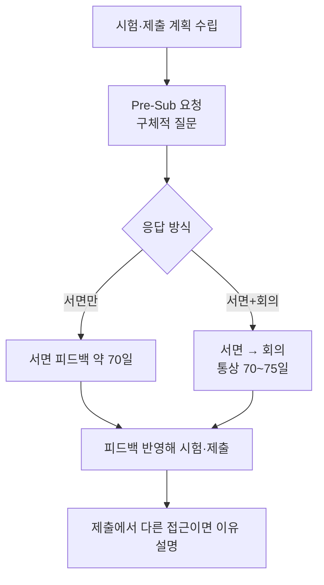

# FDA 사전 상담(Pre-Sub)

> 허가 신청서를 내기 **전에** FDA에 구체적 질문을 서면으로 보내 공식 피드백(필요하면 회의 포함)을 받는 제도. Q-Submission 프로그램의 한 유형이며, 시험 설계를 FDA와 미리 맞춰 둘 수 있다. 완전히 자발적이다.

## 쉽게 말하면
시험을 다 치른 뒤 "이 방식이 인정되나요?"라고 묻는 것보다, 시험 설계 단계에서 선생님께 "이렇게 치르면 인정되나요?"라고 묻는 것이 낫다. Pre-Sub는 그 질문 창구다. 단, 답안지를 미리 채점해 주는 곳은 아니다.

## 자세히
출처: FDA 최종 지침 "Requests for Feedback and Meetings for Medical Device Submissions: The Q-Submission Program"(2025-05, PDF를 내려받아 읽음). 비구속 권고다.
- **정의**: 제출자가 FDA에 보내는 공식 서면 요청. 응답은 공식 서면 답변이거나, 제출자가 원하면 서면 피드백 뒤 회의다. 회의 논의는 제출자가 작성한 회의록을 FDA가 검토한다.
- **용도**: IDE·PMA·HDE·De Novo·510(k) 등 예정된 제출에 관한 **구체적 질문**(생체적합성, 벤치 시험, 사이버보안 등 검토 주제)에 대한 피드백. "제출물이나 데이터의 사전 심사(pre-review)"를 위한 것이 아니다.
- **효용(FDA 서술)**: 계획한 비임상·임상 시험에 대해 일찍 상호작용하고 피드백을 반영하면 이후 제출 품질이 올라가고 전체 검토 시간이 줄 수 있다. 피드백은 시험을 **수행하기 전에** 요청할 때 가장 효과적이다.
- **구속력**: Pre-Sub에서 FDA가 제기한 이슈를 이후 제출에서 반드시 해결해야 하는 것은 아니나, 다른 접근을 택했다면 그 이유를 설명해야 한다.
- **일정(지침의 표)**: Pre-Sub는 서면 피드백이 접수 후 70일 또는 회의 5일 전 중 빠른 쪽, 회의는 상호 합의한 날짜(통상 70~75일). 서면 피드백만 선택하면 70일. 그 밖 유형: Submission Issue Request(SIR) 21일 또는 70일(자원이 허락하는 한), 연구 위험 결정(Study Risk Determination) 90일, 정보 제공 회의 90일, PMA Day 100 회의 100일.
- **포함 내용**: 어떤 후속 제출(IDE·510(k) 등)에 대한 질문인지, 충분한 배경 정보와 자료, 구체적 질문. 부록에 Pre-Sub 수락 점검표와 질문 예시가 있다.
- **AI 맥락(해설)**: AI 기기는 독자 연구 설계, 테스트 세트, PCCP 범위처럼 FDA와 합의가 필요한 사항이 많아 Pre-Sub 활용도가 높다고 알려져 있으나 이는 이 지침의 서술이 아니다.

## 그림으로 보기

## 예시
- 질문 예: "영상 AI 510(k)를 위해 제안하는 MRMC 연구(판독자 수·증례 수·종점)가 임상 성능 근거로 적절합니까?"
- 점검: 시험을 실행하기 전인가? 질문이 구체적이고 답할 수 있는 형태인가? 어떤 후속 제출을 겨냥하는지 적었는가?

## 헷갈리는 것과 비교
| 개념 | 차이 |
|---|---|
| Q-Submission | 상위 프로그램, Pre-Sub는 그 한 유형 |
| Submission Issue Request | FDA 보류·결함 서한 이후 해결 방안 협의 |
| 정식 허가 심사 | Pre-Sub는 구속력 없는 사전 피드백 |
| [MRMC 독자 연구](#mrmc-study) | Pre-Sub로 설계를 협의하는 대표적 시험 |
| [변경 관리 계획(PCCP)](#pccp) | 허가 시 함께 승인받는 계획, 제출 전 FDA와 논의 권고 |

## 더 읽을거리
- [The Q-Submission Program (FDA 최종 지침, 2025-05)](https://www.fda.gov/media/114034/download) — Pre-Sub 정의·일정표·제출 내용(내려받아 확인)
- [Q-Submission 지침 페이지 (FDA)](https://www.fda.gov/regulatory-information/search-fda-guidance-documents/requests-feedback-and-meetings-medical-device-submissions-q-submission-program) — 적용 대상 목록(열어서 확인)
