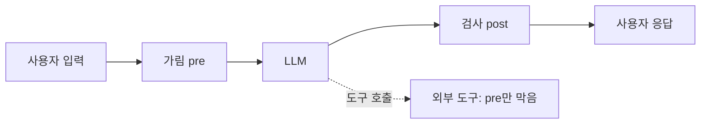
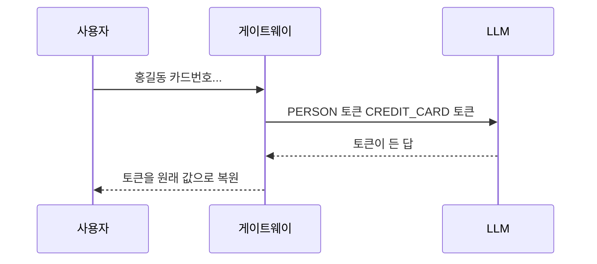

# 추론 전·후 가림

> LLM을 호출하기 **전**에 입력의 개인정보를 가리는 것(pre)과, 호출한 **후** 출력·로그를 검사해 가리는 것(post)은 막는 곳이 다르다. 실무에서는 둘을 같이 쓰되 "모델에 원본이 아예 안 들어가게 하는 것"을 1차 방어로 본다.

## 쉽게 말하면
편지를 외국 번역사에 맡길 때, 보내기 전에 이름을 지우는 것이 pre다. 번역본이 돌아온 뒤 거기 적힌 민감한 내용을 다시 점검하는 것이 post다. 보내기 전에 지우면 번역사는 원본을 영영 못 본다.

## 자세히
(요약 출처: 블로그·벤더 글 다수 + LiteLLM 공식 문서. 벤더 글은 홍보 성격이 있어 주장으로 읽는다.)
- **pre-inference**: 원본 PII가 모델 컨텍스트에 들어가지 않는다. 모델이 에코하거나 추론할 수 있어서 입력단 필터는 필수라는 설명이 많다.
- **post-inference**: 모델이 출력에서 PII를 재현·추론한 경우, 사용자에게 보이기 전에 걸러낸다.
- **빈틈**: 도구 호출 인자(tool call arguments)로 나가는 PII는 출력 가드레일이 보기 전에 실행될 수 있고, 검색(RAG) 단계에서는 청크가 컨텍스트에 들어가기 전 필터링이 필요하다(블로그 주장).
- **대체 토큰**: 단순 삭제보다 `[PERSON_1]` 같은 유형별 토큰이 문장 이해를 덜 깨뜨린다(블로그 권고).
- **LiteLLM + Presidio 설정(공식 문서 확인)**: `mode`는 `pre_call`(호출 전 입력 검사), `post_call`(호출 후 입·출력 검사), `logging_only`(로그에만 마스킹, 실제 요청·응답은 불변), `pre_mcp_call`(MCP 호출 전 검사). MASK는 `<CREDIT_CARD>` 같은 토큰으로 치환하고 BLOCK은 요청을 차단(`BlockedPiiEntityError`)한다. `output_parse_pii`는 토큰을 응답에서 **원래 값으로 되돌리는** 기능이지 출력 PII를 새로 탐지하지 않는다. 출력도 검사하려면 `presidio_filter_scope`를 `output`/`both`로 한다.
- **한계**: 정규식·개체명 인식은 문맥 속 PII를 놓친다. 오픈소스 Presidio는 운영 부담이 자기 몫이다(비교 글 주장).

## 그림으로 보기

## 예시
- 상담 요약을 외부 LLM에 보낼 때: 게이트웨이에서 `mode: pre_call`, MASK 설정 → 모델에는 `<PERSON>`만 전달, 응답에서 필요한 경우만 복원.
- 로그에 원본이 남는 것이 걱정이면 `logging_only`로 관측 도구 쪽만 마스킹.

## 헷갈리는 것과 비교
| 개념 | 차이 |
|---|---|
| pre-inference | 모델에 원본이 안 들어감 |
| post-inference | 출력·로그에서 새는 것을 차단 |
| `output_parse_pii` | 복원 기능, 탐지 아님 |
| [PII 가림 방식](#pii-redaction-types) | 가리는 기법(마스킹·가명처리 등) |
| [이관 시 개인정보 최소화](#pii-minimization-handoff) | 어떤 정보를 넘길지 정하는 원칙 |

## 더 읽을거리
- [LiteLLM: Presidio PII 마스킹](https://docs.litellm.ai/docs/proxy/guardrails/pii_masking_v2) — mode·MASK/BLOCK·output_parse_pii 설정(직접 열어 확인).
- [Requesty: LLM 가드레일과 PII 게이트웨이](https://www.requesty.ai/blog/llm-guardrails-pii-redaction-gateways) — 게이트웨이 방식 비교(벤더 글, 검색 결과 기준).
