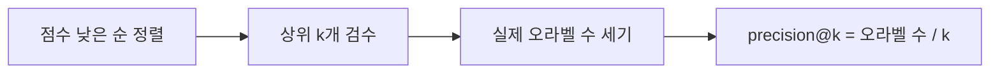
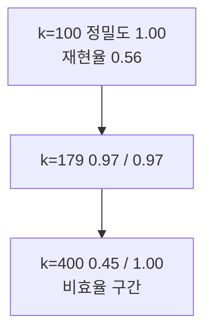

# precision@k 검수 효율

> precision@k는 점수가 낮은 순으로 k개를 사람이 검수했을 때 그중 실제 오류인 비율이다. 검수 예산(몇 개를 볼 수 있는가)이 정해진 라벨 정제 작업에서 "k를 얼마로 할지"와 "이 점수가 쓸 만한지"를 정하는 가장 실용적인 지표다.

## 쉽게 말하면
검수할 시간이 100장분밖에 없다면, 의심스러운 순서로 줄 세운 100장 중 실제로 틀린 답안지가 몇 장인지가 곧 이 작업의 성과다. 무작위로 100장을 뽑아 보면 10장쯤 틀렸을 것을, 줄 세운 상위 100장에서 100장이 틀렸다면 줄 세우기가 10배 효율적이다.

## 자세히
- **정의**: precision@k = (상위 k개 중 실제 오라벨 수) / k. 함께 보는 재현율@k = (상위 k개 중 실제 오라벨 수) / (전체 오라벨 수).
- **직접 해 본 실험(숫자 손글씨 1,797개, 라벨 약 10%(179개) 무작위 변경, 랜덤 포레스트 5겹의 표본 외 확률로 self_confidence 점수를 만들어 낮은 순 정렬)**:

| 검수 개수 k | 정밀도 | 재현율 | 찾은 오라벨 | 무작위 검수 기대값 |
| --- | --- | --- | --- | --- |
| 25 | 1.00 | 0.14 | 25 | 약 2 |
| 50 | 1.00 | 0.28 | 50 | 약 5 |
| 100 | 1.00 | 0.56 | 100 | 약 10 |
| 179 | 0.97 | 0.97 | 174 | 약 18 |
| 250 | 0.72 | 1.00 | 179 | 약 25 |
| 400 | 0.45 | 1.00 | 179 | 약 40 |

  상위 100개까지는 전부 실제 오라벨이었고, 오라벨 수와 같은 179개를 보면 97%를 찾았다. 그 뒤로는 오라벨이 이미 다 나와서 k를 늘려도 정밀도만 떨어졌다(250개에서 0.72, 400개에서 0.45). 무작위로 보면 같은 검수량에서 약 10배 적게 찾는다. 이 데이터는 오류가 쉽게 구분되는 쉬운 사례이며, 실제 데이터에서는 정밀도가 훨씬 낮을 수 있다.
- **k를 정하는 법(해석)**: 정밀도가 급락하는 지점이 "더 보면 비효율"인 신호다. 단, 실제 오라벨 수를 모르는 현장에서는 상위부터 구간별(예: 50개 단위)로 오라벨 비율을 측정해 곡선을 그려 정지 지점을 찾는다([검수 정지 규칙](#review-stopping-rule)).
- **주의**: 오라벨의 종류에 따라 놓치는 유형이 있을 수 있다(예: 오류가 한 클래스 쌍에 몰린 경우). 정밀도가 높아도 재현율을 같이 본다.
- **보고**: 점수 방식([self_confidence](#self-confidence-score), [normalized margin](#normalized-margin-score))마다 precision@k 곡선을 나란히 비교한다.

## 그림으로 보기

## 예시
- 검수 인력 1일 300건 한도라면 상위 300건의 precision@k를 하루 단위로 측정해 다음날 검수량과 점수 방식을 조정한다.
- 교육 활용: k를 바꿔 가며 정밀도·재현율 곡선을 그려 "어디서 멈출까"를 토론한다.

## 헷갈리는 것과 비교
| 개념 | 차이 |
| --- | --- |
| precision@k | 상위 k개의 정답 비율 |
| recall@k | 전체 오류 중 상위 k개가 잡은 비율 |
| AUROC | 전체 순위의 구분력(k와 무관) |
| [검수 정지 규칙](#review-stopping-rule) | 곡선으로 멈출 지점을 정함 |

## 더 읽을거리
- [Confident Learning (arXiv 1911.00068)](https://arxiv.org/abs/1911.00068) — 라벨 오류 순위 매기기의 원리
