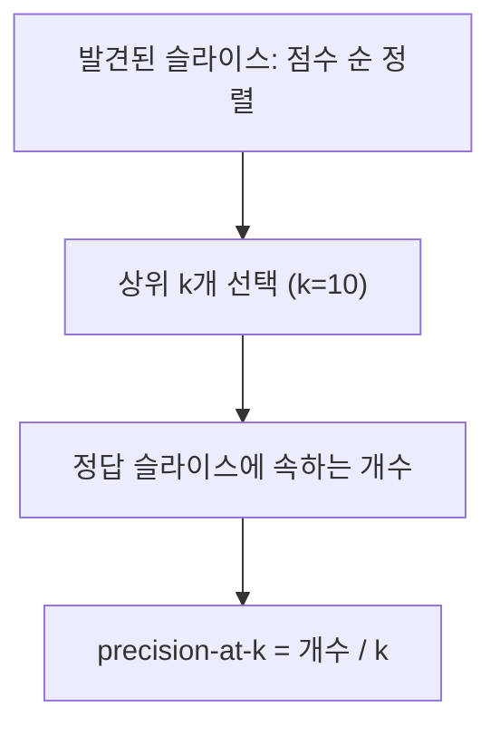
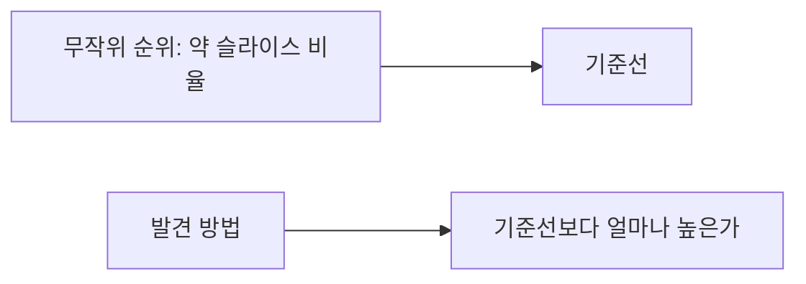

# 슬라이스 precision-at-k

> 슬라이스 발견 방법이 찾아낸 슬라이스의 **상위 k개 예시 중 몇 퍼센트가 실제(정답) 슬라이스에 속하는지**를 재는 평가 지표다. 발견한 약점 묶음이 사람이 정의한 진짜 약점과 얼마나 맞는지 알려 준다.

## 쉽게 말하면
"분수 나눗셈 문제를 모아 줘"라고 시켰을 때 AI가 가져온 10문제 중 7문제가 진짜 분수 나눗셈이면 precision-at-10은 0.7이다. 모아 온 것의 상위 몇 개가 맞는지만 보므로, 전체를 다 채점하지 않아도 품질이 보인다.

## 자세히
(Domino 논문(Eyuboglu 등, ICLR 2022, arXiv 2203.14960) PDF를 직접 읽어 확인하고, 기준선 계산은 직접 시뮬레이션했다.)
- **정의(논문)**: precision-at-k는 발견된 슬라이스의 **상위 k개 원소 중 정답 슬라이스에 속하는 비율**이다. 논문은 **k=10**을 쓴다. 정답 슬라이스는 클래스·메타데이터로 만든 설정(slice discovery setting)에서 알려져 있어 채점이 가능하다. 논문은 이런 설정 **1,235개**(자연 이미지·의료 영상·시계열)로 방법들을 비교하는 평가 틀을 제안한다.
- **논문 결과(일부)**: Domino가 1,235개 중 **36%** 설정에서 슬라이스를 정확히 식별했고 이는 이전 방법보다 12%p 높다. 교차 모달 임베딩(ConVIRT)으로 합성 모델에서 평균 precision-at-10 **0.765**(95% 구간 0.747~0.784)로 최고 단일 모달 임베딩(BiT) 0.695보다 7%p 높았고, 의료 영상(MIMIC) 설정에서 CLIP 임베딩 사용 시 **0.570**(0.554~0.586), BiT 대비 9%p 향상 등이 보고된다. 잡음·희귀 슬라이스(자연 이미지)에서는 오류 인지 혼합 모델이 평균 0.639(0.617~0.660)로 차선책(George)보다 105% 높았다. 서로 다른 설정의 값이므로 직접 비교하면 안 된다.
- **기준선을 알아야 의미가 있다(직접 계산)**: 전체 2,000건 중 정답 슬라이스가 60건(3%)일 때 **무작위 순위의 precision-at-10은 평균 0.028**(기대값 0.03)이다. 슬라이스 원소가 평균 1점 높은 점수를 받는 약한 신호 탐색기는 **0.279**였다. 같은 0.28이라도 슬라이스가 클수록 우연히 높아지므로 **슬라이스 비율(무작위 기대값)을 함께** 보고한다.
- **해석(제안)**: ① k가 작으면(10) 변동이 커서 여러 설정·시드의 평균과 구간을 낸다 ② precision만 높고 슬라이스의 일부만 찾았을 수 있어 **재현율**(정답 슬라이스 중 찾은 비율)도 필요 ③ 정답이 있는 합성·벤치마크 설정에서만 계산되므로 실제 서비스에서는 **전문가 검토**로 상위 k개가 일관된 개념인지 점검 ④ 설정을 만든 방식(클래스·메타데이터)에 결과가 의존.
- **한계**: 정답 슬라이스가 알려진 평가 틀에서의 지표이고, 실제 데이터에는 정답 슬라이스가 없다. 논문이 말하는 슬라이스는 겹칠 수 있다.

## 그림으로 보기

## 예시
- 상위 10개 오류 사례가 "야간 촬영"이라고 이름 붙은 슬라이스에서 8개가 실제 야간 사진이면 precision-at-10=0.8. 슬라이스 비율이 3%라면 기준선 0.03 대비 큰 향상.
- 교육 소재: "AI가 찾아 준 약점 목록의 정확도"를 상위 10개로 직접 채점해 보는 실습.

## 헷갈리는 것과 비교
| 개념 | 차이 |
|---|---|
| 슬라이스 precision-at-k | 발견 슬라이스의 상위 k개 정확도 |
| [일관된 슬라이스](#coherent-slice) | 사람이 이해하는 하나의 개념으로 묶이는 슬라이스 |
| [슬라이스 이름 붙이기](#slice-naming) | 슬라이스의 공유 개념을 말로 설명 |
| 분류 정확도 | 모델 예측의 정답 비율(대상이 다름) |

## 더 읽을거리
- [Domino: Discovering Systematic Errors with Cross-Modal Embeddings (arXiv 2203.14960)](https://arxiv.org/abs/2203.14960) — precision-at-k, 1,235개 설정, 결과(PDF 직접 확인).
