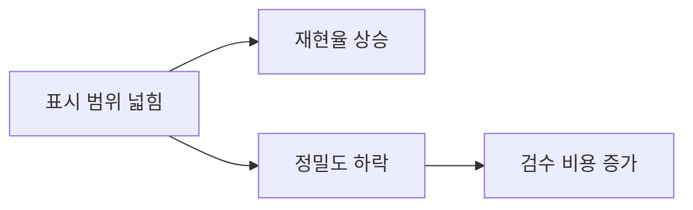
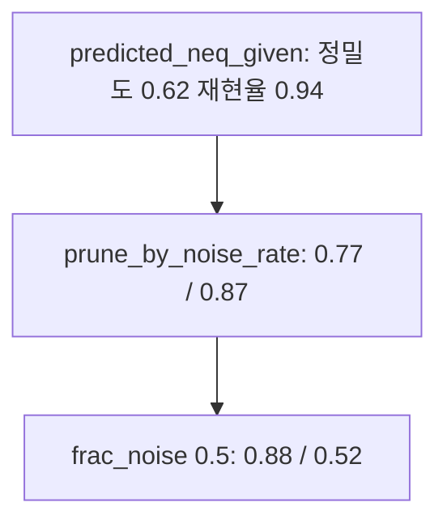

# 정리의 정밀도·재현율 균형

> 라벨 오류 정리에서 정밀도는 "표시한 것 중 진짜 오류 비율", 재현율은 "진짜 오류 중 찾아낸 비율"이다. 더 많이 표시하면 재현율은 오르지만 정밀도는 내려가고 검수 비용이 늘어난다. 둘 사이의 균형점을 정해야 한다.

## 쉽게 말하면
그물을 크게 치면 물고기를 많이 잡지만(재현율↑) 쓰레기도 많이 올라와 골라내는 일이 늘어난다(정밀도↓). 그물을 작게 치면 깨끗하지만 놓치는 물고기가 많다.

## 자세히
- **직접 실험(cleanlab 2.9.0, 가상 3클래스 2,000개, 라벨 15% 뒤집기, 실제 오류 309개, 로지스틱 회귀 5-fold 확률)**: `filter_by` 옵션별 결과는 다음과 같았다.

| filter_by | 표시 수 | 정밀도 | 재현율 |
| --- | --- | --- | --- |
| predicted_neq_given | 464 | 0.62 | 0.94 |
| prune_by_class | 365 | 0.75 | 0.88 |
| prune_by_noise_rate | 346 | 0.77 | 0.87 |
| both | 333 | 0.79 | 0.85 |
| confident_learning | 268 | 0.84 | 0.73 |
| low_normalized_margin | 268 | 0.88 | 0.76 |
| low_self_confidence | 268 | 0.87 | 0.75 |
| prune_by_noise_rate + frac_noise 0.5 | 181 | 0.88 | 0.52 |

  가장 넓게 표시하는 `predicted_neq_given`은 재현율 0.94지만 정밀도 0.62로, 검수 464건 중 약 176건이 헛수고다. 좁게 표시하는 쪽은 정밀도 0.88까지 오르지만 재현율이 0.52~0.76으로 내려간다. (한 번의 가상 실험이며 데이터·모델에 따라 다르다. 실제 오류를 아는 장난감 데이터이므로 실무에서는 검수 샘플로 정밀도를 추정해야 한다.)
- **균형 정하기(해석)**: 검수 건당 비용과 오류 하나를 놓칠 때의 피해를 비교한다. 오류 피해가 크면(의료·금융) 재현율을 높이는 넓은 옵션, 검수 인력이 부족하면 좁은 옵션으로 시작한다. 처음 소량을 검수해 정밀도를 재고 옵션을 정한다([라벨 오류 오탐](#false-positive-label-issues)).
- **연계(해석)**: 정지 시점은 [검수 정지 규칙](#review-stopping-rule), 순위 우선 검수는 [precision@k 검수 효율](#precision-at-k-review).

## 그림으로 보기

## 예시
- 검수 인력이 하루 200건이면 `frac_noise`로 후보를 약 180건으로 줄여 정밀도 높은 후보부터 처리한다(위 실험 기준).
- 교육 활용: 표에서 "우리 팀 상황에서 어느 줄을 고르겠는가"를 비용 가정과 함께 토론한다.

## 헷갈리는 것과 비교
| 개념 | 차이 |
| --- | --- |
| 정밀도 | 표시한 것 중 진짜 오류 비율 |
| 재현율 | 진짜 오류 중 찾아낸 비율 |
| [prune_by_noise_rate](#prune-by-noise-rate) | 기본 방식의 한 지점 |
| [filter_by 옵션 비교](#filter-by-options) | 옵션 개요 |

## 더 읽을거리
- [cleanlab filter 문서](https://docs.cleanlab.ai/stable/cleanlab/filter.html) — filter_by 옵션 설명
- [cleanlab in-depth tutorial](https://docs.cleanlab.ai/stable/tutorials/indepth_overview.html) — method별 정밀도·재현율이 다름
