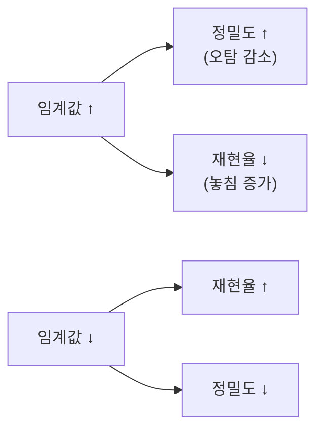

# 정밀도-재현율 트레이드오프

> 분류 임계값을 올리면 정밀도(Precision)가 오르고 재현율(Recall)이 내리며, 내리면 반대가 되는 상충 관계다.

## 쉽게 말하면
스팸 필터를 아주 엄격하게 하면 걸러진 건 거의 다 스팸이지만(정밀도↑) 스팸 상당수가 통과한다(재현율↓). 느슨하게 하면 스팸은 다 잡지만 정상 메일도 잡힌다. 둘 다 최대로 만들 수는 없고, 상황에 맞게 균형을 정한다.

## 자세히
scikit-learn 문서(1.9.1, 2026-11 확인):
- 정밀도 = tp/(tp+fp): 양성이라 한 것 중 진짜 양성. 재현율 = tp/(tp+fn): 진짜 양성 중 찾아낸 비율(민감도).
- `precision_recall_curve(y_true, y_score)`는 **이진 분류 전용**이며 결정 임계값을 바꿔 가며 정밀도·재현율·임계값 배열을 반환한다. 예시: precision `[0.5, 0.66, 0.5, 1., 1.]`, recall `[1., 1., 0.5, 0.5, 0.]`.
- **Average Precision(AP)** = Σ (Rₙ − Rₙ₋₁)·Pₙ. 무작위 예측이면 AP는 양성 비율과 같다. 보간하지 않으며, 선형 보간(사다리꼴 `auc`)은 지나치게 낙관적일 수 있다고 문서가 경고.
- 선택 기준(일반 원리): 놓치면 위험(암 검진·사기 탐지)은 재현율 우선, 오탐 비용이 큼(자동 계정 정지)은 정밀도 우선. 둘을 하나로 묶는 지표가 [F1·F-beta](#f-beta).
- 불균형 데이터에서는 ROC보다 PR 곡선이 더 민감한 경우가 많다는 것이 일반적 조언(이 문서에서 직접 확인한 것은 아님).

## 그림으로 보기

## 예시
LLM 기반 개인정보 탐지기: 점수 임계값을 0.9로 올리면 정밀도는 높지만 누락이 늘어난다. 법무 요구가 "누락 최소화"라면 임계값을 낮추고 사람이 오탐을 걸러 낸다.

## 헷갈리는 것과 비교
| 개념 | 차이 |
|---|---|
| 정밀도 | 양성 예측의 정확도 |
| 재현율 | 실제 양성의 포착률 |
| [ROC·AUC](#roc-auc) | TPR vs FPR 곡선 |
| [혼동 행렬](#confusion-matrix) | 이 값들의 원재료(tp·fp·fn·tn) |

## 더 읽을거리
- [scikit-learn: Model evaluation](https://scikit-learn.org/stable/modules/model_evaluation.html) — PR 곡선·AP.
