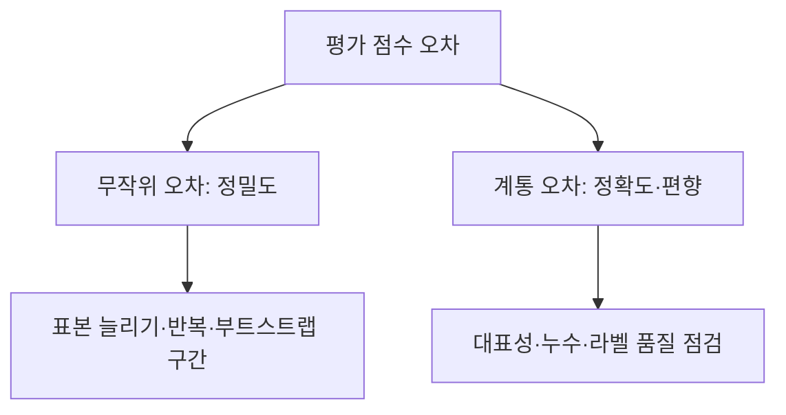
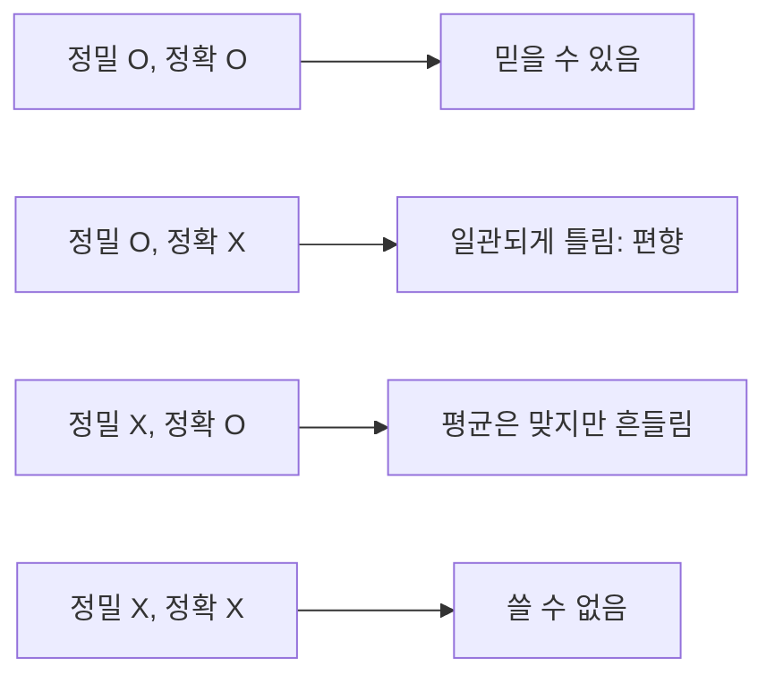

# 추정의 정밀함 vs 정확함

> **정밀함(precision)** 은 반복했을 때 결과가 서로 얼마나 가까운가(무작위 오차), **정확함(accuracy·trueness)** 은 평균이 진짜 값에 얼마나 가까운가(편향)이다. 오차 막대가 작다는 것은 정밀하다는 뜻일 뿐 맞다는 뜻이 아니다.

## 쉽게 말하면
과녁에 화살 10발이 한 점에 모였지만 중심에서 한참 벗어났다면 "정밀하지만 부정확"하다. 표본(시험 문제 수)을 아무리 늘려도 조준이 틀어진 채라면 **일관되게 틀린 답**만 얻는다.

## 자세히
- **ISO 5725 정의(Wikipedia 확인)**: 정확도(accuracy)는 측정이 참값에 가까운 정도로 무작위 오차와 계통 오차를 합친 개념. 진실성(trueness)은 많은 결과의 **평균**이 기준값에 가까운 정도(편향). 정밀도(precision)는 결과끼리 일치하는 정도(무작위 오차; 반복성·재현성). 통계에서는 두 용어를 피하고 "편향(bias)과 변동(variability)"으로 말하는 경우가 많다.
- **표본 크기의 효과**: 표본을 늘리면 정밀도는 좋아지지만 계통 오차는 안 없어진다. 편향을 없애면 정확도가 좋아지지만 정밀도는 그대로.
- **AI 평가에 대입**
  | 상황 | 종류 | 증상 |
  |---|---|---|
  | 시험 문제가 적음 | 정밀도 문제 | 구간이 넓음, 재실행 때 점수가 흔들림 |
  | 시험 세트가 운영 분포와 다름 | 편향(정확도) 문제 | 구간은 좁은데 운영에서 틀림 |
  | 벤치마크 문제가 학습 데이터에 유출 | 편향 | 높고 안정적인 점수가 거짓 |
  | 정답 라벨이 체계적으로 틀림 | 편향 | 반복해도 같은 방향 오차 |
  | 층화로 폴드 sd를 줄임 | 정밀함처럼 보일 뿐 | [오차 막대 착시](#stratification-shrinks-variance) |
- **오차 막대가 보여 주는 것**: 신뢰구간·표준오차는 대개 **무작위 오차(표본 변동)** 만 담고 편향은 담지 않는다. "95% 구간 [0.91, 0.93]"이어도 시험 세트가 편향됐다면 참값은 구간 밖일 수 있다.
- **대응**: 정밀도는 표본 수·반복으로, 정확도는 대표성 있는 시험 세트·라벨 점검·누수 점검으로 개선한다. 둘을 따로 점검한다.

## 그림으로 보기

## 예시
- 챗봇 만족도 평가 1,000건(±1%)이 모두 사내 직원이 매긴 것이라면, 정밀하지만 실제 고객 만족도와는 편향이 있을 수 있다.
- 비전 모델을 쾌청한 날 사진으로만 평가해 95% 구간이 좁게 나와도 야간 성능은 모른다.

## 헷갈리는 것과 비교
| 용어 | 의미 | 개선 |
|---|---|---|
| 정밀도(precision, 통계) | 결과의 흩어짐 | 표본↑ |
| 정확도(accuracy, 통계) | 참값과의 거리 | 편향 제거 |
| 정밀도(precision, 분류 지표) | 양성 예측 중 진짜 비율 | 완전히 다른 개념 — [거짓 양성 규모](#false-positive-volume) 참조 |

주의: 머신러닝 지표의 "정확도·정밀도"는 이 글의 측정 용어와 같은 이름이지만 뜻이 다르다.

## 더 읽을거리
- [Wikipedia: Accuracy and precision](https://en.wikipedia.org/wiki/Accuracy_and_precision) — ISO 5725 정의와 과녁 비유(열어 확인).
